# **Chapter V: Product Implementation, Validation & Deployment**
## **5.1. Configuration Management Software**
### 5.1.1. Software Development Environment Configuration
A continuación se detallan los productos de software utilizados en el proyecto **StockIA**, organizados según las principales actividades del ciclo de vida del producto digital.

### Project Management  
- **WhatsApp**  
  Aplicación de mensajería instantánea que facilita la comunicación rápida y asíncrona entre los miembros del equipo para coordinar tareas operativas.  
  Referencia: [https://web.whatsapp.com/](https://web.whatsapp.com/)  

- **Google Meet**  
  Plataforma de videoconferencias utilizada para ceremonias Scrum, reuniones de sincronización técnica y sesiones de compartición de pantalla en tiempo real.  
  Referencia: [https://meet.google.com/](https://meet.google.com/)  

---

### Product UX/UI Design  
- **UXPressia**  
  Plataforma especializada en mapeo de experiencia de usuario y diseño de servicios. Se usó para elaborar user personas, journey mapping, empathy mapping e impact mapping.  
  Referencia: [https://uxpressia.com/](https://uxpressia.com/)  

- **Miro**  
  Pizarra colaborativa digital para crear diagramas y esquemas en tiempo real. Se utilizó en sesiones de Event Storming para identificar procesos de negocio y definir Bounded Contexts.  
  Referencia: [https://miro.com/](https://miro.com/)  

- **Figma**  
  Editor de gráficos vectoriales y herramienta de prototipado de interfaces. Se empleó para wireframes, mockups y prototipos interactivos del proyecto.  
  Referencia: [https://www.figma.com/](https://www.figma.com/)  

- **Jira**  
  Software de gestión de proyectos ágil (Scrum/Kanban). Se usó para administrar el Product Backlog, priorizar requerimientos y documentar User Stories con criterios de aceptación.  
  Referencia: [https://www.atlassian.com/es/software/jira](https://www.atlassian.com/es/software/jira)  

---

### Software Development  
- **Visual Studio Code**  
  Editor de código fuente ligero y extensible. Se utilizó para el desarrollo de componentes frontend, refactorización de scripts y edición rápida de código.  
  Descargar: [https://code.visualstudio.com/](https://code.visualstudio.com/)  

- **Extensión .rd para Visual Studio Code**  
  Herramienta integrada en VS Code para diseño y modelado de bases de datos. Se usó para crear y gestionar el esquema relacional de StockIA directamente desde el entorno de desarrollo.  
  Referencia: Marketplace de Visual Studio Code (extensión .rd).  

---

### Software Deployment  
- **GitHub**  
  Plataforma de desarrollo colaborativo basada en Git. Se empleó para alojar el código fuente y gestionar el despliegue continuo de la aplicación.  
  Referencia: [https://github.com/](https://github.com/)  

---

### Software Documentation  
- **GitHub**  
  Además de control de versiones, se utilizó para redactar, organizar y dar seguimiento al informe completo del proyecto.  
  Referencia: [https://github.com/](https://github.com/)  

- **Structurizr**  
  Herramienta para modelado de arquitectura de software mediante el enfoque C4. Se usó para construir los diagramas de arquitectura del proyecto.  
  Referencia: [https://structurizr.com/](https://structurizr.com/)  

---

El equipo adopta un enfoque basado en herramientas que permiten la colaboración en tiempo real y el acceso remoto a los recursos del proyecto. **GitHub** actúa como eje central para la gestión del código fuente y la documentación, mientras que las reuniones por **Google Meet** y **WhatsApp** aseguran una comunicación fluida y constante entre los miembros del equipo.  

Por otro lado, herramientas como **Figma**, **UXPressia** y **Miro** facilitan la construcción de artefactos de diseño centrados en el usuario, mientras que **Jira** permite organizar el trabajo en Sprints siguiendo principios ágiles. En el ámbito del desarrollo, **Visual Studio Code** junto con la extensión **.rd** proporcionan un entorno flexible para programar y modelar la base de datos de StockIA.  

Finalmente, **Structurizr** contribuye al modelado arquitectónico y la documentación técnica, garantizando que diseño, desarrollo, pruebas y despliegue se mantengan alineados. Esta configuración asegura una entrega continua de valor en cada iteración del proyecto **StockIA**.  

### **5.1.2. Source Code Management**
El equipo **DataBite Corp** utiliza **GitHub** como plataforma y sistema de control de versiones para todos los productos digitales de StockIA, lo que permite mantener un registro histórico de cambios, colaborar de forma estructurada y garantizar la trazabilidad durante todo el ciclo de desarrollo.

Para ello, se creó una organización pública que contiene los siguientes repositorios independientes:

| Solución | Nombre del repositorio | Enlace |
|---|---|---|
| Report (documentación en Markdown) | `stockia-report` | https://github.com/upc-pre-202620-1asi0730-16127-stockia/stockia-report.git |
| Website (Landing Page) | `stockia-website` | https://github.com/upc-pre-202620-1asi0730-16127-databit/stockia-website.git |
| WebApp (Frontend Web Application) | `stockia-webapp` | https://github.com/upc-pre-202620-1asi0730-16127-databit/stockia-webapp.git |
| Platform (RESTful Web Services) | `stockia-platform` | https://github.com/upc-pre-202620-1asi0730-16127-databit/stockia-platform-api.git |

En el caso del repositorio **`stockia-platform`**, este incluye tanto el proyecto principal del API como los archivos de pruebas, tanto unitarias como de integración / aceptación.

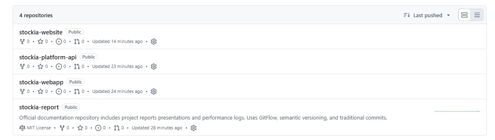 <br>

---

## Implementación de GitFlow

El equipo adopta **GitFlow** como workflow de control de versiones, siguiendo el modelo propuesto por Vincent Driessen en *“A successful Git branching model”*.

Las ramas que se manejan en todos los repositorios son:

### `main`

Rama principal de producción. Solo recibe merges desde `release` o `hotfix`, y representa siempre el código estable y desplegado.

### `develop`

Rama de integración continua. Todas las features completadas se integran aquí antes de pasar a un release, y es la rama base para crear nuevos feature branches.

### `feature/<módulo>-<descripción-corta>`

Una rama por cada funcionalidad nueva.

Se crea desde `develop` y se integra nuevamente a `develop` mediante **Pull Request**, con revisión de al menos un miembro del equipo.

Ejemplos:

```text
feature/inventory-stock-management
feature/recipe-ingredient-linking
feature/demand-prediction
```

### `release/v<MAJOR>.<MINOR>.<PATCH>`
Rama para preparar una nueva versión de producción. Se crea desde `develop` cuando las features del Sprint están completas, permitiendo únicamente correcciones menores y actualización de versión. Se integra tanto a `main` como a `develop`.

**Ejemplo:**

```text
release/v1.2.0
```
### `hotfix/<descripción-corta>`
Rama para correcciones urgentes sobre producción. Se crea desde main y se integra gtanto a main como a develop.
**Ejemplo:**

```text
hotfix/stock-discount-error
```
Todas las ramas se nombran en inglés y aplicando kebab-case.

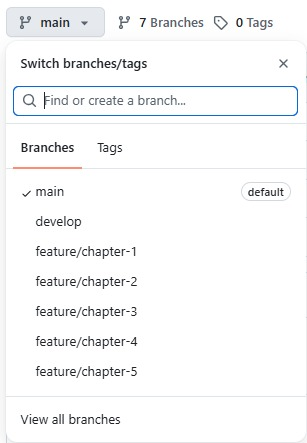 <br>


## Semantic Versioning

El equipo aplica **Semantic Versioning 2.0.0** para el nombrado de releases, bajo el esquema `MAJOR.MINOR.PATCH`, donde **MAJOR** corresponde a cambios incompatibles con versiones anteriores del API, **MINOR** a nuevas funcionalidades compatibles con versiones anteriores, y **PATCH** a correcciones de errores compatibles. La primera versión funcional del producto será `v1.0.0`, correspondiente al entregable del Sprint 1.

## Conventional Commits

El equipo aplica la especificación **Conventional Commits** para todos los mensajes de commit, bajo la estructura `<tipo>(<alcance>): <descripción corta en inglés>`. Los tipos permitidos son:

| Tipo | Uso |
|---|---|
| `feat` | Nueva funcionalidad |
| `fix` | Corrección de error |
| `docs` | Cambios en documentación |
| `style` | Cambios de formato que no afectan la lógica |
| `refactor` | Refactorización sin nueva funcionalidad ni corrección |
| `test` | Adición o modificación de pruebas |
| `chore` | Tareas de mantenimiento, dependencias o configuración |

**Ejemplos aplicados al proyecto:**

```text
feat(inventory): add automatic ingredient deduction by recipe
fix(auth): correct expired token validation
docs(chapter-iv): add information architecture section
```
Este enfoque facilita la generación de historiales de cambios y mantiene un registro organizado y semántico del desarrollo.

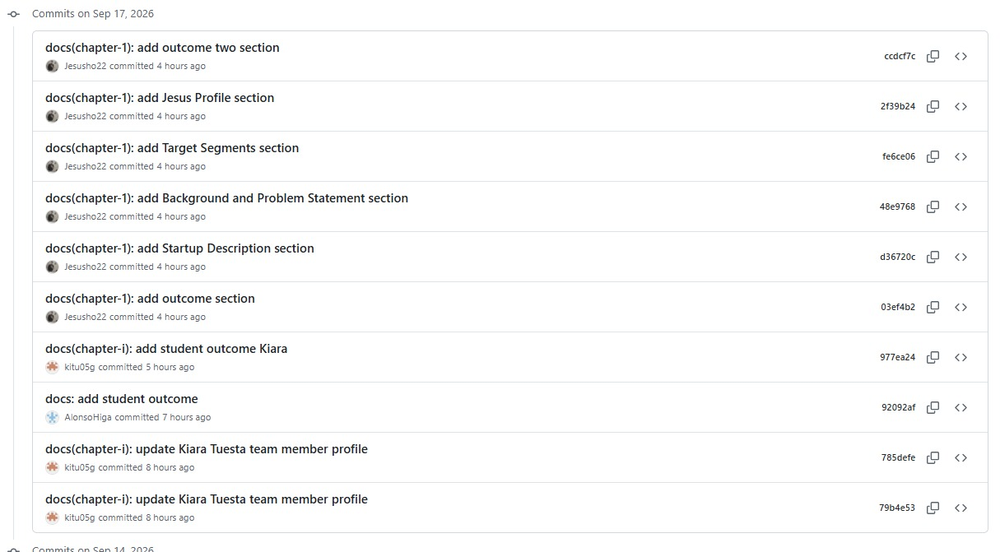 <br>


### **5.1.3. Source Code Style Guide & Conventions**
Como norma general, todo el código desarrollado en StockIA se redacta completamente en inglés, incluyendo nombres de variables, funciones, clases, archivos y comentarios, garantizando consistencia, mantenibilidad y alineación con estándares internacionales. Los nombres deben ser descriptivos y alineados al Ubiquitous Language del dominio (por ejemplo: `ingredient`, `recipe`, `stockLevel`, `demandForecast`, `expirationDate`), evitando ambigüedad.

## HTML

Se siguen el **HTML Style Guide and Coding Conventions (W3Schools)** y el **Google HTML/CSS Style Guide**:

- Etiquetas y atributos en minúsculas, con comillas dobles: `<section id="inventory-summary"></section>`
- Cierre correcto de todos los elementos.
- Inclusión de atributos de accesibilidad: ``
- Sangría de 2 espacios.

## CSS

Se sigue el **Google HTML/CSS Style Guide**:

- Clases e IDs en kebab-case: `.inventory-card`, `.alert-banner`
- Omitir unidades en valores cero: `margin: 0;`
- Uso de custom properties para colores y espaciado, evitando valores hardcodeados: `color: var(--primary);`
- Uso de unidades relativas (`rem`, `%`, `vh`) para responsive design.
- Evitar estilos inline; mantener la presentación en archivos `.css` separados.

## JavaScript

Se siguen el **Google JavaScript Style Guide**, las **MDN JavaScript Guidelines** y el **W3C JavaScript Style Guide**:

- camelCase para variables y funciones: `function calculateStockLevel() {}`
- Declaración con `const` y `let`, evitando `var`: `const stockThreshold = 10;`
- Uso de ES6+ (arrow functions, destructuring, template literals).
- Manejo de errores con `try/catch`.
- Evitar funciones excesivamente largas (máximo 20–30 líneas).

## Vue (Frontend Web Application)

Se sigue el **Vue Style Guide oficial**:

- Nombres de componentes en PascalCase: `InventoryDashboard`, `RecipeForm`
- Nombres de archivos de componente en PascalCase o kebab-case de forma consistente: `InventoryDashboard.vue`
- Uso de componentes en templates en kebab-case: `<inventory-dashboard />`
- Orden de bloques dentro de cada Single File Component: `<template>`, `<script>`, `<style>`
- Un componente por archivo, organizados por dominio funcional (`inventory`, `recipes`, `alerts`, `auth`).
- Props siempre con tipo definido y valor por defecto cuando aplique.

## C# (RESTful API con ASP.NET Core)

Se siguen las **C# Coding Conventions** y las **Microsoft ASP.NET Core Coding Guidelines**:

- PascalCase para clases, métodos y propiedades públicas: `public class InventoryService { public void DeductIngredients() { } }`
- camelCase para variables locales y parámetros: `int stockQuantity;`
- UPPER_SNAKE_CASE para constantes: `const int MAX_INGREDIENTS = 500;`
- Sangría de 4 espacios, sin tabulaciones.
- Aplicación de los principios de responsabilidad única y código modular, organizado por bounded context.
- Documentación de endpoints con OpenAPI mediante Swagger.

## Gherkin (criterios de aceptación y pruebas de aceptación)

Se siguen las **Gherkin Conventions for Readable Specifications**:

- Estructura obligatoria Given – When – Then.
- Escenarios en inglés, descriptivos, cortos y sin ambigüedad.
- Un escenario por comportamiento específico.
- Uso de Scenario Outline cuando corresponda.
- Archivos `.feature` nombrados por módulo: `inventory_management.feature`, `demand_prediction.feature`

### Ejemplo

```gherkin
Feature: Automatic ingredient deduction

Scenario: Stock is reduced when a dish is sold
    Given a recipe registered with its linked ingredients
    When a sale of that dish is recorded
    Then the system deducts the corresponding ingredient quantities from stock
```

### **5.1.4. Software Deployment Configuration**
A continuación se describe la configuración de despliegue de cada producto digital de StockIA, partiendo desde los repositorios de código fuente hasta su publicación.
#### Landing Page → Vercel

1. El código fuente del Landing Page (HTML, CSS y JavaScript estático) reside en el repositorio `stockia-website`, rama `main`.

2. Crear una cuenta en Vercel e iniciar sesión con la cuenta de GitHub de la organización del equipo, autorizando el acceso a los repositorios.

3. Importar el repositorio desde el panel de Vercel mediante **"Add New Project" → "Import Git Repository"**.

4. Configurar el proyecto con Framework Preset **"Other"**, al tratarse de un sitio estático sin proceso de build.

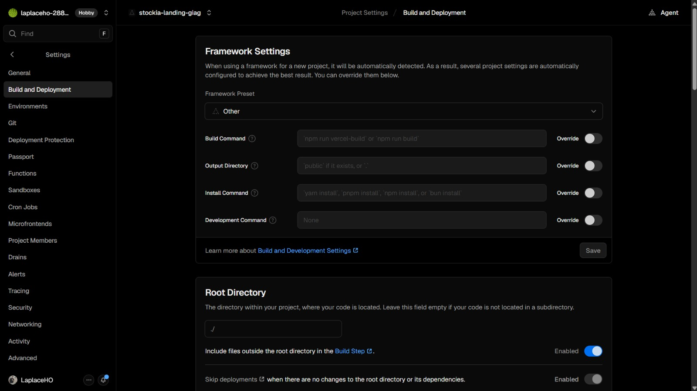 <br>

5. Establecer `develop` como rama de producción. Cada push a `main` desencadena un redespliegue automático, y cada Pull Request hacia `develop` genera un preview deployment para revisión previa a la integración.

6. Verificar el despliegue accediendo a la URL pública asignada por Vercel y registrarla en la documentación del proyecto.


##### Evidencia del despliegue en Vercel

La siguiente imagen muestra el panel de Vercel con el **Production Deployment** del Landing Page, donde se observa el estado `Ready`, la rama utilizada y el dominio público asignado.

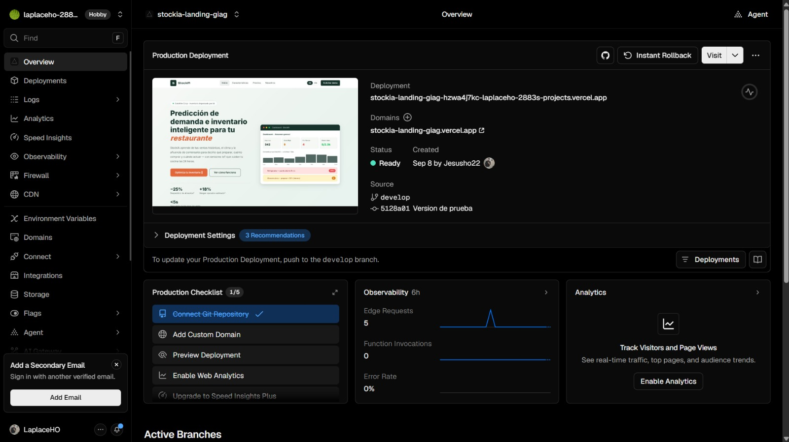 <br>

##### Landing Page desplegada

La siguiente imagen muestra la **Landing Page de StockIA desplegada y disponible mediante el dominio público proporcionado por Vercel**.

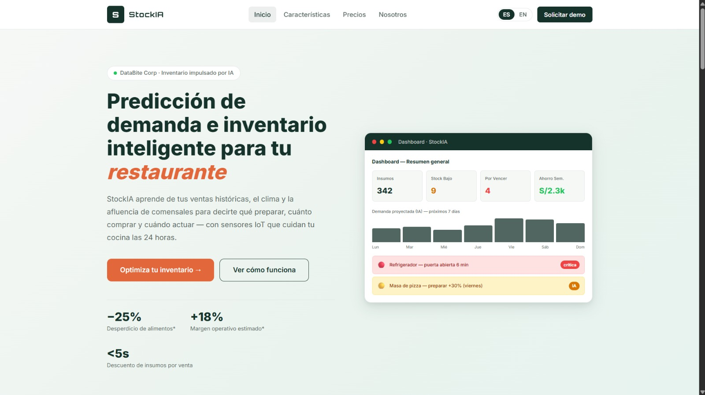 <br>

#### RESTful Web Services (ASP.NET Core + MySQL)

El RESTful API requiere un entorno de ejecución de servidor para aplicaciones .NET, por lo que se despliega en una plataforma compatible junto con su base de datos relacional.

La configuración prevista contempla:

1. Crear el servicio de base de datos MySQL.

2. Registrar las variables de entorno de conexión (host, puerto, nombre de base de datos, usuario y contraseña) en la plataforma de despliegue.

3. Referenciar dichas variables desde el archivo de configuración `appsettings.json` del proyecto en lugar de escribir las credenciales directamente en el código.

4. La documentación de los endpoints quedará disponible públicamente vía Swagger UI.

5. La configuración detallada y las URLs finales se documentarán en el Sprint correspondiente, una vez implementado el servicio.

##### Configuración de variables de entorno

La siguiente imagen muestra el apartado de **Environment Variables** de la plataforma de despliegue, utilizado para gestionar las variables de configuración del proyecto.

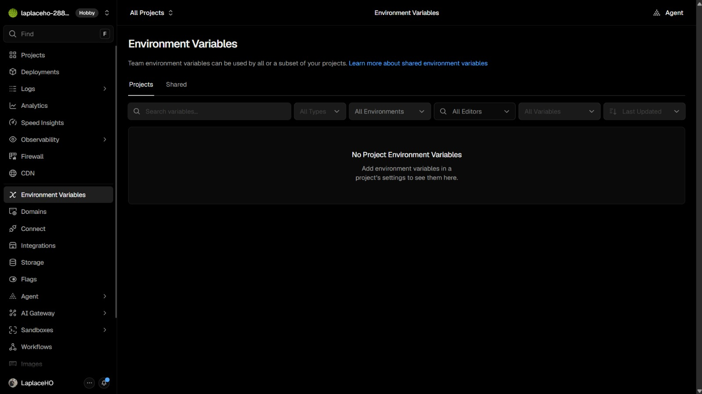 <br>

## **5.2. Landing Page, Services & Applications Implementation**
### **5.2.1. Sprint 1**
Este primer ciclo de desarrollo se centró en establecer los pilares de la identidad digital de **StockIA**, integrando el esfuerzo colaborativo del equipo para entregar un sitio de marketing funcional inicial. Durante este Sprint, el equipo priorizó la captación de visitantes mediante una Landing Page de 4 páginas (`index.html`, `features.html`, `pricing.html`, `about.html`), completamente bilingüe (ES/EN) y responsiva, documentando cada fase desde la planificación hasta el despliegue final para validar la propuesta de valor frente al segmento elegido. Los ítems seleccionados son US01 a US20 y RNF01 a RNF10 del Product Backlog, correspondientes a las épicas EP01 a EP08.

#### **5.2.1.1. Sprint Planning 1**
El Sprint Planning Meeting marcó el inicio formal del desarrollo del código de StockIA. Durante esta sesión, el equipo de desarrollo junto al Product Owner seleccionaron las Historias de Usuario más prioritarias del Product Backlog (correspondientes a los Epics EP01–EP08) para definir el objetivo central de la iteración. A continuación, se presenta el cuadro resumen con los detalles y acuerdos de esta reunión:

| **Sprint #** | Sprint 1 |
| :--- | :--- |
| **Sprint Planning Background** | |
| **Date** | 09/09/2026 |
| **Time** | 10:00 am |
| **Location** | Lima/Lima/Santiago de Surco/UPC |
| **Prepared By** | Huaman Oscco, Aldo Jesus (Jesusho22) |
| **Attendees (to planning meeting)** | Higa Kohatsu, Alonso Enrique / Asmat Alminco, Martin Alejandro / Huaman Oscco, Aldo Jesus / Ortiz Laura, Leyla Alisson / Tuesta Girón, Kiara Lucia |
| **Sprint Review Summary** | No aplica: es el primer Sprint. Antes de él, el equipo cerró la fase de ideación (segmentos objetivo, propuesta de valor y entrevistas), finalizó la arquitectura C4 y el modelado de la base de datos, y configuró la organización y los repositorios de GitHub para trabajar con GitFlow. |
| **Sprint Retrospective Summary** | No aplica al ser el primer Sprint. Como acuerdo inicial de trabajo, el equipo definió el uso de GitHub y Jira para la colaboración remota y una rama `feature/*` por página o capítulo integrada mediante Pull Request. |
| **Sprint Goal & User Stories** | |
| **Sprint 1 Goal** | **Contexto:** El equipo prioriza establecer la identidad digital de StockIA y comunicar la propuesta de valor al segmento objetivo, publicando un sitio de marketing de 4 páginas totalmente bilingüe (ES/EN), antes de invertir esfuerzo en la Web Application. <br><br> **Sprint Goal:**<br>*"Our focus is on building a trustworthy digital presence that clearly communicates StockIA's value proposition. We believe this will let visitors understand the product's benefits within seconds and request a demo with confidence. This will be confirmed when the four-page site is live, fully bilingual, responsive, and generating demo requests."* |
| **Sprint 1 Velocity** | No aplica: es el primer Sprint y no existe una velocidad histórica. |
| **Sum of Story Points** | 88 Story Points comprometidos en 30 ítems (20 US y 10 RNF) |
 

#### **5.2.1.2. Aspect Leaders and Collaborators**
En esta sección se presenta la **Leadership-and-Collaboration Matrix (LACX)** del Sprint 1. Cada aspecto agrupa las tareas del Sprint Backlog; el líder (L) responde por la integración y la revisión de ese aspecto, y los colaboradores (C) desarrollan o revisan sus tareas.
 
| Team Member | GitHub Username | Estructura, estilos e interacciones (CSS/JS) (L/C) | Maquetación del Home y contenido bilingüe (L/C) | Páginas internas (features, pricing, about) (L/C) | Responsive, accesibilidad y SEO (L/C) | Despliegue y QA (L/C) |
| :--- | :--- | :---: | :---: | :---: | :---: | :---: |
| Higa Kohatsu, Alonso Enrique | AlonsoHiga | C | C | L | C | C |
| Asmat Alminco, Martin Alejandro | Alemarr2 | C | C | C | L | C |
| Huaman Oscco, Aldo Jesus | Jesusho22 | C | C | C | C | L |
| Ortiz Laura, Leyla Alisson | Leylaa-O | L | C | C | C | C |
| Tuesta Girón, Kiara Lucia | kitu05g | C | L | C | C | C |
 
> **Leyenda:** **L:** Líder del aspecto · **C:** Colaborador

#### **5.2.1.3. Sprint Backlog 1**
**Periodo:** 09/09/2026 – 18/09/2026  
**Objetivo del Sprint:** Tener la Landing Page de StockIA (4 páginas) completamente maquetada, traducida ES/EN, responsiva y con el formulario de demo funcional, lista para publicarse.


| **User Story Id** | **Título de la Historia** | **Task Id** | **Título de la Tarea** | **Descripción de la Tarea** | **Est. (Hrs)** | **Asignado** | **Status** |
| :--- | :--- | :--- | :--- | :--- | :---: | :--- | :---: |
| **US01** | Conocer la propuesta de valor | T-01-1 | Maquetado del Hero | Construir el layout del hero con título, descripción y botones CTA. | 5 | Higa Kohatsu, Alonso Enrique | Done |
|  |  | T-01-2 | Redacción y traducción del mensaje principal | Escribir el copy de la propuesta de valor en español e inglés. | 3 | Tuesta Girón, Kiara Lucia | Done |
| **US02** | Ver una vista previa del dashboard | T-02-1 | Mockup ilustrativo del dashboard | Maquetar las tarjetas y el gráfico ilustrativos con CSS. | 6 | Asmat Alminco, Martin Alejandro | Done |
|  |  | T-02-2 | Responsive del mockup | Ocultar el mockup en pantallas menores a 768px. | 2 | Ortiz Laura, Leyla Alisson | Done |
| **US03** | Conocer estadísticas e indicadores | T-03-1 | Barra de estadísticas | Maquetar los cuatro indicadores de impacto del Home. | 4 | Huaman Oscco, Aldo Jesus | Done |
|  |  | T-03-2 | Nota de transparencia | Redactar y traducir la nota de cifras de ejemplo. | 2 | Higa Kohatsu, Alonso Enrique | Done |
| **US04** | Identificar si StockIA es para mi rol | T-04-1 | Sección "¿Para quién es StockIA?" | Maquetar las tarjetas por segmento (dueños/CEOs y administradores). | 4 | Tuesta Girón, Kiara Lucia | Done |
|  |  | T-04-2 | Redacción por segmento | Escribir el contenido diferenciado para cada rol. | 3 | Asmat Alminco, Martin Alejandro | Done |
| **US05** | Conocer las funcionalidades principales | T-05-1 | Grid de seis funcionalidades | Maquetar las tarjetas de funcionalidades en el Home. | 5 | Ortiz Laura, Leyla Alisson | Done |
|  |  | T-05-2 | Enlace a features.html | Implementar el botón "Ver todas las características". | 2 | Huaman Oscco, Aldo Jesus | Done |
| **US06** | Conocer los diferenciadores | T-06-1 | Sección "Más que un inventario" | Maquetar las tres tarjetas de diferenciadores. | 3 | Higa Kohatsu, Alonso Enrique | Done |
|  |  | T-06-2 | Redacción y traducción | Escribir el contenido de cada diferenciador. | 2 | Tuesta Girón, Kiara Lucia | Done |
| **US07** | Conocer las integraciones externas | T-07-1 | Sección de integraciones | Maquetar las cuatro tarjetas con la etiqueta "En evaluación". | 3 | Asmat Alminco, Martin Alejandro | Done |
|  |  | T-07-2 | Nota de transparencia | Redactar el texto que aclara que la decisión está pendiente. | 2 | Ortiz Laura, Leyla Alisson | Done |
| **US08** | Explorar vistas ilustrativas | T-08-1 | Sección de portafolio | Maquetar las cuatro vistas ilustrativas. | 5 | Huaman Oscco, Aldo Jesus | Done |
|  |  | T-08-2 | Tabs de portafolio (JS) | Implementar el cambio de pestaña Inventario / IA & IoT. | 3 | Higa Kohatsu, Alonso Enrique | Done |
| **US09** | Ver el video de presentación | T-09-1 | Placeholder de video | Maquetar el bloque "Video demostrativo próximamente". | 2 | Tuesta Girón, Kiara Lucia | Done |
|  |  | T-09-2 | Estructura para reemplazo futuro | Dejar preparado el iframe de YouTube comentado en el código. | 2 | Asmat Alminco, Martin Alejandro | Done |
| **US10** | Navegar entre las páginas del sitio | T-10-1 | Navbar compartido | Implementar el menú superior en las 4 páginas. | 4 | Ortiz Laura, Leyla Alisson | Done |
|  |  | T-10-2 | Estado activo del enlace | Resaltar visualmente la página actual en el navbar. | 2 | Huaman Oscco, Aldo Jesus | Done |
| **US11** | Ver el detalle completo de funcionalidades | T-11-1 | Grid completo en features.html | Maquetar las seis funcionalidades con descripción extendida. | 5 | Higa Kohatsu, Alonso Enrique | Done |
| **US12** | Entender cómo empezar a usar StockIA | T-12-1 | Sección "Cómo funciona" | Maquetar los cuatro pasos numerados. | 4 | Tuesta Girón, Kiara Lucia | Done |
| **US13** | Cambiar el idioma del sitio | T-13-1 | Selector de idioma (ES/EN) | Implementar los botones de idioma en el navbar. | 3 | Asmat Alminco, Martin Alejandro | Done |
|  |  | T-13-2 | Motor de traducción (i18n.js) | Programar el reemplazo de textos mediante data-i18n. | 6 | Ortiz Laura, Leyla Alisson | Done |
| **US14** | Mantener mi idioma preferido | T-14-1 | Persistencia en localStorage | Guardar y leer el idioma seleccionado entre páginas. | 3 | Huaman Oscco, Aldo Jesus | Done |
| **US15** | Consultar los planes disponibles | T-15-1 | Maquetado de los 3 planes | Construir las tarjetas de Esencial, Profesional e IoT Completo. | 5 | Higa Kohatsu, Alonso Enrique | Done |
|  |  | T-15-2 | Nota de precios de ejemplo | Redactar la nota de transparencia sobre precios ilustrativos. | 2 | Tuesta Girón, Kiara Lucia | Done |
| **US16** | Comparar precios mensuales y anuales | T-16-1 | Toggle mensual/anual (JS) | Implementar el interruptor y el recálculo de montos. | 4 | Asmat Alminco, Martin Alejandro | Done |
| **US17** | Resolver dudas frecuentes | T-17-1 | Acordeón de preguntas frecuentes | Implementar la apertura/cierre exclusivo de preguntas. | 4 | Ortiz Laura, Leyla Alisson | Done |
|  |  | T-17-2 | Redacción de preguntas y respuestas | Escribir el contenido del FAQ en español e inglés. | 3 | Huaman Oscco, Aldo Jesus | Done |
| **US18** | Conocer misión, visión y valores | T-18-1 | Sección misión/visión/valores | Maquetar el bloque correspondiente en about.html. | 3 | Higa Kohatsu, Alonso Enrique | Done |
|  |  | T-18-2 | Redacción de contenido | Escribir la misión, visión y los cinco valores. | 2 | Tuesta Girón, Kiara Lucia | Done |
| **US19** | Conocer al equipo detrás de StockIA | T-19-1 | Fichas de equipo | Maquetar las cuatro fichas placeholder con nombre, rol y código. | 3 | Asmat Alminco, Martin Alejandro | Done |
|  |  | T-19-2 | Nota de datos pendientes | Redactar la nota de "fichas de ejemplo". | 1 | Ortiz Laura, Leyla Alisson | Done |
| **US20** | Solicitar una demo mediante formulario | T-20-1 | Formulario de contacto | Maquetar el formulario con validación nativa de campos obligatorios. | 4 | Huaman Oscco, Aldo Jesus | Done |
|  |  | T-20-2 | Confirmación visual de envío | Implementar el mensaje "✓ Enviado" y el reseteo del formulario. | 3 | Higa Kohatsu, Alonso Enrique | Done |
|  |  | T-20-3 | Accesos al formulario | Enlazar los botones "Solicitar demo" del navbar, banner y footer. | 2 | Tuesta Girón, Kiara Lucia | Done |
| **RNF01** | Experiencia responsiva | T-R1-1 | Breakpoints de 1024px y 768px | Definir media queries para tablets y móviles. | 4 | Asmat Alminco, Martin Alejandro | Done |
|  |  | T-R1-2 | Ajuste de cuadrículas | Reorganizar columnas y ocultar elementos no esenciales en móvil. | 4 | Ortiz Laura, Leyla Alisson | Done |
| **RNF02** | Contraste y legibilidad accesible | T-R2-1 | Paleta de contraste | Definir colores de texto con contraste adecuado sobre fondos claros y oscuros. | 3 | Huaman Oscco, Aldo Jesus | Done |
| **RNF03** | Navegación consistente | T-R3-1 | Navbar y footer compartidos | Reutilizar los mismos componentes en las 4 páginas. | 3 | Higa Kohatsu, Alonso Enrique | Done |
| **RNF04** | Carga rápida | T-R4-1 | Optimización de assets | Evitar frameworks y librerías pesadas innecesarias. | 3 | Tuesta Girón, Kiara Lucia | Done |
| **RNF05** | Buen posicionamiento en buscadores | T-R5-1 | Metadatos por página | Agregar title y meta description a cada página. | 2 | Asmat Alminco, Martin Alejandro | Done |
|  |  | T-R5-2 | Metadatos adicionales del Home | Agregar meta keywords, author y copyright en index.html. | 2 | Ortiz Laura, Leyla Alisson | Done |
| **RNF06** | Compatibilidad con navegadores | T-R6-1 | CSS estándar (Flexbox/Grid) | Verificar compatibilidad en navegadores modernos. | 3 | Huaman Oscco, Aldo Jesus | Done |
|  |  | T-R6-2 | Degradación de animaciones | Manejar el caso sin soporte de IntersectionObserver. | 2 | Higa Kohatsu, Alonso Enrique | Done |
| **RNF07** | Animaciones de entrada | T-R7-1 | Scroll reveal (JS) | Implementar la animación de aparición progresiva de tarjetas. | 4 | Tuesta Girón, Kiara Lucia | Done |
| **RNF08** | Contenido pendiente señalizado | T-R8-1 | Notas visibles de contenido de ejemplo | Agregar notas junto a las secciones con datos ilustrativos. | 2 | Asmat Alminco, Martin Alejandro | Done |
|  |  | T-R8-2 | Comentarios en el código | Documentar en HTML qué elementos deben reemplazarse. | 1 | Ortiz Laura, Leyla Alisson | Done |
| **RNF09** | Sistema de diseño centralizado | T-R9-1 | Variables CSS en :root | Centralizar colores, tipografías y espaciados. | 4 | Huaman Oscco, Aldo Jesus | Done |
| **RNF10** | Textos centralizados (i18n) | T-R10-1 | Diccionario único de traducciones | Concentrar todos los textos ES/EN en i18n.js. | 4 | Higa Kohatsu, Alonso Enrique | Done |
| **TOTAL** | | | | **Esfuerzo total estimado para el Sprint** | **162** | | |

**Capacidad del Sprint 1**

| Integrante | Disponibilidad declarada (h) | Horas asignadas | N.° de tareas | Uso de la capacidad |
| :--- | :---: | :---: | :---: | :---: |
| Higa Kohatsu, Alonso Enrique | 40 | 38 | 11 | 95 % |
| Asmat Alminco, Martin Alejandro | 40 | 32 | 10 | 80 % |
| Huaman Oscco, Aldo Jesus | 40 | 33 | 10 | 83 % |
| Ortiz Laura, Leyla Alisson | 40 | 31 | 10 | 78 % |
| Tuesta Girón, Kiara Lucia | 40 | 28 | 10 | 70 % |
| **Total** | **200** | **162** | **51** | **81 %** |

<p align="center">
  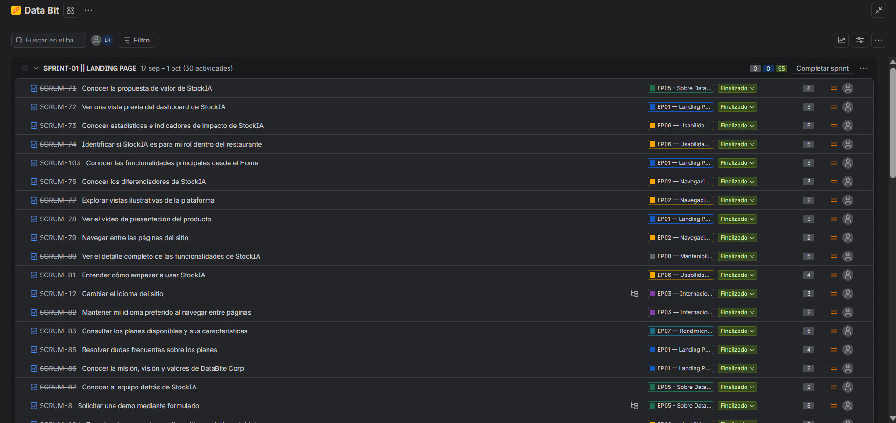
  <br/><i>Artefacto: Jira para Sprint 1 Priorizado</i>
</p>
<p align="center">
  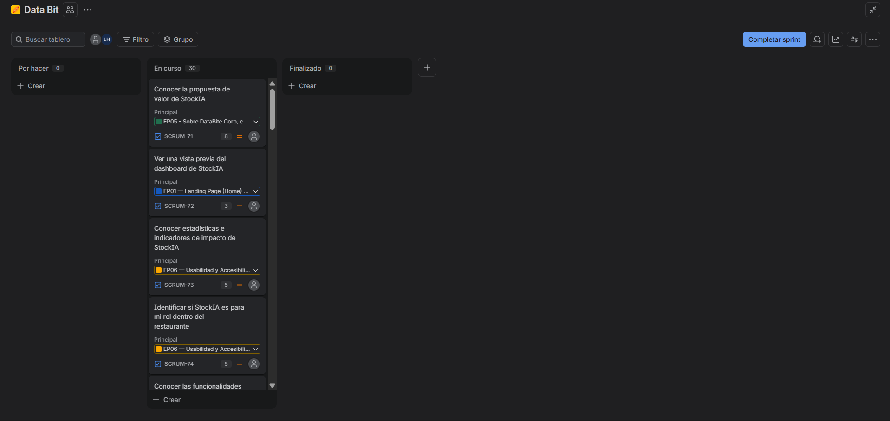
  <br/><i>Artefacto: Jira para demostrar el tablero Kanban - Proceso -</i>
</p>
<p align="center">
  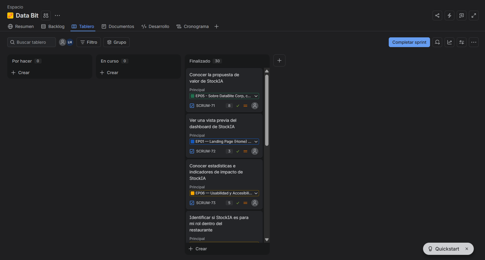
  <br/><i>Artefacto: Jira para demostrar el tablero Kanban - Finalizado -</i>
</p>

##### Resumen Técnico
- **Total de horas:** 162 horas en 51 tareas.
- **Distribución:** 09/09/2026 – 18/09/2026, con una disponibilidad declarada de 40 horas por integrante (20 h por semana); la capacidad libre cubre revisiones de Pull Request y ceremonias.
- **Story Points:** 88 comprometidos; 88 completados al cierre del Sprint (velocidad del Sprint 1).
- **Entregable principal:** Landing Page de StockIA (4 páginas), bilingüe ES/EN, responsiva, con formulario de solicitud de demo funcional.

#### **5.2.1.4. Development Evidence for Sprint Review**
En esta sección se presentan los avances de implementación del Sprint 1 (Landing Page) mediante los commits que los respaldan. Cada commit se relaciona con el ítem del Sprint Backlog 1 que implementa, de modo que puede rastrearse el trabajo de cada integrante desde la historia hasta el código.

**Repositorio del informe (`stockia-report`)**

El informe se trabajó con GitFlow: una rama `feature/chapter-N` por capítulo y su integración en `develop` mediante Pull Request (PR #1 al #11 durante el Sprint 1, con la versión `v1.0.0` publicada en `main`). Se presentan los commits más representativos de cada integrante:

| **Repository** | **Branch** | **Commit Id** | **Commit Message** | **Commit Message Body** | **Committed on (Date)** |
| :--- | :--- | :--- | :--- | :--- | :---: |
| stockia-report | main | `147c971` | chore: initialize report repository structure | Creación del repositorio del informe con la estructura de `docs/` (Alonso-Higa). | 27/08/2026 |
| stockia-report | feature/chapter-3 | `293996b` | docs: create chapter 3 documentation | Estructura inicial del capítulo III (AlonsoHiga). | 09/09/2026 |
| stockia-report | develop | `3f41c6d` | chore: create develop branch | Rama `develop` como base de integración de GitFlow (AlonsoHiga). | 10/09/2026 |
| stockia-report | feature/chapter-3 | `12b4340` | docs(chapter-3): add User Stories section | User Stories de la Landing Page y de la Web Application (Jesus). | 17/09/2026 |
| stockia-report | feature/chapter-3 | `6570d87` | docs(chapter-3): add Product Backlog section | Product Backlog priorizado con Story Points (Jesus). | 17/09/2026 |
| stockia-report | feature/chapter-4 | `794e63c` | docs(chapter-4): add Landing Page Wireframe section | Wireframes de la Landing Page (Jesus). | 17/09/2026 |
| stockia-report | feature/chapter-2 | `d4d4f38` | docs(chapter-2): update interviews for stockman segment | Entrevistas del segmento de encargados de almacén (Alemarr2). | 17/09/2026 |
| stockia-report | feature/chapter-4 | `53a88d3` | docs(chapter-4): add database diagrams for each bounded context | Diagramas de base de datos por Bounded Context (Alemarr2). | 17/09/2026 |
| stockia-report | feature/chapter-2 | `86d4e66` | docs(chapter-2): add big-picture-event-storming | Big Picture EventStorming del dominio (AlonsoHiga). | 17/09/2026 |
| stockia-report | feature/chapter-2 | `cc654c1` | docs(chapter-ii): add analysis of interview 2 | Análisis de la entrevista 2 (kitu05g). | 17/09/2026 |
| stockia-report | feature/chapter-5 | `ee49203` | docs(chapter-v): add source code management and style guide | Secciones 5.1.2 y 5.1.3 (kitu05g). | 17/09/2026 |
| stockia-report | feature/chapter-5 | `4c938ad` | docs(chapter-v): add software deployment configuration | Sección 5.1.4 (kitu05g). | 17/09/2026 |
| stockia-report | feature/chapter-3 | `c98ce10` | docs(chapter-3): add Impact Mapping section | Impact Map del segmento objetivo (Leylaa-O). | 18/09/2026 |
| stockia-report | feature/chapter-4 | `98d9bf3` | docs(chapter-4): add Web Applications UX/UI Design section | Wireframes, wireflows y mock-ups de la Web Application (Leylaa-O). | 18/09/2026 |
| stockia-report | feature/chapter-5 | `2eb79ae` | docs(chapter-5): add section Configuration Management Software | Sección 5.1.1 (Leylaa-O). | 18/09/2026 |
| stockia-report | feature/chapter-4 | `88cc204` | docs: add all component diagrams for each bounded context. | Diagramas de componentes C4 por Bounded Context (Alemarr2). | 18/09/2026 |
| stockia-report | feature/chapter-4 | `f16e0b4` | docs(chapter-4): add container diagram | Diagrama de contenedores C4 (AlonsoHiga). | 18/09/2026 |
| stockia-report | feature/chapter-5 | `66c56dd` | docs(chapter-5): add Team Collaboration Insights during Sprint section | Sección 5.2.1.8 (Jesus). | 18/09/2026 |
| stockia-report | main | `ae58e7f` | Merge pull request #11 from develop | Publicación de la versión `v1.0.0` del informe para el AV1 (Martin). | 18/09/2026 |

<br/>

**Repositorio de la Landing Page (`stockia-website`)**

La Landing Page se integró en el repositorio de la organización siguiendo GitFlow: Alonso creó la estructura y los scripts base, cada integrante integró su página mediante una rama `feature/*` y su Pull Request, y Leyla ajustó los estilos y las interacciones.

| **Repository** | **Branch** | **Commit Id** | **Commit Message** | **Commit Message Body** | **Committed on (Date)** |
| :--- | :--- | :--- | :--- | :--- | :---: |
| stockia-website | develop | `1a58474` | chore: set up project structure | Estructura base con las cuatro páginas y las carpetas `css`, `js` y `assets` (AlonsoHiga). | 17/09/2026 |
| stockia-website | develop | `2efd03a` | feat: add about section | US18, US19 y US20: misión, visión, valores, equipo y formulario de solicitud de demo en `about.html` (AlonsoHiga). | 17/09/2026 |
| stockia-website | develop | `6e0d010` | feat: add index.html code | US01 a US09: hero, mockup del dashboard, estadísticas, segmentos, funcionalidades, diferenciadores, integraciones, portafolio y video en `index.html` (kitu05g). | 17/09/2026 |
| stockia-website | feature/pricing | `6f5bf63` | feat(pricing): add navbar section | US10: barra de navegación de `pricing.html` (Jesus). | 18/09/2026 |
| stockia-website | feature/pricing | `9f5b940` | feat(pricing): add pricing cards section | US15 y US16: planes Esencial, Profesional e IoT Completo con interruptor mensual/anual (Jesus). | 18/09/2026 |
| stockia-website | feature/pricing | `af0e54c` | feat(pricing): add faq section | US17: preguntas frecuentes de `pricing.html` (Jesus). | 18/09/2026 |
| stockia-website | feature/pricing | `9ca1046` | feat(pricing): add footer section | US10 y RNF03: pie de página de `pricing.html` (Jesus). | 18/09/2026 |
| stockia-website | develop | `0e54999` | Merge pull request #1 from feature/pricing | Integración revisada de `pricing.html` en `develop` (Aldo_Jesus). | 18/09/2026 |
| stockia-website | feature/features-page | `4082128` | feat(features): update Landing's features page. | US11 y US12: detalle de las seis funcionalidades y la sección "Cómo funciona" en `features.html` (Alemarr2). | 18/09/2026 |
| stockia-website | develop | `be0b019` | Merge pull request #2 from feature/features-page | Integración revisada de `features.html` en `develop` (Martin). | 18/09/2026 |
| stockia-website | develop | `04782c2` | feat: add js files and cs file | RNF09, RNF10, US13 y US14: hoja de estilos, diccionario ES/EN e interacciones del sitio (AlonsoHiga). | 18/09/2026 |
| stockia-website | main | `d89ab65` | Merge pull request #3 from develop | Publicación de la versión `v1.0.0` de la Landing Page (AlonsoHiga). | 18/09/2026 |
| stockia-website | feature/styles | `9887414` | feat: update styles.css | RNF07 y RNF09: ajustes del sistema de diseño (Leylaa-O). | 18/09/2026 |
| stockia-website | feature/js-files | `0897fec` | feat: update js files | RNF10: limpieza de `i18n.js` y `main.js` (Leylaa-O). | 18/09/2026 |

#### **5.2.1.5. Execution Evidence for Sprint Review**
En el Sprint 1 se implementaron las cuatro páginas de la Landing Page de StockIA. A continuación se presenta cada sección publicada junto con la User Story o el requisito que la respalda:

1. **Barra de navegación (US10, US13, US14):** menú común a las cuatro páginas con los enlaces Inicio, Características, Precios y Nosotros, el selector de idioma ES/EN y el botón "Solicitar demo".
<p align="center">
  
  <br/><i>Barra de navegación — US10, US13 y US14</i>
</p>

2. **Hero con mockup del dashboard (US01, US02):** propuesta de valor, CTA principal y secundario y la vista previa ilustrativa del dashboard.
<p align="center">
  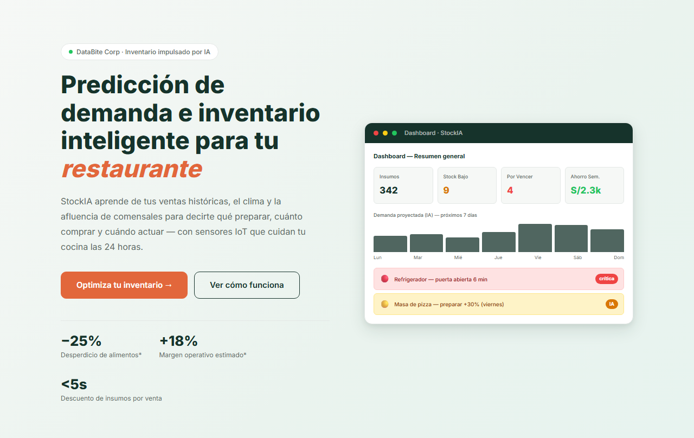
  <br/><i>Hero con mockup del dashboard — US01 y US02</i>
</p>

3. **Barra de estadísticas (US03, RNF08):** los cuatro indicadores de impacto y la nota que identifica las cifras referenciales.
<p align="center">
  
  <br/><i>Barra de estadísticas — US03 y RNF08</i>
</p>

4. **"¿Para quién es StockIA?" (US04):** una tarjeta para dueños y CEOs y otra para administradores y jefes de cocina.
<p align="center">
  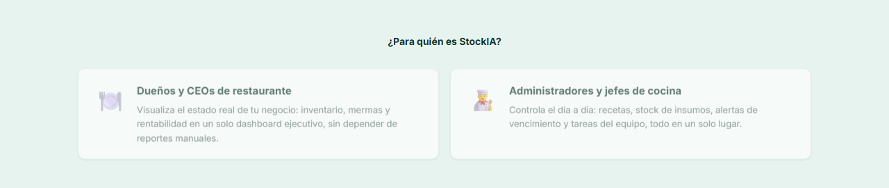
  <br/><i>Sección "¿Para quién es StockIA?" — US04</i>
</p>

5. **Funcionalidades del Home (US05):** seis tarjetas de funcionalidades y el botón "Ver todas las características".
<p align="center">
  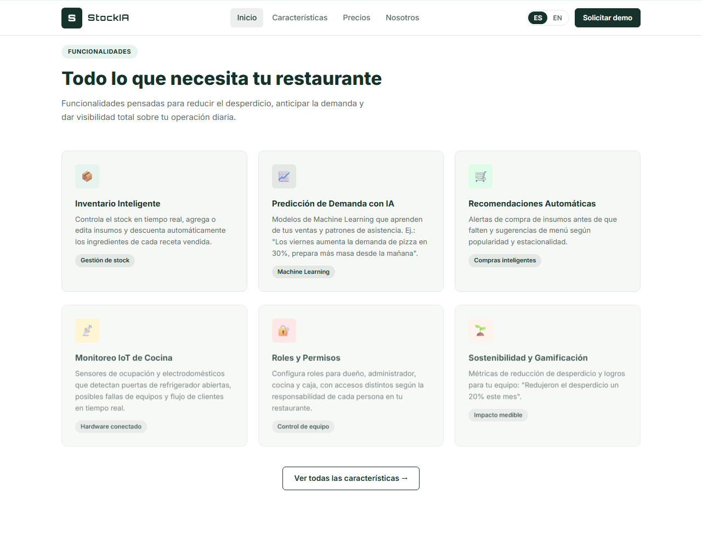
  <br/><i>Funcionalidades del Home — US05</i>
</p>

6. **"Más que un inventario" (US06):** las tres tarjetas de diferenciadores de StockIA.
<p align="center">
  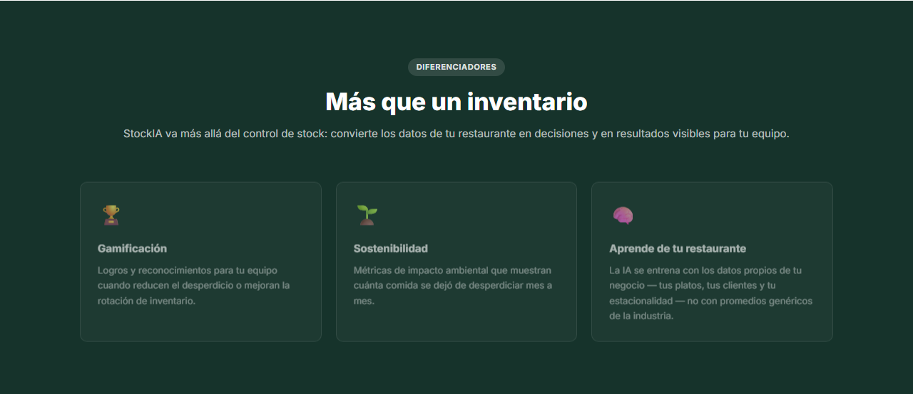
  <br/><i>Diferenciadores — US06</i>
</p>

7. **Integraciones en evaluación (US07, RNF08):** cuatro tarjetas con la etiqueta "En evaluación" y la nota de que la integración definitiva aún no se ha elegido.
<p align="center">
  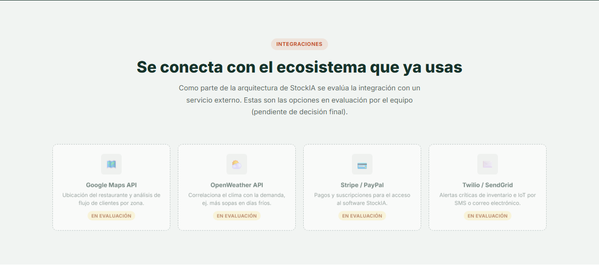
  <br/><i>Integraciones en evaluación — US07 y RNF08</i>
</p>

8. **Portafolio (US08):** vistas ilustrativas de la plataforma con pestañas Inventario e IA & IoT.
<p align="center">
  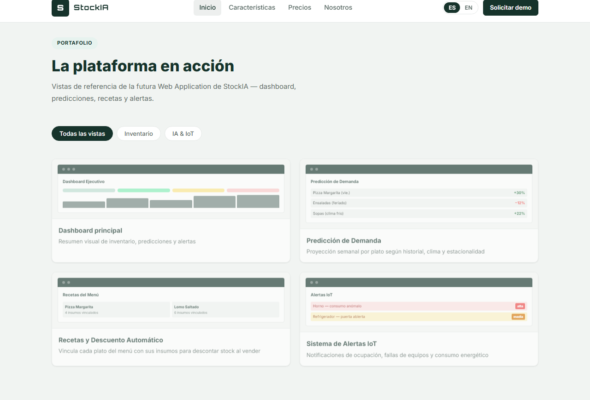
  <br/><i>Portafolio — US08</i>
</p>

9. **Video del producto (US09):** bloque "Video demostrativo próximamente", con el iframe de YouTube preparado para su reemplazo.
<p align="center">
  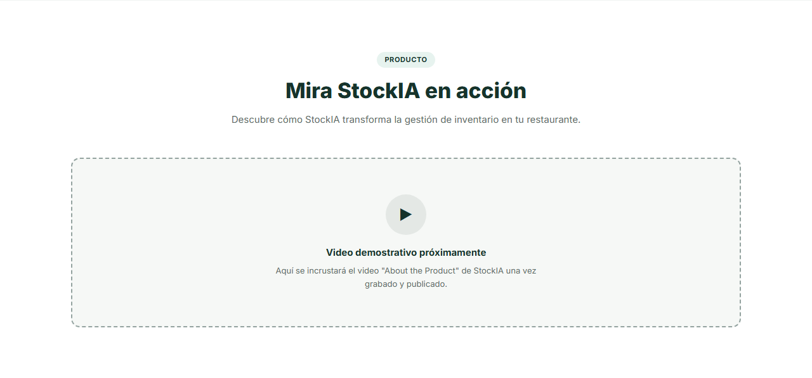
  <br/><i>Bloque del video del producto — US09</i>
</p>

10. **features.html (US11, US12):** detalle de las seis funcionalidades y la sección "Cómo funciona" con cuatro pasos.
<p align="center">
  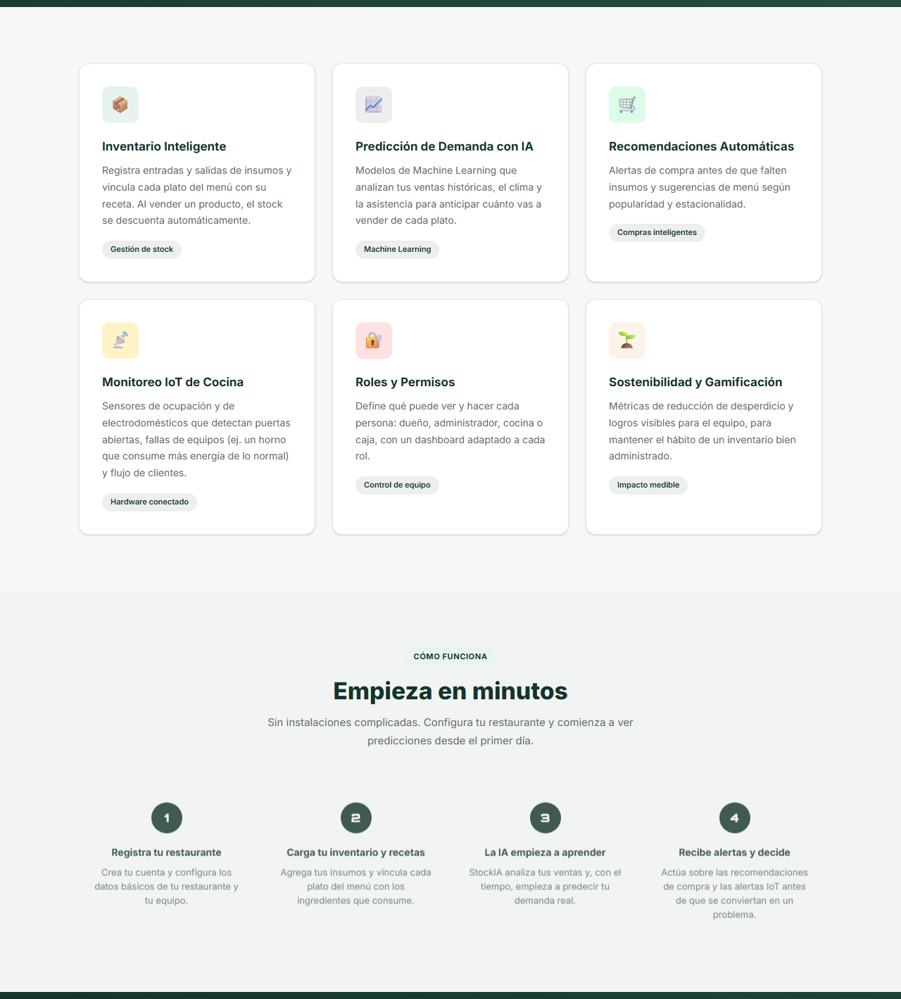
  <br/><i>features.html — US11 y US12</i>
</p>

11. **pricing.html (US15, US16, US17, RNF08):** planes Esencial, Profesional e IoT Completo con el interruptor mensual/anual, la nota de precios de ejemplo y el acordeón de preguntas frecuentes.
<p align="center">
  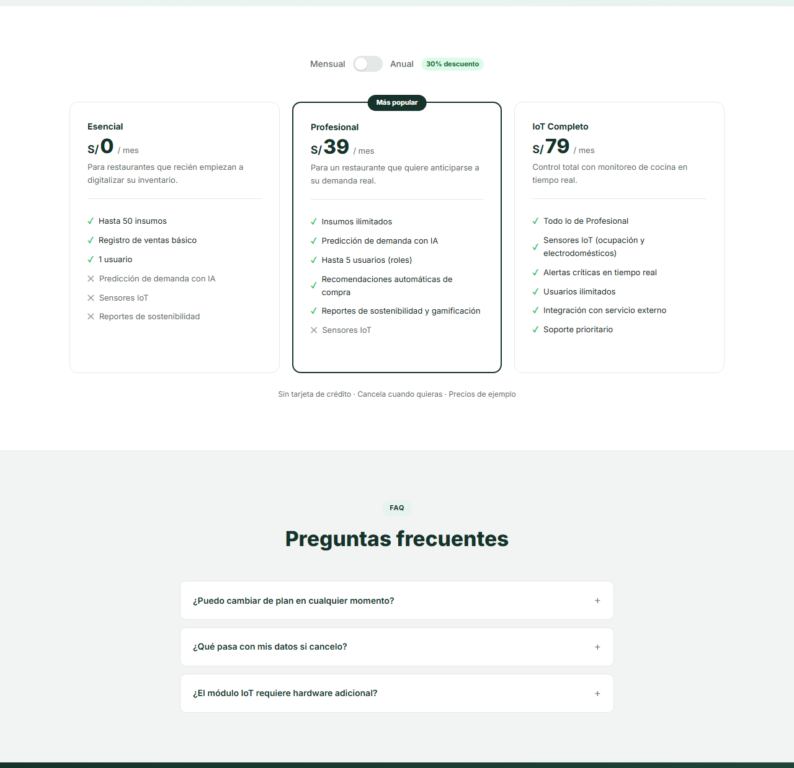
  <br/><i>pricing.html — US15, US16, US17 y RNF08</i>
</p>

12. **about.html (US18, US19, US20):** misión, visión, valores, fichas del equipo y formulario de solicitud de demo.
<p align="center">
  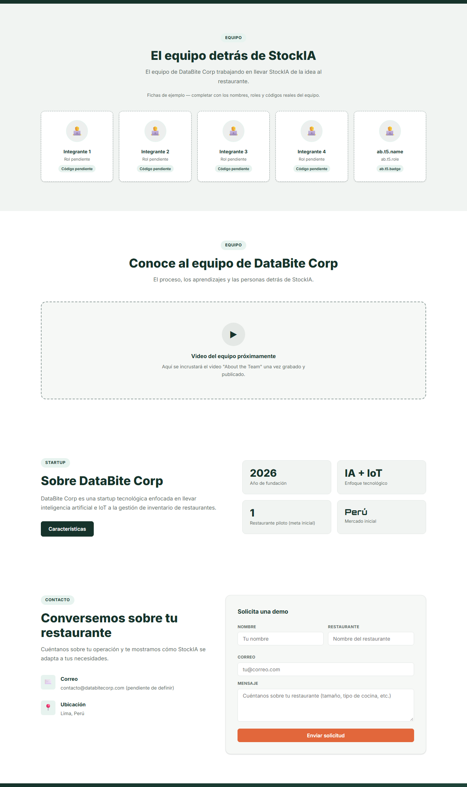
  <br/><i>about.html — US18, US19 y US20</i>
</p>

13. **Pie de página (US10, RNF03):** columnas Producto, Empresa y Legal, comunes a las cuatro páginas.
<p align="center">
  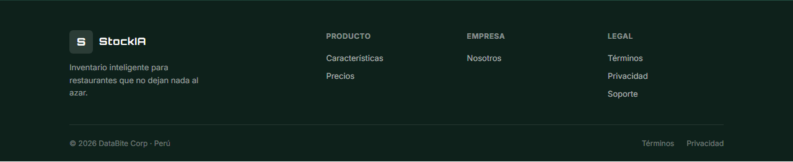
  <br/><i>Pie de página — US10 y RNF03</i>
</p>

**Verificación de los requisitos no funcionales**

| **RNF** | **Requisito** | **Herramienta de verificación** | **Evidencia** |
| :--- | :--- | :--- | :--- |
| RNF01 | Experiencia responsiva en móviles y tablets | DevTools a 390, 768, 1024 y 1440 px | `rnf01-responsive.png` |
| RNF02 | Contraste y legibilidad accesible | WebAIM Contrast Checker y Lighthouse Accessibility | `rnf02-lighthouse-accessibility.png` |
| RNF04 | Carga rápida del sitio estático | Lighthouse Performance en modo móvil | `rnf04-lighthouse-performance.png` |
| RNF05 | Metadatos para buscadores | Inspección del `<head>` y Lighthouse SEO | `rnf05-lighthouse-seo.png` |
| RNF06 | Compatibilidad con navegadores modernos | Matriz de pruebas en Chrome, Edge, Firefox y Safari | `rnf06-navegadores.png` |
| RNF07 | Animaciones de entrada que no bloquean la interacción | Revisión de `main.js` y prueba sin IntersectionObserver | `rnf07-animaciones.png` |
| RNF08 | Identificación del contenido pendiente | Revisión de las cuatro páginas en ES y EN | Capturas 3, 7 y 11 de esta sección |

<p align="center">
  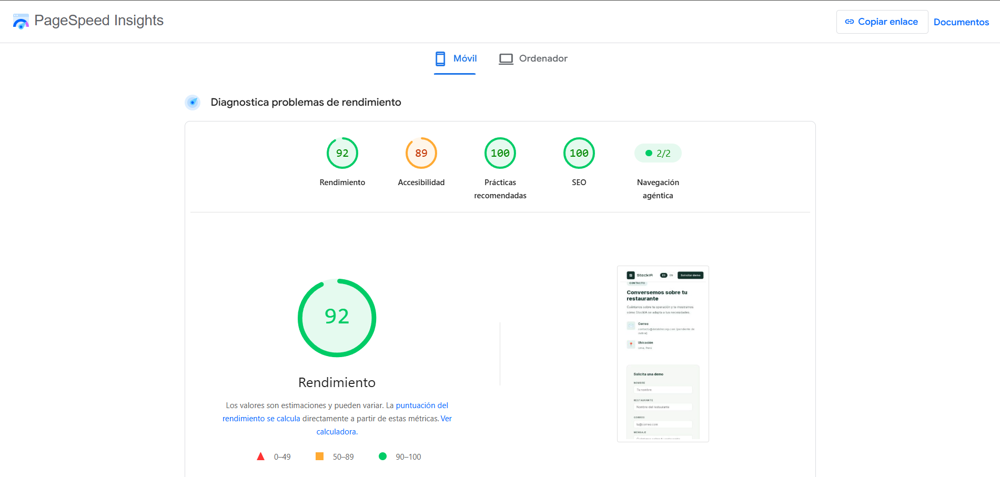
  <br/><i>Reporte de Lighthouse en modo móvil — RNF02, RNF04 y RNF05</i>
</p>

Para finalizar, se muestra el repositorio de la Landing Page en la organización de GitHub:
<p align="center">
  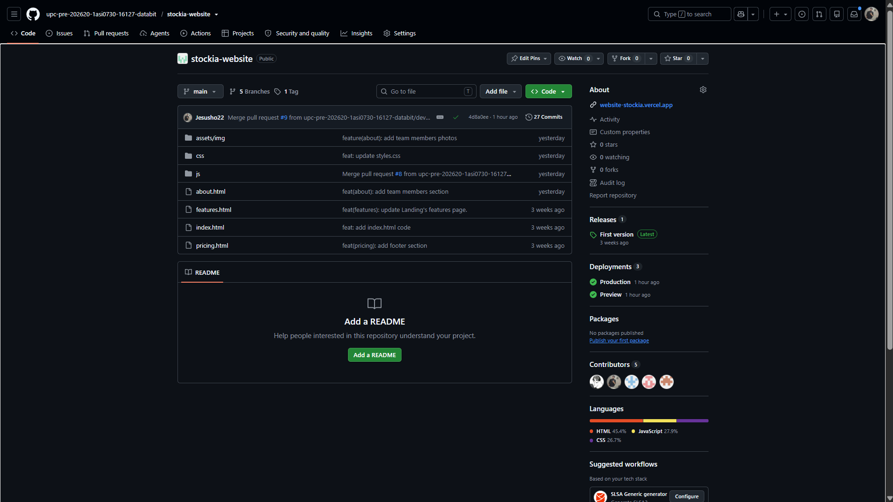
  <br/><i>Repositorio <code>stockia-website</code> en la organización upc-pre-202620-1asi0730-16127-databit</i>
</p>

#### **5.2.1.6. Services Documentation Evidence for Sprint Review**
La Landing Page es un sitio estático y en este Sprint no consume servicios de backend. Las interacciones que sí ejecutan lógica se resuelven en el navegador y se documentan a continuación, junto con la User Story que cubren.

| **Endpoint / Interacción** | **Acción** | **Parámetros** | **Descripción del Response** | **User Story** |
| :--- | :---: | :--- | :--- | :---: |
| `about.html#contactForm` | **POST (simulado)** | `nombre`*, `restaurante`, `correo`*, `mensaje` (`*` obligatorios con `required` y `type="email"`) | El navegador bloquea el envío si falta un campo obligatorio o el correo no es válido. Con datos válidos, `preventDefault()` evita el envío real, el botón cambia a "✓ Enviado" y se deshabilita durante 3 segundos, y luego el formulario se limpia. | US20 |
| Selector de idioma (`ES` / `EN`) | Lectura y escritura en `localStorage` | Clave `stockia-lang` con valor `es` o `en` | Aplica las traducciones a todos los elementos con `data-i18n` sin recargar la página y conserva el idioma al navegar entre páginas. | US13, US14 |
| Interruptor mensual / anual (`pricing.html`) | Cálculo en el cliente | Estado del interruptor | Cambia los precios mensuales a los anuales y viceversa, sin recargar la página. | US16 |
| Preguntas frecuentes (`pricing.html`) | Interacción en el cliente | Pregunta seleccionada | Despliega la respuesta elegida y cierra la que estaba abierta. | US17 |

* **Repositorio de la Landing Page:** https://github.com/upc-pre-202620-1asi0730-16127-databit/stockia-website
* **Landing Page desplegada:** https://website-stockia.vercel.app/

#### **5.2.1.7. Software Deployment Evidence for Sprint Review**
La Landing Page se publicó en **Vercel** como sitio estático, servido desde su CDN global, a partir del repositorio `stockia-website` de la organización.

**Actividades de despliegue realizadas**

1. Se creó el proyecto en Vercel con el preset "Other", al tratarse de un sitio estático sin proceso de build, y se vinculó al repositorio `upc-pre-202620-1asi0730-16127-databit/stockia-website`.
2. Se activó el despliegue automático: cada cambio integrado en la rama de producción se publica sin pasos manuales, y cada Pull Request genera una URL de vista previa.
3. Se verificaron las cuatro páginas (`index.html`, `features.html`, `pricing.html` y `about.html`) en el dominio público, incluidos los enlaces entre páginas y el cambio de idioma.
4. Se verificó la visualización en escritorio y en móvil (RNF01).

* **URL de la Landing Page desplegada:** https://website-stockia.vercel.app/

**Evidencia: proyecto y despliegues en Vercel**
<p align="center">
  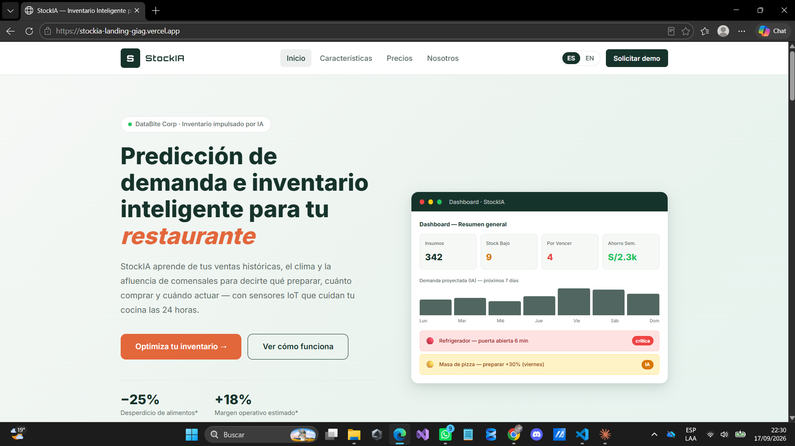
  <br/><i>Proyecto de la Landing Page en Vercel con el historial de despliegues</i>
</p>

**Evidencia: Landing Page desplegada en escritorio**
<p align="center">
  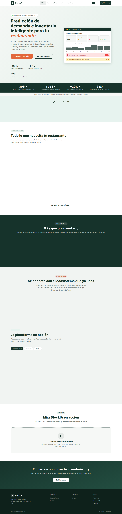
  <br/><i>Landing Page desplegada — website-stockia.vercel.app</i>
</p>

**Evidencia: Landing Page desplegada en móvil**
<p align="center">
  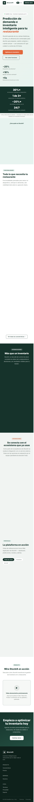
  <br/><i>Landing Page desplegada en móvil (390 px) — website-stockia.vercel.app</i>
</p>

#### **5.2.1.8. Team Collaboration Insights during Sprint**
**Dinámica de trabajo**

Durante el Sprint 1 el equipo trabajó en dos frentes: la Landing Page y la documentación del informe. Las tareas se organizaron en Jira, en el proyecto SCRUM, con un responsable por tarea (ver 5.2.1.3). El código y el informe se versionaron en GitHub siguiendo GitFlow: `main` para versiones entregables, `develop` para integración y una rama `feature/*` por capítulo o página, integrada por Pull Request. La comunicación diaria se mantuvo por WhatsApp y las reuniones de coordinación por Google Meet.

**Aporte por integrante**

| **Integrante** | **GitHub** | **Aporte principal en el Sprint 1** | **Commits en `stockia-report` (al 18/09/2026)** | **Commits en `stockia-website`** |
| :--- | :--- | :--- | :---: | :---: |
| Higa Kohatsu, Alonso Enrique | AlonsoHiga (Alonso-Higa) | Estructura del repositorio, `about.html` (US18, US19, US20) y scripts base (RNF10, US13, US14); capítulos II y IV, conclusiones y bibliografía del informe | 26 | 3 |
| Asmat Alminco, Martin Alejandro | Alemarr2 (Martin) | `features.html` (US11, US12); entrevistas, diagramas de clases, base de datos y componentes del informe | 12 | 1 |
| Huaman Oscco, Aldo Jesus | Jesusho22 (Jesus / Aldo_Jesus) | `pricing.html` (US15, US16, US17) y despliegue en Vercel; capítulos III y V, wireframes y mock-up de la Landing Page en el informe | 25 | 7 |
| Ortiz Laura, Leyla Alisson | Leylaa-O (Leyla Ortiz) | Sistema de diseño (RNF09) e interacciones (RNF07, RNF10); Impact Map, diseño UX/UI de la Web Application y sección 5.1.1 del informe | 16 | 2 |
| Tuesta Girón, Kiara Lucia | kitu05g | `index.html` (US01 a US09); perfil, entrevistas y secciones 5.1.2 a 5.1.4 del informe | 11 | 1 |

**Evidencia: contribuciones por integrante en `stockia-report`**
<p align="center">
  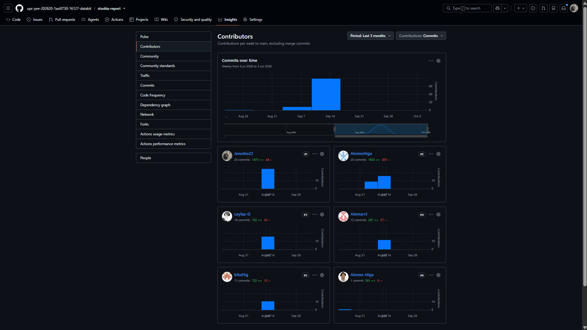
  <br/><i>Contributors del repositorio stockia-report</i>
</p>

**Evidencia: contribuciones por integrante en `stockia-website`**
<p align="center">
  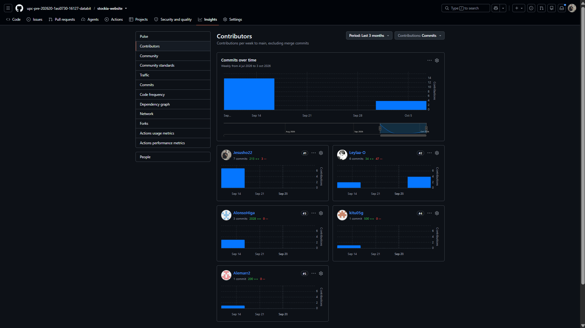
  <br/><i>Contributors del repositorio stockia-website</i>
</p>

**Evidencia: grafo de GitFlow**
<p align="center">
  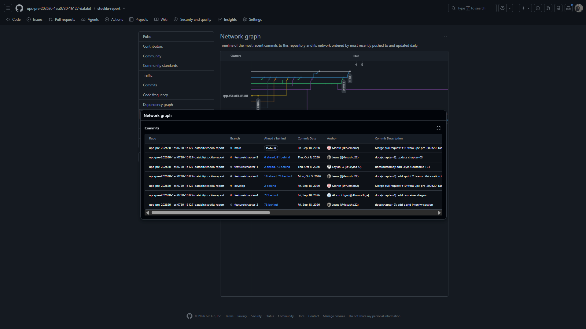
  <br/><i>Network: ramas feature integradas mediante Pull Request</i>
</p>

### **5.2.2. Sprint 2**
 
El Sprint 2 se dedicó a la primera versión de la Frontend Web Application de StockIA, desarrollada en Vue 3 con PrimeVue, Pinia, vue-router y vue-i18n, organizada por Bounded Context y conectada a una API REST simulada y desplegada. Cada integrante implementó su Bounded Context en el repositorio de la organización (`stockia-webapp`) con una rama `feature/*` y su Pull Request. El Sprint incluye además la nueva versión de la Landing Page (TS04). El RESTful API en ASP.NET Core no forma parte de este Sprint y se mantiene en el Product Backlog.
 
#### **5.2.2.1. Sprint Planning 2**
 
| **Sprint #** | Sprint 2 |
| :--- | :--- |
| **Sprint Planning Background** | |
| **Date** | 25/09/2026 |
| **Time** | 10:00 am |
| **Location** | Lima/Lima/Santiago de Surco/UPC (presencial) y Google Meet |
| **Prepared By** | Huaman Oscco, Aldo Jesus (Jesusho22) |
| **Attendees (to planning meeting)** | Higa Kohatsu, Alonso Enrique / Asmat Alminco, Martin Alejandro / Huaman Oscco, Aldo Jesus / Ortiz Laura, Leyla Alisson / Tuesta Girón, Kiara Lucia |
| **Sprint 1 Review Summary** | Se presentó la Landing Page de cuatro páginas, bilingüe y con el formulario de demo simulado, publicada en `main` del repositorio `stockia-website` con la versión `v1.0.0`; se completaron los 88 Story Points comprometidos. Al revisar el incremento se identificaron como pendientes: las fichas del equipo con datos de ejemplo, el botón "Solicitar demo" de la barra de navegación sin destino, el español como idioma inicial (la rúbrica exige inglés por defecto) y la ausencia de enlaces hacia la Web Application. Estos pendientes se planifican en TS04. |
| **Sprint 1 Retrospective Summary** | Funcionó: la división del trabajo por página y la integración por Pull Request en la organización (11 Pull Requests en `stockia-report` y 3 en `stockia-website`). A mejorar: (1) los merges se concentraron el 17 y 18 de setiembre, por lo que se acordó integrar cada contexto a `develop` apenas se termina; (2) usar una rama `feature/*` por Bounded Context con mensajes de commit en Conventional Commits; y (3) estimar por esfuerzo real y registrar la disponibilidad de cada integrante. |
| **Sprint Goal & User Stories** | |
| **Sprint 2 Goal** | **Contexto:** Con la Landing Page publicada, el equipo construye el núcleo del producto: que cada venta descuente insumos por receta y que el administrador vea a tiempo lo que debe reponer.<br><br>**Sprint Goal:**<br>*"Our focus is on delivering the first working version of the StockIA web application, organised by bounded context and connected to a deployed mock REST API. We believe it delivers to restaurant administrators the ability to keep their inventory in sync with every sale, manage their team and act on stock alerts from a single dashboard. This will be confirmed when, in the deployed application, an administrator can register, load ingredients and recipes, record a sale that automatically deducts stock, and see the resulting critical items and alerts on the dashboard."* |
| **Sprint 2 Velocity** | 88 Story Points (completados en el Sprint 1; es la única referencia histórica disponible). |
| **Sum of Story Points** | 90 Story Points comprometidos en 22 ítems (14 US, 4 TS y 4 RNF) |

El compromiso del Sprint 2 (90 SP) se calculó a partir de la velocidad del Sprint 1 ajustada a la nueva disponibilidad: en el Sprint 1 el equipo completó 88 SP con 40 horas declaradas por integrante; para el Sprint 2 cada integrante declaró 45 horas, por lo que la capacidad proyectada es 88 × 45 / 40 ≈ 99 SP. El equipo comprometió 90 SP para dejar margen a la curva de aprendizaje de Vue y PrimeVue. Las 142.5 horas planificadas equivalen al 63 % de la capacidad disponible (225 horas); el margen restante cubre revisiones de Pull Request, ceremonias y la documentación del informe.

#### **5.2.2.2. Aspect Leaders and Collaborators**
 
En esta sección se presenta la **Leadership-and-Collaboration Matrix (LACX)** del Sprint 2. Los aspectos corresponden a los Bounded Contexts definidos en el Capítulo IV, más la arquitectura transversal, la Landing Page y la internacionalización; cada integrante lidera un Bounded Context y lo implementa en sus cuatro capas (domain, infrastructure, application y presentation). El líder (L) responde por la integración y la revisión de ese aspecto, y los colaboradores (C) desarrollan o revisan sus tareas.

| Team Member | GitHub Username | IAM y Restaurant Registration (L/C) | Stock Management & Recipes Management (L/C) | ML and Recommendations (L/C) | Subscription and Payments Management (L/C) | Analytics and Dashboard y Notifications (L/C) | Arquitectura, API simulada y despliegue (L/C) | Landing Page (L/C) | Internacionalización y accesibilidad (L/C) |
| :--- | :--- | :---: | :---: | :---: | :---: | :---: | :---: | :---: | :---: |
| Higa Kohatsu, Alonso Enrique | AlonsoHiga | L | C | C | C | C | C | C | L |
| Asmat Alminco, Martin Alejandro | Alemarr2 | C | L | C | C | C | C | C | C |
| Huaman Oscco, Aldo Jesus | Jesusho22 | C | C | L | C | C | L | C | C |
| Ortiz Laura, Leyla Alisson | Leylaa-O | C | C | C | C | L | C | L | C |
| Tuesta Girón, Kiara Lucia | kitu05g | C | C | C | L | C | C | C | C |

> **Leyenda:** **L:** Líder del aspecto · **C:** Colaborador

#### **5.2.2.3. Sprint Backlog 2**
**Periodo:** 25/09/2026 – 08/10/2026 (2 semanas)  
**Objetivo del Sprint:** Entregar la Frontend Web Application con autenticación, equipo y roles, configuración de la cuenta, inventario, recetas, ventas con descuento automático, historial de ventas, dashboard, alertas, recomendaciones, proyección de demanda y planes, conectada a la API simulada desplegada, y publicar la nueva versión de la Landing Page.

| **User Story Id** | **Título de la Historia** | **Task Id** | **Título de la Tarea** | **Descripción de la Tarea** | **Est. (Hrs)** | **Asignado** | **Status** |
| :--- | :--- | :--- | :--- | :--- | :---: | :--- | :---: |
| **TS01** | Estructurar la Web Application en Vue por Bounded Context | T-TS01-1 | Inicializar el proyecto Vue 3 | Crear el proyecto con Vite, PrimeVue, Pinia, vue-router y vue-i18n y la estructura de carpetas por Bounded Context. | 3 | Higa Kohatsu, Alonso Enrique | Done |
|  |  | T-TS01-2 | Construir el layout de la aplicación | Implementar el layout con menú lateral, barra superior y vistas anidadas bajo /app. | 3 | Higa Kohatsu, Alonso Enrique | Done |
|  |  | T-TS01-3 | Implementar el dominio y la infraestructura compartidos | Crear BaseApi, BaseEndpoint, BusinessRuleError y DecimalQuantity en la carpeta shared. | 3 | Asmat Alminco, Martin Alejandro | Done |
|  |  | T-TS01-4 | Construir los componentes compartidos de presentación | Crear page-header, form-field, quantity-input, password-input, el tema de PrimeVue y los composables de formato. | 3 | Asmat Alminco, Martin Alejandro | Done |
|  |  | T-TS01-5 | Configurar el enrutamiento por contexto | Registrar las rutas diferidas de cada contexto en router.js y su inicialización en main.js. | 2 | Ortiz Laura, Leyla Alisson | Done |
| **TS02** | Implementar y desplegar la API simulada de la Web Application | T-TS02-1 | Configurar json-server para la Web Application | Definir el prefijo /api/v1 en routes.json y el script de arranque de la API simulada. | 1.5 | Higa Kohatsu, Alonso Enrique | Done |
|  |  | T-TS02-2 | Configurar las variables de entorno | Leer la URL base y las rutas de cada recurso desde VITE_STOCKIA_API_URL y VITE_*_ENDPOINT_PATH. | 1.5 | Higa Kohatsu, Alonso Enrique | Done |
|  |  | T-TS02-3 | Modelar las colecciones del dominio | Poblar usuarios, insumos, recetas, ventas, alertas, recomendaciones, proyecciones, planes y suscripciones. | 3 | Huaman Oscco, Aldo Jesus | Done |
|  |  | T-TS02-4 | Desplegar la API simulada en Render | Publicar json-server como servicio web con CORS y verificar cada recurso. | 2 | Huaman Oscco, Aldo Jesus | Done |
| **TS03** | Desplegar la Web Application en Vercel | T-TS03-1 | Configurar el proyecto de Vercel | Importar stockia-webapp de la organización con el preset de Vite y las variables de entorno de producción. | 1.5 | Huaman Oscco, Aldo Jesus | Done |
|  |  | T-TS03-2 | Probar la versión publicada | Verificar inicio de sesión, recarga de rutas internas y redirecciones de los guards en webapp-stockia.vercel.app. | 1 | Tuesta Girón, Kiara Lucia | To-do |
| **TS04** | Publicar la nueva versión de la Landing Page enlazada con la Web Application | T-TS04-1 | Publicar las fichas reales del equipo | Agregar las fotos y los datos de los 5 integrantes en about.html. | 2 | Ortiz Laura, Leyla Alisson | Done |
|  |  | T-TS04-2 | Ajustar estilos y traducciones de la Landing Page | Actualizar styles.css e i18n.js después de la revisión del AV1. | 1.5 | Ortiz Laura, Leyla Alisson | Done |
|  |  | T-TS04-3 | Enlazar los call-to-action con la Web Application | Llevar el CTA de cada segmento a /auth/sign-up y /auth/sign-in y enlazar "Solicitar demo" de la barra a about.html#contacto. | 2 | Tuesta Girón, Kiara Lucia | To-do |
|  |  | T-TS04-4 | Cambiar el idioma por defecto a inglés | Iniciar la Landing Page en inglés cuando el visitante no tiene un idioma guardado. | 0.5 | Tuesta Girón, Kiara Lucia | To-do |
| **US29** | Registrarme como nuevo usuario en StockIA | T-US29-1 | Modelar el usuario y su rol | Crear la entidad User y el enumerador de roles Administrador y Empleado. | 1.5 | Higa Kohatsu, Alonso Enrique | Done |
|  |  | T-US29-2 | Implementar la API y el assembler de IAM | Crear IamApi y UserAssembler para registrar y consultar usuarios. | 2 | Higa Kohatsu, Alonso Enrique | Done |
|  |  | T-US29-3 | Implementar el registro en el store de IAM | Validar el correo duplicado, crear la cuenta con rol Administrador e iniciar la sesión. | 2 | Higa Kohatsu, Alonso Enrique | Done |
|  |  | T-US29-4 | Construir la vista de registro | Crear sign-up con validaciones por campo dentro de auth-layout. | 2.5 | Higa Kohatsu, Alonso Enrique | Done |
| **US30** | Iniciar sesión con mis credenciales | T-US30-1 | Implementar el inicio y el cierre de sesión | Validar credenciales, guardar la sesión y restaurarla al recargar; limpiarla al salir. | 2.5 | Higa Kohatsu, Alonso Enrique | Done |
|  |  | T-US30-2 | Construir la vista de inicio de sesión | Crear sign-in con el mensaje de credenciales incorrectas. | 2.5 | Higa Kohatsu, Alonso Enrique | Done |
| **US40** | Actualizar mi perfil, los datos de mi restaurante y mi contraseña | T-US40-1 | Construir los formularios de la cuenta | Crear profile-form, restaurant-form y change-password-form con sus validaciones. | 3.5 | Higa Kohatsu, Alonso Enrique | Done |
|  |  | T-US40-2 | Construir las vistas de configuración | Crear settings-hub, account-settings y help-center en el contexto settings. | 3 | Higa Kohatsu, Alonso Enrique | Done |
| **US24** | Configurar roles y permisos de los empleados | T-US24-1 | Construir la gestión del equipo | Crear team-roles para invitar integrantes, cambiar su rol y darlos de baja. | 3 | Higa Kohatsu, Alonso Enrique | Done |
|  |  | T-US24-2 | Aplicar las reglas de roles | Impedir la baja de la propia cuenta y mantener al menos un Administrador. | 1.5 | Higa Kohatsu, Alonso Enrique | Done |
| **RNF13** | Control de acceso por sesión y por rol en la Web Application | T-RNF13-1 | Implementar el guard de navegación | Aplicar requiresAuth, adminOnly y guestOnly en router.js con un aviso en cada bloqueo. | 2 | Higa Kohatsu, Alonso Enrique | Done |
| **RNF14** | Internacionalización de la Web Application | T-RNF14-1 | Crear los archivos de traducción | Definir en.json (por defecto) y es.json con los textos de navegación y de cada vista. | 2.5 | Higa Kohatsu, Alonso Enrique | Done |
|  |  | T-RNF14-2 | Construir el selector de idioma | Agregar el language-switcher en la barra superior sin recargar la página. | 1.5 | Higa Kohatsu, Alonso Enrique | Done |
|  |  | T-RNF14-3 | Completar las claves de cada contexto | Agregar las claves de inventario, recetas, alertas y dashboard y los formatos de fecha y moneda. | 2 | Ortiz Laura, Leyla Alisson | Done |
| **US21** | Gestionar el inventario de insumos (alta, baja y modificación) | T-US21-1 | Modelar el insumo y su estado | Crear InventoryItem con el estado Disponible, Stock bajo, Crítico o Vencido. | 2 | Asmat Alminco, Martin Alejandro | Done |
|  |  | T-US21-2 | Implementar la API y los assemblers de inventario | Crear el servicio de API de stock-management y los assemblers de insumo y receta. | 2.5 | Asmat Alminco, Martin Alejandro | Done |
|  |  | T-US21-3 | Implementar el store de inventario | Cargar, guardar y eliminar insumos y calcular los indicadores del inventario. | 2.5 | Asmat Alminco, Martin Alejandro | Done |
|  |  | T-US21-4 | Construir la vista de inventario | Crear inventory-list con alta, edición, eliminación confirmada y stock-status-tag. | 4 | Asmat Alminco, Martin Alejandro | Done |
| **US36** | Calcular automáticamente la fecha límite de consumo de un insumo | T-US36-1 | Calcular la fecha límite de consumo | Calcular la fecha límite a partir de la vida útil al guardar el insumo y marcar los que vencen en 3 días o menos. | 1.5 | Asmat Alminco, Martin Alejandro | Done |
| **US22** | Vincular recetas al inventario con descuento automático de insumos | T-US22-1 | Modelar la receta y la asignación de stock | Crear Recipe y el servicio de dominio stock-allocation que verifica y descuenta los insumos. | 3 | Asmat Alminco, Martin Alejandro | Done |
|  |  | T-US22-2 | Construir la vista de recetas | Crear recipe-list con alta, edición y eliminación de recetas y sus ingredientes. | 4 | Asmat Alminco, Martin Alejandro | Done |
|  |  | T-US22-3 | Registrar la venta con descuento automático | Validar el stock, registrar la venta y descontar los insumos de la receta; listar los faltantes si no alcanzan. | 3 | Asmat Alminco, Martin Alejandro | Done |
| **US39** | Consultar el historial de ventas y anular ventas registradas por error | T-US39-1 | Implementar la API y el store de ventas | Crear la entidad Receipt, su assembler, el servicio de API y el store de receipts-management. | 2.5 | Asmat Alminco, Martin Alejandro | Done |
|  |  | T-US39-2 | Construir el historial de ventas | Crear receipts-history con total por venta e ingresos de las ventas confirmadas. | 2.5 | Asmat Alminco, Martin Alejandro | Done |
|  |  | T-US39-3 | Implementar la anulación de ventas | Confirmar y cambiar la venta a Anulada sin eliminarla del historial. | 1.5 | Asmat Alminco, Martin Alejandro | Done |
| **RNF15** | Retroalimentación de estado y confirmaciones en la Web Application | T-RNF15-1 | Implementar el servicio de notificaciones | Crear la cola de notificaciones de éxito y error usada por las vistas y el enrutador. | 1.5 | Asmat Alminco, Martin Alejandro | Done |
|  |  | T-RNF15-2 | Verificar confirmaciones y estados vacíos | Recorrer cada vista y comprobar confirmaciones, notificaciones y mensajes de lista vacía. | 1.5 | Tuesta Girón, Kiara Lucia | To-do |
| **US27** | Recibir alertas de insumos por stock bajo o vencimiento próximo | T-US27-1 | Modelar la alerta y su assembler | Crear Alert con tipo, severidad, canal y canales entregados, y su assembler. | 2 | Ortiz Laura, Leyla Alisson | Done |
|  |  | T-US27-2 | Implementar la API y el store de alertas | Crear alerts-api y el store que carga, crea, actualiza y elimina alertas. | 2.5 | Ortiz Laura, Leyla Alisson | Done |
|  |  | T-US27-3 | Construir la vista de alertas | Crear alerts-list con alert-severity-tag y el contador de pendientes. | 3 | Ortiz Laura, Leyla Alisson | Done |
| **US41** | Atender las alertas operativas y asegurar su entrega por canal | T-US41-1 | Implementar la regla de canales requeridos | Exigir WhatsApp y correo en alertas críticas y el canal principal en las demás. | 2 | Ortiz Laura, Leyla Alisson | Done |
|  |  | T-US41-2 | Implementar atención y reintento | Marcar la alerta como atendida solo si fue entregada y reintentar el canal pendiente. | 2.5 | Ortiz Laura, Leyla Alisson | Done |
| **US26** | Recibir recomendaciones automáticas de ajuste de menú | T-US26-1 | Modelar la recomendación y su assembler | Crear Recommendation con tipo, mensaje, impacto esperado y estado aplicado. | 1.5 | Ortiz Laura, Leyla Alisson | Done |
|  |  | T-US26-2 | Construir la vista de recomendaciones | Crear recommendations-list con la acción "Aplicar". | 2.5 | Ortiz Laura, Leyla Alisson | Done |
| **US23** | Visualizar un dashboard operativo con alertas y métricas clave | T-US23-1 | Construir los indicadores del dashboard | Mostrar insumos registrados, en estado bajo o crítico, por vencer en 3 días o menos y valor del inventario. | 3 | Ortiz Laura, Leyla Alisson | Done |
|  |  | T-US23-2 | Construir las secciones del dashboard | Mostrar los insumos críticos, las 5 alertas más recientes, la última proyección y los datos del restaurante. | 3 | Ortiz Laura, Leyla Alisson | Done |
| **RNF16** | Accesibilidad y adaptabilidad de la Web Application | T-RNF16-1 | Construir la navegación móvil | Reemplazar el menú lateral por un menú móvil en pantallas pequeñas. | 2 | Higa Kohatsu, Alonso Enrique | Done |
|  |  | T-RNF16-2 | Agregar etiquetas accesibles | Agregar aria-label a los botones de solo ícono y etiquetas a los campos de cada vista. | 2 | Ortiz Laura, Leyla Alisson | Done |
|  |  | T-RNF16-3 | Medir la accesibilidad | Ejecutar Lighthouse en inicio de sesión, dashboard e inventario y corregir hasta alcanzar 90 o más. | 1 | Tuesta Girón, Kiara Lucia | To-do |
| **US25** | Recibir predicción de demanda según históricos y clima | T-US25-1 | Modelar la proyección de demanda | Crear DemandForecast con unidades proyectadas por plato y día. | 1.5 | Huaman Oscco, Aldo Jesus | Done |
|  |  | T-US25-2 | Implementar la API y el assembler de proyecciones | Crear ForecastApi y DemandForecastAssembler. | 2 | Huaman Oscco, Aldo Jesus | Done |
|  |  | T-US25-3 | Implementar el store de proyecciones | Cargar las proyecciones y generar la proyección de 7 días. | 2 | Huaman Oscco, Aldo Jesus | Done |
|  |  | T-US25-4 | Construir el gráfico de demanda | Crear forecast-chart con las unidades proyectadas por día. | 3 | Huaman Oscco, Aldo Jesus | Done |
|  |  | T-US25-5 | Construir la vista de proyección | Crear forecast-dashboard con el nivel de confianza y la condición climática. | 2 | Huaman Oscco, Aldo Jesus | Done |
| **US31** | Pagar o renovar mi suscripción con Stripe o PayPal | T-US31-1 | Modelar el plan y la suscripción | Crear las entidades Plan y Subscription. | 2 | Tuesta Girón, Kiara Lucia | Done |
|  |  | T-US31-2 | Implementar la API y los assemblers de suscripción | Crear subscription-api y los assemblers de plan y suscripción. | 2.5 | Tuesta Girón, Kiara Lucia | Done |
|  |  | T-US31-3 | Implementar el store de suscripción | Cargar los planes y la suscripción actual y elegir o cambiar de plan. | 2 | Tuesta Girón, Kiara Lucia | Done |
|  |  | T-US31-4 | Construir la vista de planes | Crear plans-page y subscription-summary con el pago simulado con Stripe o PayPal. | 4 | Tuesta Girón, Kiara Lucia | Done |
| **TOTAL** | | | | **Esfuerzo total estimado para el Sprint** | **142.5** | | |

**Capacidad del Sprint 2**

| Integrante | Disponibilidad declarada (h) | Horas asignadas | N.° de tareas | Uso de la capacidad |
| :--- | :---: | :---: | :---: | :---: |
| Higa Kohatsu, Alonso Enrique | 45 | 41 | 18 | 91 % |
| Asmat Alminco, Martin Alejandro | 45 | 36.5 | 14 | 81 % |
| Huaman Oscco, Aldo Jesus | 45 | 17 | 8 | 38 % |
| Ortiz Laura, Leyla Alisson | 45 | 31.5 | 14 | 70 % |
| Tuesta Girón, Kiara Lucia | 45 | 16.5 | 9 | 37 % |
| **Total** | **225** | **142.5** | **63** | **63 %** |

<p align="center">
  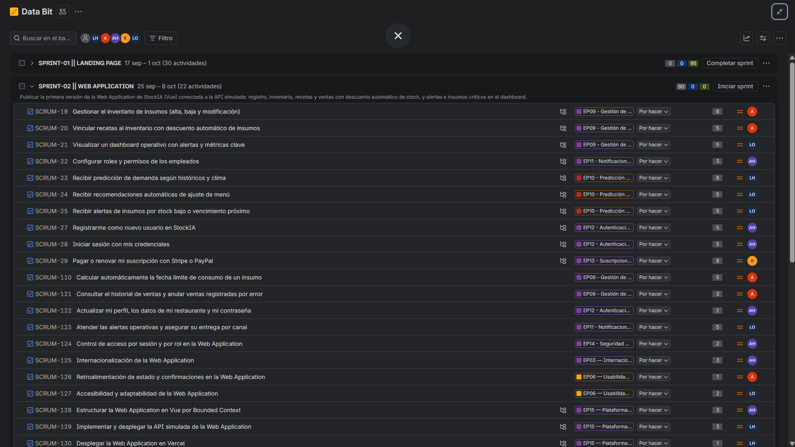
  <br/><i>Artefacto: Jira para Sprint 2 Priorizado</i>
</p>
<p align="center">
  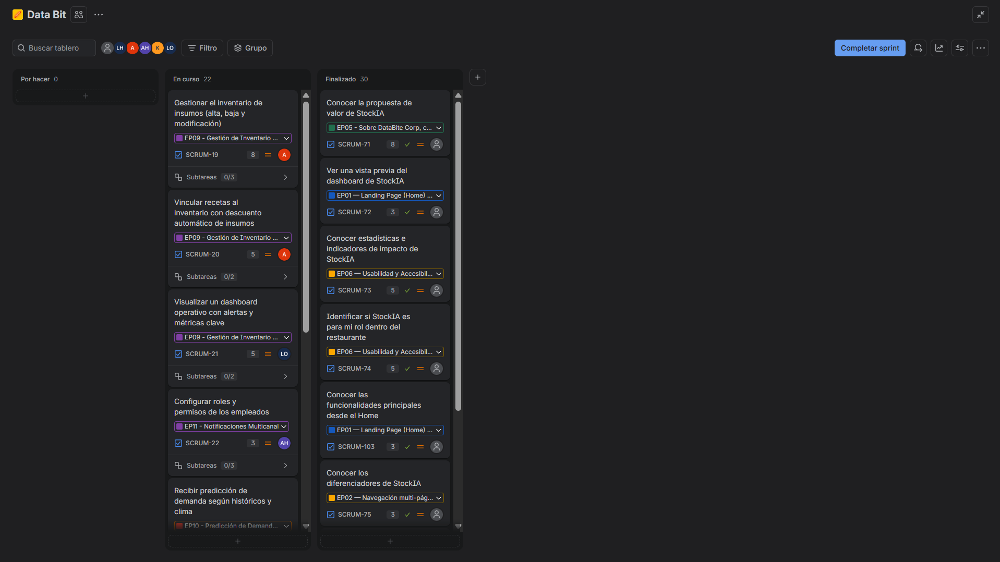
  <br/><i>Artefacto: Jira para demostrar el tablero Kanban del Sprint 2 - Proceso -</i>
</p>
<p align="center">
  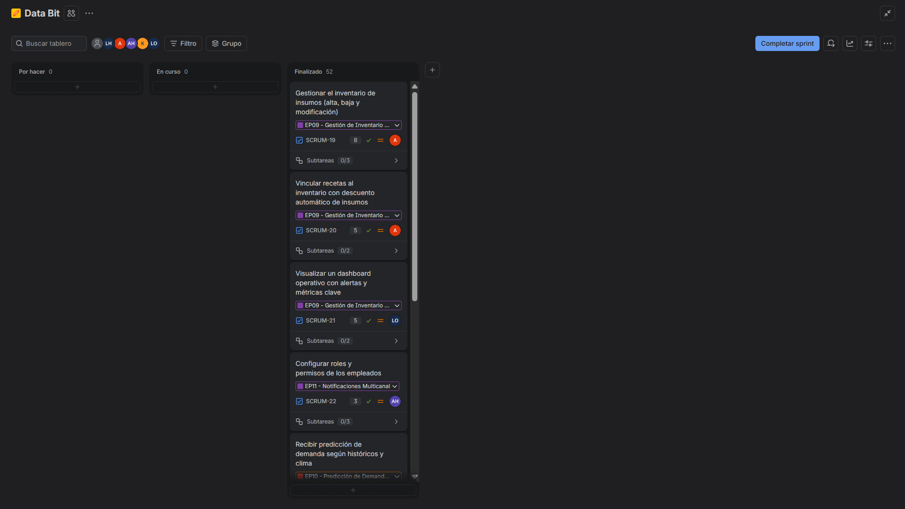
  <br/><i>Artefacto: Jira para demostrar el tablero Kanban del Sprint 2 - Finalizado -</i>
</p>

URL del tablero: https://laplaceho-22.atlassian.net/jira/software/projects/SCRUM/boards/1

##### Resumen Técnico
- **Total de horas:** 142.5 horas en 63 tareas.
- **Distribución:** dos semanas (25/09/2026 – 08/10/2026), con una disponibilidad declarada de 45 horas por integrante; la capacidad libre cubre revisiones de Pull Request, ceremonias y la documentación del informe.
- **Story Points:** 90 comprometidos; 83 completados al 08/10/2026. Quedan en curso TS03 (prueba en producción), TS04 (enlaces e idioma de la Landing Page), RNF15 (verificación por vista) y RNF16 (medición con Lighthouse), que suman 7 SP.
- **Entregable principal:** Frontend Web Application de StockIA en Vue 3 conectada a la API simulada desplegada en Render y publicada en Vercel desde el repositorio de la organización.

#### **5.2.2.4. Development Evidence for Sprint Review**
 
En esta sección se presentan los avances de implementación del Sprint 2 (Web Application y nueva versión de la Landing Page) mediante los commits que los respaldan, relacionados con el ítem del Sprint Backlog 2 que implementan.

**Distribución del código por Bounded Context**

Cada integrante implementó y subió al repositorio de la organización su Bounded Context completo, en sus cuatro capas, mediante su rama `feature/*` y su Pull Request:

| **Bounded Context (Cap. IV)** | **Responsable** | **Carpetas en la Web Application** | **Rama y Pull Request** | **Ítems del Sprint Backlog 2** |
| :--- | :--- | :--- | :--- | :--- |
| IAM y Restaurant Registration | Higa Kohatsu, Alonso Enrique | `iam`, `settings` | `feature/iam` (PR #4 y #9) | US29, US30, US40, US24, RNF13 |
| Stock Management & Recipes Management | Asmat Alminco, Martin Alejandro | `stock-management`, `receipts-management` | `feature/recipes-management` (PR #5) y `feature/stock-management` (PR #7) | US21, US36, US22, US39 |
| ML and Recommendations | Huaman Oscco, Aldo Jesus | `demand-forecasting` | `feature/demand-forecasting` (PR #6) | US25 |
| Notifications and Messaging (alertas y recomendaciones) | Ortiz Laura, Leyla Alisson | `alerts` | `feature/alerts` (PR #1 y #2) | US27, US41, US26 |
| Analytics and Dashboard | Ortiz Laura, Leyla Alisson | `dashboard` | `feature/dashboard` (PR #8) | US23 |
| Subscription and Payments Management | Tuesta Girón, Kiara Lucia | `subscription` | `feature/subscription` (PR #3) | US31 |
| Arquitectura transversal | Higa Kohatsu, Alonso Enrique / Asmat Alminco, Martin Alejandro / Ortiz Laura, Leyla Alisson | `shared`, `router.js`, `main.js`, `i18n.js`, `locales`, `server` | `develop` y `feature/main-config` (PR #10) | TS01, TS02, RNF14, RNF15, RNF16 |
| Despliegue | Huaman Oscco, Aldo Jesus | API simulada en Render y proyecto de Vercel | — | TS02, TS03 |
| Landing Page | Ortiz Laura, Leyla Alisson | repositorio `stockia-website` | `feature/about` (PR #6 y #7) y `feature/styles` (PR #8) | TS04 |

**Repositorio de la Web Application (`stockia-webapp`)**

| **Repository** | **Branch** | **Commit Id** | **Commit Message** | **Commit Message Body** | **Committed on (Date)** |
| :--- | :--- | :--- | :--- | :--- | :---: |
| stockia-webapp | main | `c6b77aa` | chore: initialize project structure | TS01: proyecto Vue 3 con Vite, PrimeVue, Pinia, vue-router, vue-i18n y la configuración de json-server (AlonsoHiga). | 28/09/2026 |
| stockia-webapp | develop | `54b5fba` | feat(develop): add json files for i18n | RNF14: archivos de traducción en inglés y español (AlonsoHiga). | 29/09/2026 |
| stockia-webapp | develop | `aa6d654` | feat(develop): add sidebar and topbar components | TS01: menú lateral y barra superior (AlonsoHiga). | 29/09/2026 |
| stockia-webapp | feature/alerts | `31551c1` | feat(alerts): add alert entity | US27 y US41: entidad `Alert` con severidad, canal y canales entregados (Leylaa-O). | 08/10/2026 |
| stockia-webapp | feature/alerts | `6c38994` | feat(alerts): add recommendation entity | US26: entidad `Recommendation` (Leylaa-O). | 08/10/2026 |
| stockia-webapp | feature/alerts | `dbb01aa` | feat(alert): add alerts store | US27 y US41: store de alertas (Leylaa-O). | 08/10/2026 |
| stockia-webapp | feature/subscription | `c7ea7e3` | feat(subscription): add plan domain entity | US31: entidad `Plan` (kitu05g). | 08/10/2026 |
| stockia-webapp | develop | `1e6998c` | Merge pull request #3 from feature/subscription | Integración revisada del contexto de suscripción en `develop` (Kiara Tuesta). | 08/10/2026 |
| stockia-webapp | feature/iam | `dd0fca1` | feat(iam): add user entity and role | US29 y US24: entidad `User` y roles Administrador y Empleado (AlonsoHiga). | 08/10/2026 |
| stockia-webapp | feature/recipes-management | `ba1ab46` | refactor(shared-domain): update business rule errors and decimal quantity value object | TS01: errores de regla de negocio y value object de cantidades (Alemarr2). | 08/10/2026 |
| stockia-webapp | feature/recipes-management | `128a0b2` | feat(receipts): initialize receipts-management bounded context | US22 y US39: contexto de ventas con su entidad, API y store (Alemarr2). | 08/10/2026 |
| stockia-webapp | feature/demand-forecasting | `b850fb0` | feat(demand-forecasting): add ForecastApi for the demand forecasts endpoint | US25: servicio de API de proyecciones (Jesus). | 08/10/2026 |
| stockia-webapp | feature/stock-management | `469be92` | feat(stock-domain): define inventory item and recipe entities with stock allocation service | US21, US36 y US22: entidades `InventoryItem` y `Recipe` y servicio de asignación de stock (Alemarr2). | 08/10/2026 |
| stockia-webapp | feature/stock-management | `d7ecf31` | feat(stock-application): implement inventory store for state management | US21: store de inventario y recetas (Alemarr2). | 08/10/2026 |
| stockia-webapp | feature/stock-management | `085cb49` | feat(stock-infra): add inventory api client and entity assemblers | US21 y US22: servicio de API y assemblers (Alemarr2). | 08/10/2026 |
| stockia-webapp | feature/stock-management | `80664e7` | feat(stock-presentation): implement inventory and recipe list views with status tag component | US21, US22 y US36: vistas de inventario y recetas con el estado de stock (Alemarr2). | 08/10/2026 |
| stockia-webapp | feature/stock-management | `b90bda6` | feat(receipts,i18n): update receipts store and add localization keys for stock management | US39 y RNF14: historial de ventas y claves de traducción (Alemarr2). | 08/10/2026 |
| stockia-webapp | feature/dashboard | `e0fa6ef` | feat(dashboard): add dashboard component | US23: dashboard con indicadores, insumos críticos, alertas recientes y última proyección (Leylaa-O). | 08/10/2026 |
| stockia-webapp | develop | `05b7726` | Merge pull request #8 from feature/dashboard | Integración revisada del dashboard en `develop` (Leyla Ortiz). | 08/10/2026 |
| stockia-webapp | feature/iam | `d404407` | feat(iam): add settings | US40: configuración de la cuenta, del restaurante y de la contraseña (AlonsoHiga). | 08/10/2026 |
| stockia-webapp | feature/main-config | `51d54bd` | feat(router): update router.js | TS01 y RNF13: rutas de todos los contextos y guard de sesión y rol (Leylaa-O). | 08/10/2026 |
| stockia-webapp | feature/main-config | `e75abed` | feat(i18n): update i18n and its locals files | RNF14: inglés por defecto y formatos de fecha y moneda (Leylaa-O). | 08/10/2026 |
| stockia-webapp | develop | `1cf756f` | Merge pull request #10 from feature/main-config | Integración revisada de la configuración principal en `develop` (Leyla Ortiz). | 08/10/2026 |

**Repositorio de la Landing Page (`stockia-website`) — TS04**

| **Repository** | **Branch** | **Commit Id** | **Commit Message** | **Commit Message Body** | **Committed on (Date)** |
| :--- | :--- | :--- | :--- | :--- | :---: |
| stockia-website | feature/about | `3e670bd` | feature(about): add team members photos | TS04: fotos de los cinco integrantes (Leylaa-O). | 07/10/2026 |
| stockia-website | feature/about | `61b1af1` | feat(about): add team members section | TS04: fichas reales del equipo en `about.html` (Leylaa-O). | 07/10/2026 |
| stockia-website | feature/styles | `7019704` | feat: update styles.css | TS04: ajustes de estilos de la Landing Page (Leylaa-O). | 07/10/2026 |
| stockia-website | feature/styles | `6ddfed8` | feat: update i18n.js | TS04: actualización de traducciones (Leylaa-O). | 07/10/2026 |
| stockia-website | develop | `1566c60` | Merge pull request #8 from feature/styles | Integración revisada de estilos y traducciones en `develop` (Leyla Ortiz). | 07/10/2026 |
| stockia-website | main | `4d8a0ee` | Merge pull request #9 from develop | Publicación de la nueva versión de la Landing Page en `main` (Aldo_Jesus). | 08/10/2026 |

**Repositorio del informe (`stockia-report`)**

| **Repository** | **Branch** | **Commit Id** | **Commit Message** | **Commit Message Body** | **Committed on (Date)** |
| :--- | :--- | :--- | :--- | :--- | :---: |
| stockia-report | feature/chapter-1 | `c494586` | docs(logs): add TB1 log section | Registro de versiones del TB1 (Leylaa-O). | 08/10/2026 |
| stockia-report | feature/chapter-1 | `d602f34` | docs(outcome): add Leyla's outcome TB1 | Student Outcome del TB1 (Leylaa-O). | 08/10/2026 |
| stockia-report | feature/chapter-3 | `a3f91c2` | revert(chapter-3): restore AV1 user stories and product backlog | Restauración de las User Stories US01–US38 y RNF01–RNF12 del AV1 (Jesusho22). | 08/10/2026 |
| stockia-report | feature/chapter-3 | `5be07d4` | docs(chapter-3): add sprint 2 user stories, technical stories and backlog | US39–US41, RNF13–RNF16, TS01–TS04 y Product Backlog ordenado por Story Points (Jesusho22). | 08/10/2026 |
| stockia-report | feature/chapter-5 | `e8c2a6f` | docs(chapter-5): add sprint 2 and align sprint 1 for TB1 | Sprint Planning, Sprint Backlog, evidencias y Team Collaboration del Sprint 2 (Jesusho22). | 08/10/2026 |

#### **5.2.2.5. Execution Evidence for Sprint Review**

En el Sprint 2 se implementó la primera versión de la Web Application de StockIA. Las capturas corresponden a la versión desplegada en [webapp-stockia.vercel.app](https://webapp-stockia.vercel.app/) (TS03), que consume la API simulada en Render (TS02). A continuación se presenta cada vista junto con la User Story o el requisito que la respalda:

1. **Registro (US29):** creación de la cuenta del restaurante con validaciones por campo y rechazo de correos duplicados; la cuenta se crea con el rol Administrador.
<p align="center">
  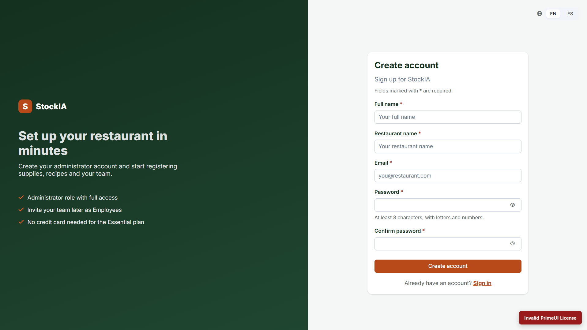
  <br/><i>Registro — US29</i>
</p>

2. **Inicio de sesión (US30, RNF13):** inicio de sesión con mensaje de credenciales incorrectas y redirección a `/auth/sign-in` al abrir una ruta interna sin sesión.
<p align="center">
  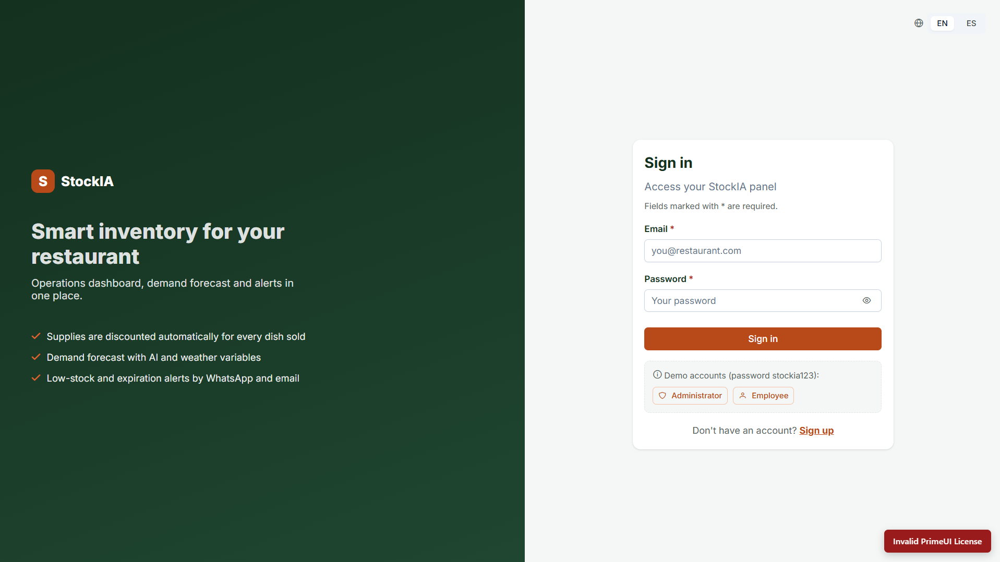
  <br/><i>Inicio de sesión — US30 y RNF13</i>
</p>

3. **Dashboard operativo (US23):** insumos registrados, en estado bajo o crítico y por vencer en 3 días o menos, valor del inventario, insumos críticos, las 5 alertas más recientes y la última proyección.
<p align="center">
  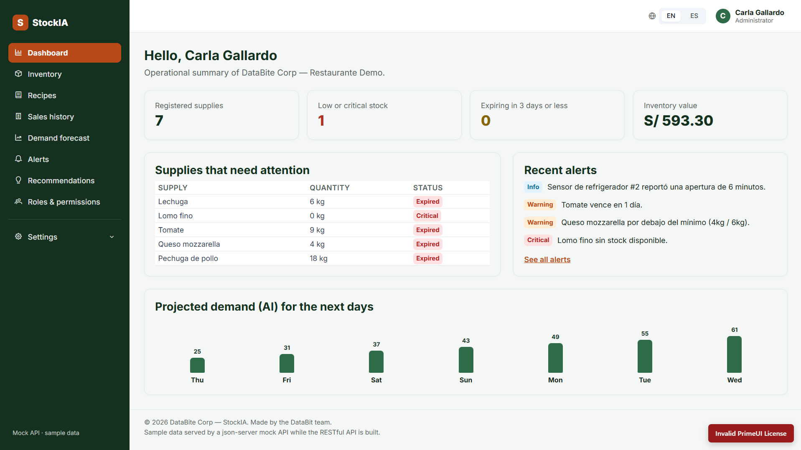
  <br/><i>Dashboard operativo — US23</i>
</p>

4. **Inventario de insumos (US21, US36):** alta, edición y eliminación confirmada de insumos, con su fecha límite de consumo y su estado Disponible, Stock bajo, Crítico o Vencido.
<p align="center">
  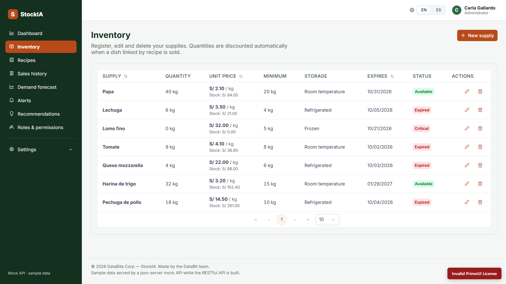
  <br/><i>Inventario de insumos — US21 y US36</i>
</p>

5. **Recetas y venta con descuento automático (US22):** recetas vinculadas a los insumos y registro de la venta de un plato que valida y descuenta el stock.
<p align="center">
  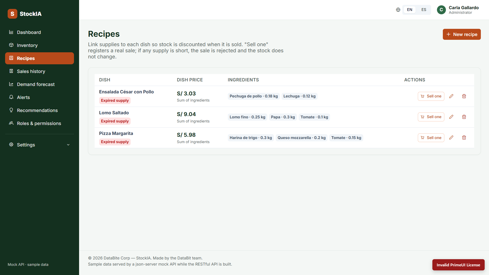
  <br/><i>Recetas y venta con descuento automático — US22</i>
</p>

6. **Historial de ventas (US39):** ventas con total en S/, estado e ingresos del período, con anulación confirmada.
<p align="center">
  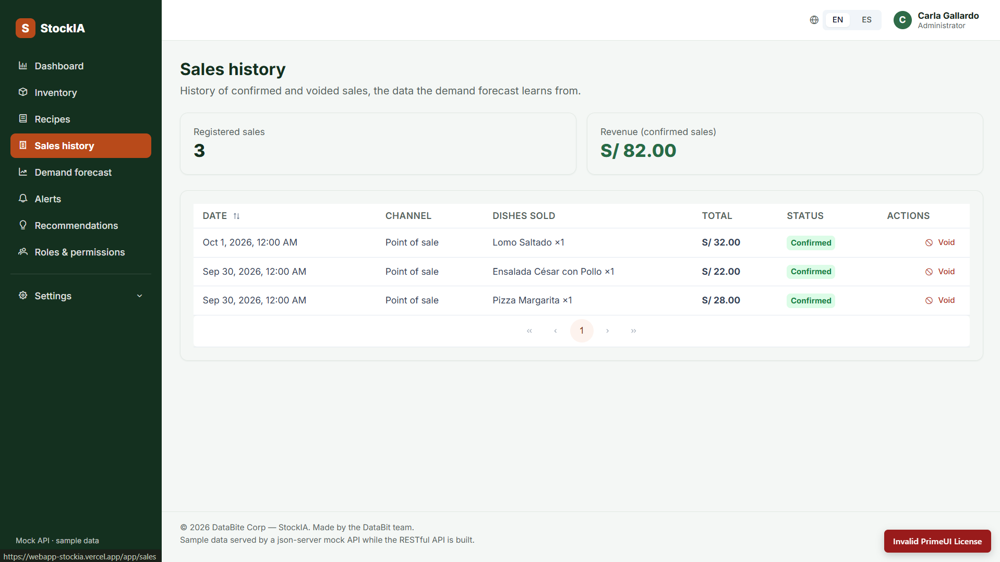
  <br/><i>Historial de ventas — US39</i>
</p>

7. **Alertas operativas (US27, US41):** alertas por severidad, contador de pendientes, entrega por canal, reintento del canal pendiente y atención.
<p align="center">
  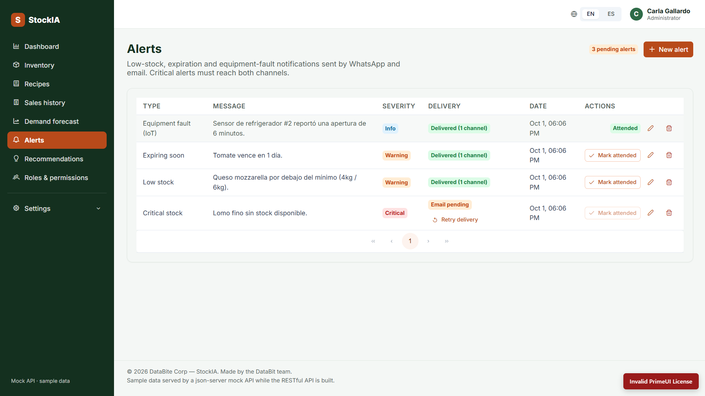
  <br/><i>Alertas operativas — US27 y US41</i>
</p>

8. **Recomendaciones (US26):** recomendaciones de compra y de menú con su impacto esperado y la acción "Aplicar".
<p align="center">
  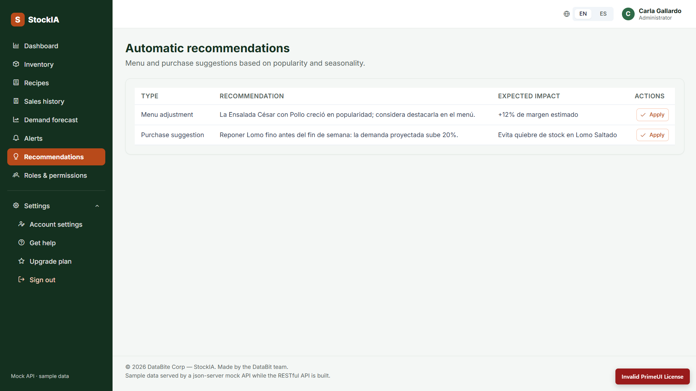
  <br/><i>Recomendaciones — US26</i>
</p>

9. **Proyección de demanda (US25):** proyección de 7 días por plato con su nivel de confianza y la condición climática.
<p align="center">
  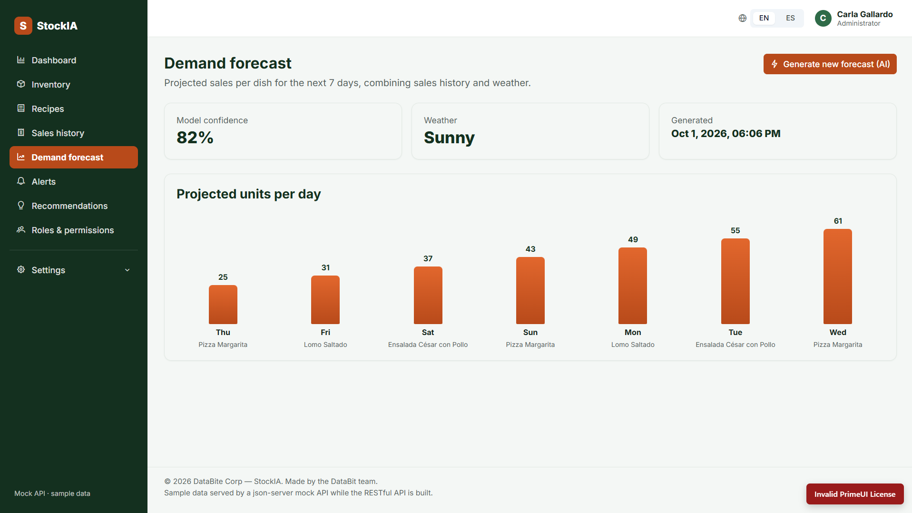
  <br/><i>Proyección de demanda — US25</i>
</p>

10. **Equipo y roles (US24, RNF13):** invitación de integrantes, cambio de rol y baja, con la regla del último administrador; vista disponible solo para el rol Administrador.
<p align="center">
  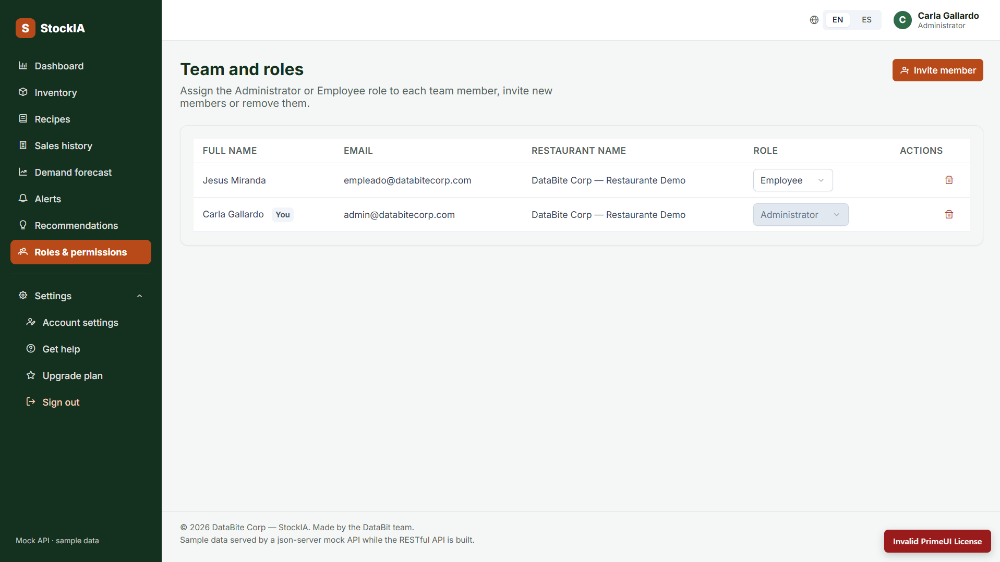
  <br/><i>Equipo y roles — US24 y RNF13</i>
</p>

11. **Configuración de la cuenta (US40):** datos personales, datos del restaurante y cambio de contraseña.
<p align="center">
  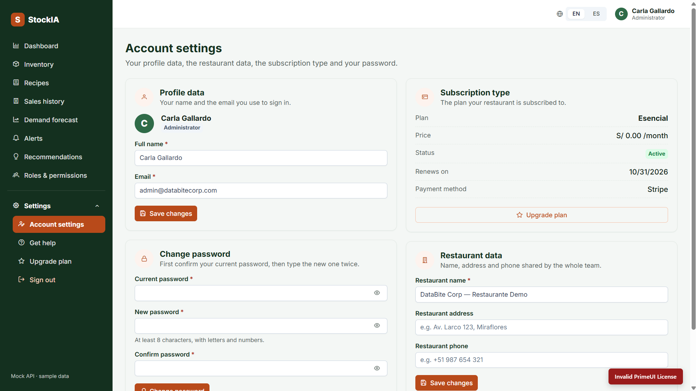
  <br/><i>Configuración de la cuenta — US40</i>
</p>

12. **Planes de suscripción (US31):** planes con su precio, plan actual y pago simulado con Stripe o PayPal.
<p align="center">
  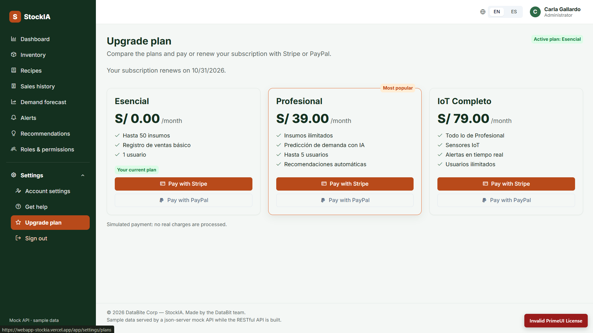
  <br/><i>Planes de suscripción — US31</i>
</p>

13. **Web Application en español y en móvil (RNF14, RNF16):** la misma vista con el idioma cambiado a español y en una pantalla de 390 px.
<p align="center">
  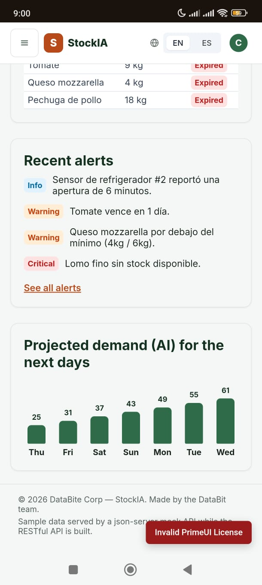
  <br/><i>Idioma y vista móvil — RNF14 y RNF16</i>
</p>

14. **Nueva versión de la Landing Page (TS04):** sección del equipo con las fichas reales de los cinco integrantes.
<p align="center">
  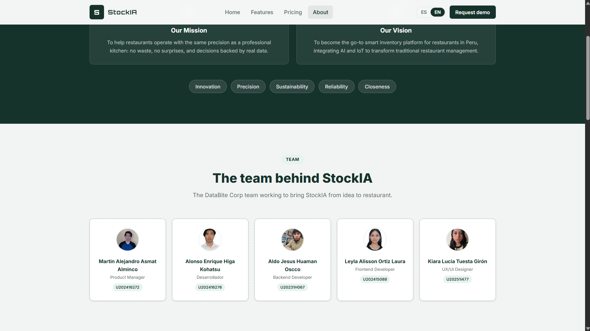
  <br/><i>Nueva versión de la Landing Page — TS04</i>
</p>

**Alcance implementado por escenario**

La Web Application consume una API simulada, por lo que los escenarios que dependen del RESTful API, del modelo de Machine Learning o de servicios externos quedan para los Sprints siguientes:

| **Ítem** | **Escenarios implementados en el Sprint 2** | **Escenarios que dependen del backend** |
| :--- | :--- | :--- |
| US25 | Visualización de la proyección de 7 días con confianza y clima (valores simulados) | Escenarios 1 a 3: cálculo a partir de históricos, feriados y aprendizaje del modelo (US37 y US38) |
| US26 | Lista de recomendaciones y acción "Aplicar" | Escenario 3: logro de gamificación |
| US24 | Escenarios 1 y 2: roles Empleado y Administrador | Escenario 3: rol especializado |
| US30 | Escenarios 1 y 2: inicio de sesión exitoso y con error | Escenario 3: recuperación de contraseña por correo |
| US31 | Escenario 1: elección del plan con pago simulado | Escenarios 2 y 3: renovación y error de transacción con la pasarela real |

**Verificación de los requisitos no funcionales**

| **RNF** | **Criterio medible** | **Verificación** | **Resultado** |
| :--- | :--- | :--- | :--- |
| RNF13 | 100 % de las rutas bajo `/app` con sesión requerida; vistas de equipo, recomendaciones y planes solo para el rol Administrador | Revisión de `router.js` y prueba de cada ruta sin sesión y con rol Empleado | El guard aplica `requiresAuth`, `adminOnly` y `guestOnly` y muestra un aviso en cada bloqueo. |
| RNF14 | 100 % de los textos en inglés al primer ingreso y cambio a español sin recargar | Recorrido de las vistas en ambos idiomas | `DEFAULT_LOCALE` es `en`; los textos viven en `en.json` y `es.json`. |
| RNF15 | 100 % de las eliminaciones y anulaciones con confirmación | Lista de verificación por vista | Inventario, recetas, alertas, equipo e historial de ventas piden confirmación. <!-- ACTUALIZAR: resultado de T-RNF15-2. --> |
| RNF16 | Botones de solo ícono con `aria-label`; sin desborde a 390 px; Lighthouse Accessibility ≥ 90 |


#### **5.2.2.6. Services Documentation Evidence for Sprint Review**
 
En el Sprint 2 la Web Application consume una API REST simulada con **json-server**, desplegada en Render bajo el prefijo `/api/v1`. Cada recurso expone las operaciones REST estándar (`GET`, `POST`, `PUT` y `DELETE`) y acepta los filtros de json-server (`?campo=valor`, `?_sort=campo&_order=asc`). La Web Application accede a ellos desde la capa `infrastructure` de cada Bounded Context mediante `BaseApi` y `BaseEndpoint`; la URL base se define en `VITE_STOCKIA_API_URL` y la ruta de cada recurso en su variable `VITE_*_ENDPOINT_PATH`, por lo que al reemplazar la API simulada por el RESTful API no cambia ningún componente de presentación.

| **Endpoint** | **Acción (HTTP)** | **Parámetros** | **Descripción del Response** | **User Story** |
| :--- | :---: | :--- | :--- | :---: |
| `/api/v1/users?email={email}` | GET | `email` | `200 OK` con los usuarios que coinciden; se usa para validar el correo duplicado y el inicio de sesión. | US29, US30, US40 |
| `/api/v1/users` | POST | `fullName`, `restaurantName`, `email`, `password`, `role` | `201 Created` con el usuario creado al registrar el restaurante o invitar a un integrante. | US29, US24 |
| `/api/v1/users/{id}` | PUT / DELETE | `id` y datos del usuario | `200 OK` con el perfil, el restaurante, la contraseña o el rol actualizados, o con la baja del integrante. | US40, US24 |
| `/api/v1/inventoryItems` y `/api/v1/inventoryItems/{id}` | GET / POST / PUT / DELETE | `name`, `unit`, `quantity`, `minThreshold`, `storageType`, `shelfLifeDays`, `expirationDate`, `unitCost` | `200 OK` o `201 Created` con el insumo; el `PUT` también registra el descuento por venta. | US21, US36, US22 |
| `/api/v1/recipes` y `/api/v1/recipes/{id}` | GET / POST / PUT / DELETE | `dishName` e ingredientes (`inventoryItemId`, `quantityRequired`, `unit`) | `200 OK` o `201 Created` con la receta y sus ingredientes. | US22 |
| `/api/v1/sales` y `/api/v1/sales/{id}` | GET / POST / PUT | `saleDate`, `channel`, `status`, `lineItems` | `201 Created` con la venta confirmada; el `PUT` con `status: "VOIDED"` la anula. | US22, US39 |
| `/api/v1/alerts` y `/api/v1/alerts/{id}` | GET / POST / PUT / DELETE | `type`, `severity`, `message`, `channel`, `acknowledged`, `deliveredChannels` | `200 OK` o `201 Created` con la alerta registrada, atendida o con su entrega actualizada. | US27, US41 |
| `/api/v1/recommendations/{id}` | GET / PUT | `applied: true` | `200 OK` con la recomendación aplicada. | US26 |
| `/api/v1/demandForecasts` | GET / POST | `generatedAt`, `confidenceScore`, `weatherCondition`, `dataPoints` | `201 Created` con la proyección de 7 días. | US25 |
| `/api/v1/plans` | GET | — | `200 OK` con los planes, su precio y sus características. | US31 |
| `/api/v1/subscriptions` y `/api/v1/subscriptions/{id}` | GET / POST / PUT | `planId`, `paymentMethod`, `status`, `renewalDate` | `201 Created` o `200 OK` con la suscripción activada o cambiada. | US31 |

**Ejemplo de interacción — consulta de insumos (US21)**

Request:

```http
GET https://stockia-mock-api.onrender.com/api/v1/inventoryItems?_limit=1
```

Response `200 OK`:

```json
[
  {
    "id": 1,
    "name": "Pechuga de pollo",
    "unit": "kg",
    "quantity": 18,
    "minThreshold": 10,
    "storageType": "REFRIGERATED",
    "shelfLifeDays": 4,
    "expirationDate": "2026-10-04",
    "unitCost": 14.5
  }
]
```

* **Repositorio de la Web Application (configuración de json-server en `src/server`):** https://github.com/upc-pre-202620-1asi0730-16127-databit/stockia-webapp
* **URL de la API simulada desplegada:** https://stockia-mock-api.onrender.com/api/v1

<p align="center">
  
  <br/><i>Respuesta de la API simulada desplegada en Render — TS02</i>
</p>

#### **5.2.2.7. Software Deployment Evidence for Sprint Review**
 
En el Sprint 2 se desplegaron dos componentes: la API simulada en **Render** (TS02) y la Web Application en **Vercel** (TS03), además de la nueva versión de la Landing Page (TS04).

**Actividades de despliegue realizadas**

1. Se publicó la API simulada en Render como servicio web con json-server, CORS habilitado y el prefijo `/api/v1`.
2. Se definieron en los archivos de entorno la URL base de la API (`VITE_STOCKIA_API_URL`) y la ruta de cada recurso (`VITE_*_ENDPOINT_PATH`).
3. Se importó el repositorio `upc-pre-202620-1asi0730-16127-databit/stockia-webapp` en Vercel con el preset de Vite (`npm run build` y carpeta de salida `dist`) y las variables de entorno de producción.
4. Se publicó la nueva versión de la Landing Page desde `main` del repositorio `stockia-website` (PR #9).

* **URL de la API simulada:** https://stockia-mock-api.onrender.com/api/v1
* **URL de la Web Application desplegada:** https://webapp-stockia.vercel.app/
* **URL de la Landing Page desplegada:** https://website-stockia.vercel.app/

**Evidencia: API simulada en Render**
<p align="center">
  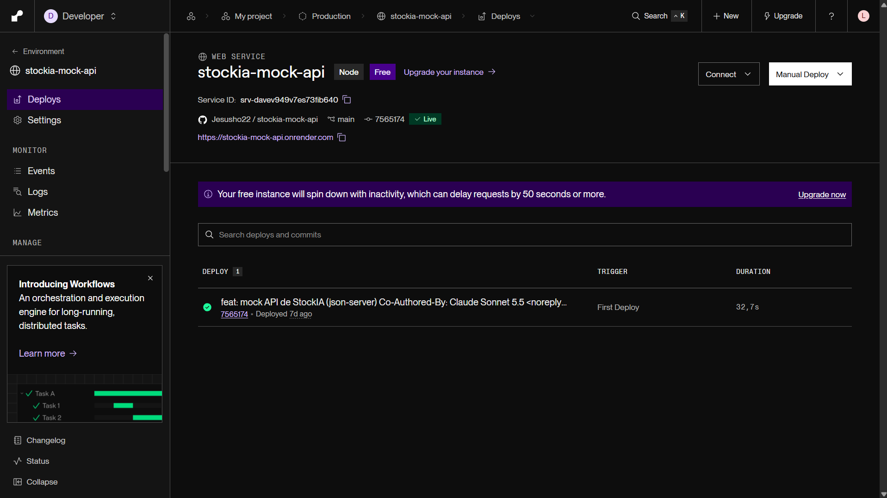
  <br/><i>Servicio de la API simulada desplegado en Render</i>
</p>

**Evidencia: Web Application en Vercel**
<p align="center">
  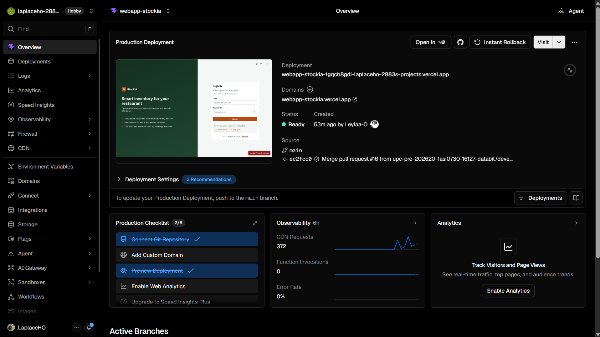
  <br/><i>Proyecto de la Web Application en Vercel con el historial de despliegues</i>
</p>
<p align="center">
  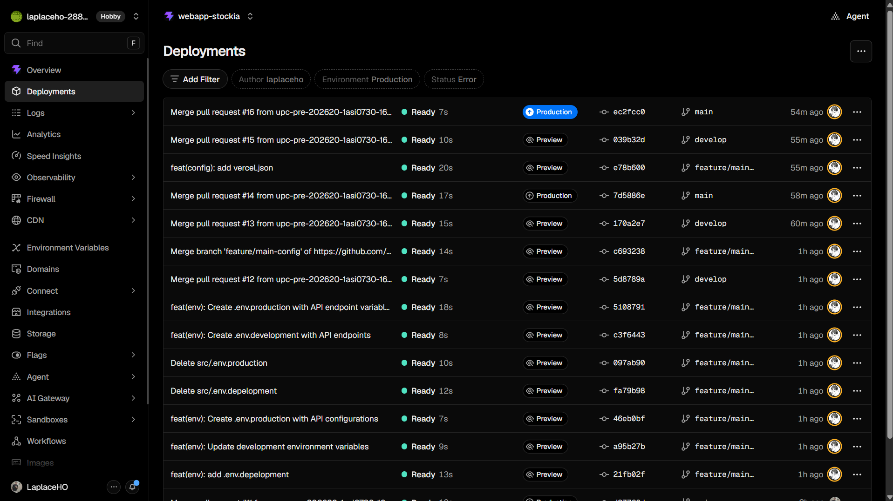
  <br/><i>Web Application desplegada — webapp-stockia.vercel.app</i>
</p>

#### **5.2.2.8. Team Collaboration Insights during Sprint**
 
**Dinámica de trabajo**

En el Sprint 2 el equipo trabajó por Bounded Context: cada integrante implementó un contexto del Capítulo IV en sus cuatro capas (domain, infrastructure, application y presentation) y lo integró en la Web Application mediante su rama `feature/*` y su Pull Request hacia `develop` (ver 5.2.2.2 y la tabla de distribución de 5.2.2.4). Alonso preparó la estructura base, el layout y la internacionalización desde el inicio del Sprint, y los demás contextos se integraron sobre esa base mediante 10 Pull Requests. Las tareas se gestionaron en Jira, en el proyecto SCRUM. La comunicación diaria se mantuvo por WhatsApp y las reuniones de sincronización por Google Meet.

**Aporte por integrante**

| **Integrante** | **GitHub** | **Aporte principal en el Sprint 2** | **Horas asignadas** | **Commits en `stockia-webapp`** |
| :--- | :--- | :--- | :---: | :---: |
| Higa Kohatsu, Alonso Enrique | AlonsoHiga | Estructura del proyecto, layout y navegación móvil (TS01, RNF16), internacionalización (RNF14), IAM, equipo y configuración de la cuenta (US29, US30, US24, US40) y guard de navegación (RNF13) | 41 | 16 |
| Asmat Alminco, Martin Alejandro | Alemarr2 | Stock Management & Recipes Management: inventario, fecha límite, recetas, venta con descuento e historial de ventas (US21, US36, US22, US39); dominio y componentes compartidos (TS01) y notificaciones (RNF15) | 36.5 | 11 |
| Huaman Oscco, Aldo Jesus | Jesusho22 | ML and Recommendations: proyección de demanda (US25); API simulada en Render (TS02) y despliegue en Vercel (TS03) | 17 | 6 |
| Ortiz Laura, Leyla Alisson | Leylaa-O | Notifications and Messaging y Analytics and Dashboard: alertas, entrega por canal, recomendaciones y dashboard (US27, US41, US26, US23); enrutamiento (TS01), claves de traducción (RNF14), etiquetas accesibles (RNF16) y nueva versión de la Landing Page (TS04) | 31.5 | 22 |
| Tuesta Girón, Kiara Lucia | kitu05g | Subscription and Payments Management: planes y pago simulado (US31); pruebas en producción y verificación de RNF15 y RNF16 | 16.5 | 7 |

**Evidencia: tablero del Sprint 2 en Jira**
<p align="center">
  
  <br/><i>Tablero del Sprint 2 en Jira (SCRUM)</i>
</p>

**Evidencia: contribuciones por integrante en `stockia-webapp`**
<p align="center">
  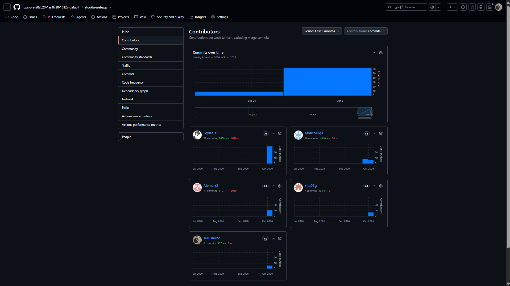
  <br/><i>Insights → Contributors del repositorio stockia-webapp</i>
</p>

**Evidencia: grafo de GitFlow**
<p align="center">
  
  <br/><i>Insights → Network: ramas feature integradas mediante Pull Request</i>
</p>

### **5.2.3. Sprint 3**

El Sprint 3 se dedicó a construir el RESTful API de StockIA (Web Services) en **ASP.NET Core (.NET 10)**, organizado en los ocho Bounded Contexts del Capítulo IV como un monolito modular con DDD (`Domain`, `Application`, `Infrastructure` e `Interfaces`), persistencia con Entity Framework Core y MySQL con migraciones, autenticación con JWT y BCrypt, documentación OpenAPI con Scalar, un modelo de Machine Learning de pronóstico de demanda entrenado en Python y ejecutado en la API en formato ONNX, y despliegue en Azure, para reemplazar la API simulada (json-server) que consumía la Web Application desde el Sprint 2. Cada integrante implementó sus Bounded Contexts en el repositorio de la organización (`stockia-platform-api`) con una rama `feature/*` y su Pull Request hacia `develop` (GitFlow). La Landing Page se mantiene sin cambios de funcionalidad y la Web Application solo cambia su configuración (`VITE_STOCKIA_API_URL`) para consumir el nuevo API.

**Alcance y exclusiones.** Quedan para los Sprints siguientes las integraciones reales que en este Sprint se resuelven con adaptadores simulados detrás de interfaces (`IPaymentGateway` e `INotificationSender`): cobro real con Stripe y PayPal, entrega real de alertas por WhatsApp, correo (SendGrid) y SMS (Twilio) (US28, US32, US33 y RNF12), consulta de vida útil mediante API externa (US34 y US35) y la recopilación y el reentrenamiento periódicos y automáticos del modelo (US37 y US38; en este Sprint el pipeline de ML existe y se reentrena manualmente o desde GitHub Actions). El clima sí se consulta a un servicio real de terceros (Open-Meteo).

#### **5.2.3.1. Sprint Planning 3**
 
| **Sprint #** | Sprint 3 |
| :--- | :--- |
| **Sprint Planning Background** | |
| **Date** | 26/10/2026 |
| **Time** | 10:00 |
| **Location** | Lima/Lima/Santiago de Surco/UPC |
| **Prepared By** | Asmat Alminco, Martin Alejandro |
| **Attendees (to planning meeting)** | Higa Kohatsu, Alonso Enrique / Asmat Alminco, Martin Alejandro / Huaman Oscco, Aldo Jesus / Ortiz Laura, Leyla Alisson / Tuesta Girón, Kiara Lucia |
| **Sprint 2 Review Summary** | Se presentó la primera versión de la Web Application de StockIA en Vue 3, desplegada en Vercel y conectada a una API simulada en Render; se completaron 83 de los 90 Story Points comprometidos. Quedaron en curso TS03 (prueba en producción), TS04 (enlaces de los call-to-action e inglés por defecto en la Landing Page), RNF15 (verificación de confirmaciones por vista) y RNF16 (medición con Lighthouse), que suman 7 SP y continúan como tareas de cierre en el tablero, fuera del compromiso del Sprint 3. Se identificó además que la recuperación de contraseña, el pago de la suscripción, el cálculo real de la proyección de demanda y la entrega de alertas dependen del RESTful API. |
| **Sprint 2 Retrospective Summary** | Funcionó: la organización por Bounded Context con rama `feature/*` y Pull Request por contexto (10 Pull Requests en `stockia-webapp`) y el despliegue encadenado de la API simulada y la Web Application. A mejorar: (1) casi todos los commits de los contextos se registraron el último día del Sprint (08/10/2026), por lo que se acordó hacer commits y Pull Requests diarios; (2) la carga quedó desbalanceada (uso de capacidad entre 37 % y 91 %), por lo que en este Sprint se reparten las tareas según la disponibilidad declarada; y (3) las tareas de verificación quedaron pendientes al cierre, por lo que se automatizan en el pipeline de integración continua. *[Validar este resumen con el equipo antes de entregar.]* |
| **Sprint Goal & User Stories** | |
| **Sprint 3 Goal** | **Contexto:** Con la Web Application publicada sobre una API simulada, el equipo construye el backend real: que los datos del restaurante se guarden de forma persistente y segura, que cada venta descuente los insumos por receta en el servidor y que las alertas, la proyección de demanda y el dashboard se calculen a partir de esos datos.<br><br>**Sprint Goal:**<br>*"Our focus is on delivering the first working version of the StockIA RESTful API, organised by bounded context, secured with JWT, backed by MySQL and an ONNX demand-forecast model, and deployed to Azure with OpenAPI documentation. We believe it delivers to restaurant administrators reliable, persistent inventory, recipes, sales, alerts and forecasts that replace the mock API used so far. This will be confirmed when, in the deployed API, an administrator can register a restaurant, sign in (with account lock and password recovery), load supply lots and recipes, register a sale that deducts stock from the freshest unexpired lot or is rejected with the missing supplies, and see the resulting alerts, the 7-day demand forecast, the recommendations, the dashboard and the weekly savings."* |
| **Sprint 3 Velocity** | 83 Story Points (completados en el Sprint 2, el más reciente). |
| **Sum of Story Points** | 86 Story Points comprometidos en 19 ítems (15 US, 4 TS) |
 
El compromiso del Sprint 3 (86 SP) se calculó a partir de la velocidad del Sprint 2: el equipo completó 83 SP y se mantiene la disponibilidad de 45 horas por integrante, por lo que la capacidad proyectada es 83 × 45 / 45 = 83 SP; se comprometieron 3 SP adicionales porque parte del trabajo (dominio, repositorios y controladores) sigue un patrón repetible entre contextos. Las 162 horas planificadas equivalen al 72 % de la capacidad disponible (225 horas); el margen restante cubre revisiones de Pull Request, ceremonias, correcciones y la documentación del informe.

**Technical Stories nuevas del Sprint 3.** TS05 (3 SP), TS06 (2 SP), TS07 (2 SP) y TS08 (2 SP) se agregan al Product Backlog del Capítulo III con el rol Developer y la épica EP16 — Plataforma técnica del RESTful API. RNF11 se atiende en este Sprint en su parte de credenciales y datos de pago.

#### **5.2.3.2. Aspect Leaders and Collaborators**
 
En esta sección se presenta la **Leadership-and-Collaboration Matrix (LACX)** del Sprint 3. Los aspectos corresponden a los Bounded Contexts definidos en el Capítulo IV, más la arquitectura y persistencia, el despliegue con integración continua y la documentación OpenAPI. Cada integrante lidera sus Bounded Contexts y los implementa en las cuatro capas del RESTful API; el líder (L) responde por la integración y la revisión de ese aspecto, y los colaboradores (C) desarrollan o revisan sus tareas.

| Team Member | GitHub Username | IAM | Restaurant Registration | Subscription & Payments | Stock Management | Recipes Management | ML & Recommendations | Notifications & Messaging | Analytics & Dashboard | Arquitectura y persistencia | Despliegue y CI/CD | OpenAPI (Scalar) |
| :--- | :--- | :---: | :---: | :---: | :---: | :---: | :---: | :---: | :---: | :---: | :---: | :---: |
| Higa Kohatsu, Alonso Enrique | AlonsoHiga | C | L | C | C | L | C | C | C | C | C | C |
| Asmat Alminco, Martin Alejandro | Alemarr2 | L | C | C | L | C | C | C | C | C | C | C |
| Huaman Oscco, Aldo Jesus | Jesusho22 | C | C | C | C | C | L | C | C | C | L | C |
| Ortiz Laura, Leyla Alisson | Leylaa-O | C | C | C | C | C | C | L | L | L | C | C |
| Tuesta Girón, Kiara Lucia | kitu05g | C | C | L | C | C | C | C | C | C | C | L |

> **Leyenda:** **L:** Líder del aspecto · **C:** Colaborador

#### **5.2.3.3. Sprint Backlog 3**
 
**Periodo:** 26/10/2026 – 13/11/2026
**Objetivo del Sprint:** Entregar el RESTful API de StockIA en ASP.NET Core con registro de restaurante, autenticación JWT con bloqueo de cuenta y recuperación de contraseña, equipo y roles, inventario por lotes con vencimiento, recetas con venta y descuento automático, historial de ventas, alertas con entrega por canal, pronóstico de demanda con modelo ONNX, recomendaciones, dashboard con ahorro semanal y suscripción con pago simulado, persistido en MySQL con migraciones, documentado con Scalar y desplegado en Azure.

| **User Story Id** | **Título de la Historia** | **Task Id** | **Título de la Tarea** | **Descripción de la Tarea** | **Est. (Hrs)** | **Asignado** | **Status** |
| :--- | :--- | :--- | :--- | :--- | :---: | :--- | :---: |
| **TS05** | Estructurar el RESTful API en ASP.NET Core por Bounded Context | T-TS05-1 | Crear la solución y las carpetas por contexto | Crear el proyecto `DataBit.StockIA.Platform` en .NET 10 con una carpeta por Bounded Context (`Iam`, `RestaurantRegistration`, `SubscriptionPayments`, `StockManagement`, `RecipesManagement`, `MlRecommendations`, `NotificationsMessaging`, `AnalyticsDashboard`) con `Domain`, `Application`, `Infrastructure`, `Interfaces` y `Resources`. | 3 | Higa Kohatsu, Alonso Enrique | Done |
|  |  | T-TS05-2 | Implementar el kernel compartido | Crear en `Shared`: `Result`, `Quantity` (entero `BigInteger` escalado ×10^32), `UnitOfWork`, ProblemDetails con el manejador de excepciones, la convención de rutas kebab-case, los recursos `.resx` en inglés y español y `IRestaurantClock` (hora de Lima). | 4 | Higa Kohatsu, Alonso Enrique | Done |
| **TS06** | Documentar el RESTful API con OpenAPI y Scalar | T-TS06-1 | Configurar OpenAPI y Scalar | Configurar `AddOpenApi` y `MapScalarApiReference` en `/scalar`, el documento en `/openapi/v1.json`, la redirección de `/swagger` y el esquema Bearer. | 1.5 | Tuesta Girón, Kiara Lucia | Done |
|  |  | T-TS06-2 | Documentar controladores y ejemplos | Agregar resúmenes y códigos de respuesta a los controladores y los ejemplos de petición en `DataBit.StockIA.Platform.http`. | 2 | Tuesta Girón, Kiara Lucia | Done |
| **TS07** | Implementar la persistencia con EF Core y MySQL | T-TS07-1 | Configurar el AppDbContext y las migraciones | Configurar `AppDbContext` con `MySql.EntityFrameworkCore`, tablas en `snake_case`, la migración inicial y `Database.Migrate()` al arrancar. | 3 | Ortiz Laura, Leyla Alisson | Done |
|  |  | T-TS07-2 | Implementar el seed de datos demo | Cargar el restaurante demo con 10 insumos (lote vencido, por vencer, sin stock y dos lotes de pollo), 4 recetas, 120 días de ventas, los consumos de las dos últimas semanas, un primer pronóstico y las cuentas de Administrador y Empleado. | 3 | Ortiz Laura, Leyla Alisson | Done |
| **TS08** | Desplegar el RESTful API con integración continua | T-TS08-1 | Configurar el pipeline de integración continua | Crear `ci.yml` (compilación, pruebas xUnit, verificación de migraciones, smoke test contra MySQL 8.4 y prueba E2E con Playwright), `ef-migrations.yml` y `ml.yml`. | 4 | Tuesta Girón, Kiara Lucia | Done |
|  |  | T-TS08-2 | Contenerizar el API | Crear el `Dockerfile` y el `docker-compose.yml` con MySQL 8.4 y la API en el puerto 5000. | 2 | Huaman Oscco, Aldo Jesus | Done |
|  |  | T-TS08-3 | Publicar el API y la base de datos en Azure | Crear el App Service (Linux, .NET 10) y Azure Database for MySQL, cargar las variables de entorno y crear `deploy-azure.yml` para publicar en cada push a `main`. | 3.5 | Huaman Oscco, Aldo Jesus | Done |
|  |  | T-TS08-4 | Conectar la Web Application con el API | Cambiar `VITE_STOCKIA_API_URL` en Vercel y agregar el dominio a `STOCKIA_CORS_ORIGINS`. | 1.5 | Huaman Oscco, Aldo Jesus | Done |
| **US29** | Registrarme como nuevo usuario en StockIA | T-US29-1 | Modelar el registro del restaurante | Crear el aggregate `Restaurant` con su dueño y su repositorio en Restaurant Registration. | 2.5 | Higa Kohatsu, Alonso Enrique | Done |
|  |  | T-US29-2 | Implementar el comando de registro | Registrar en una sola transacción el restaurante, el dueño como Administrador (`CreateOwnerAccount` de IAM) y el plan gratuito (`CreateDefaultSubscription`), y devolver el JWT. | 3.5 | Higa Kohatsu, Alonso Enrique | Done |
|  |  | T-US29-3 | Exponer el endpoint de registro | Crear `POST /api/v1/restaurant-registrations` público con su resource y su assembler. | 1.5 | Higa Kohatsu, Alonso Enrique | Done |
| **US30** | Iniciar sesión con mis credenciales | T-US30-1 | Implementar la autenticación con JWT | Generar y validar tokens JWT propios con el secreto `STOCKIA_JWT_SECRET`, el administrador de sesión y la autorización por rol. | 3 | Asmat Alminco, Martin Alejandro | Done |
|  |  | T-US30-2 | Implementar el inicio de sesión y el bloqueo | Crear `POST /api/v1/authentication/sign-in` y `AccountLockService`: 401 con `remainingAttempts` y, tras 5 errores seguidos, 423 `AccountLocked` por 15 minutos. | 3 | Asmat Alminco, Martin Alejandro | Done |
|  |  | T-US30-3 | Implementar la recuperación de contraseña | Crear `password-reset-requests` y `password-resets` con código de 6 dígitos (solo se guarda su hash), vencimiento de 30 minutos, 5 intentos y un solo uso; el correo se envía mediante la facade de Notifications & Messaging. | 3.5 | Asmat Alminco, Martin Alejandro | Done |
| **US24** | Configurar roles y permisos de los empleados | T-US24-1 | Implementar la gestión del equipo | Crear los comandos para invitar a un miembro (contraseña temporal), cambiar su rol, desbloquearlo y retirarlo. | 3 | Asmat Alminco, Martin Alejandro | Done |
|  |  | T-US24-2 | Aplicar las reglas de roles | Mantener siempre un Administrador y responder 403 a los empleados en los endpoints solo para Administrador. | 2 | Asmat Alminco, Martin Alejandro | Done |
|  |  | T-US24-3 | Exponer los endpoints del equipo | Crear `GET/POST /api/v1/users`, `PATCH /users/{id}/role`, `POST /users/{id}/unlock` y `DELETE /users/{id}`. | 2 | Asmat Alminco, Martin Alejandro | Done |
| **RNF11** | Protección de credenciales y datos de pago | T-RNF11-1 | Proteger las credenciales | Cifrar las contraseñas con BCrypt, exigir un secreto JWT de 32 caracteres o más por variable de entorno y restringir el CORS a los orígenes permitidos. | 2 | Asmat Alminco, Martin Alejandro | Done |
|  |  | T-RNF11-2 | Proteger los datos de pago | No almacenar números de tarjeta ni cuentas de PayPal en la base de datos; el pago simulado guarda solo su referencia y su resultado. | 2 | Tuesta Girón, Kiara Lucia | Done |
| **US40** | Actualizar mi perfil, los datos de mi restaurante y mi contraseña | T-US40-1 | Actualizar los datos del restaurante | Crear `GET /api/v1/restaurants/current` (Usuario) y `PUT` (Administrador) con su comando y sus resources. | 2.5 | Higa Kohatsu, Alonso Enrique | Done |
|  |  | T-US40-2 | Actualizar el perfil y la contraseña | Crear `PATCH /api/v1/users/{id}` y `POST /users/{id}/change-password`, que verifica la contraseña actual y solo permite al propio usuario. | 2.5 | Asmat Alminco, Martin Alejandro | Done |
| **US21** | Gestionar el inventario de insumos (alta, baja y modificación) | T-US21-1 | Modelar el insumo por lotes | Crear el aggregate `InventoryItem` con lote, vencimiento, costo y `Quantity` de hasta 32 decimales. | 3 | Asmat Alminco, Martin Alejandro | Done |
|  |  | T-US21-2 | Implementar la persistencia | Crear la configuración de EF Core, el repositorio y la columna `varchar(80)` de las cantidades. | 2 | Asmat Alminco, Martin Alejandro | Done |
|  |  | T-US21-3 | Implementar los servicios de comando y consulta | Crear el alta, la modificación, la baja y la consulta de insumos, y publicar `StockLevelChangedEvent` con Cortex.Mediator al cambiar el stock. | 3 | Asmat Alminco, Martin Alejandro | Done |
|  |  | T-US21-4 | Exponer los endpoints de inventario | Crear `GET/POST /api/v1/inventory-items` y `GET/PUT/DELETE /inventory-items/{id}`. | 2.5 | Asmat Alminco, Martin Alejandro | Done |
|  |  | T-US21-5 | Implementar la facade ACL y el registro de consumos | Crear `IStockContextFacade` (`CheckAvailability`, `DeductStock` y `PricesOf`) y el registro de consumos que usa Analytics. | 2.5 | Asmat Alminco, Martin Alejandro | Done |
|  |  | T-US21-6 | Probar `Quantity` y la asignación de stock | Escribir pruebas xUnit de `Quantity` y de `StockAllocationService` (lote más fresco, nunca uno vencido). | 1.5 | Tuesta Girón, Kiara Lucia | Done |
| **US36** | Calcular automáticamente la fecha límite de consumo de un insumo | T-US36-1 | Calcular el estado de vencimiento | Calcular la fecha límite y el estado del lote (vencido, por vencer en 3 días o menos, bajo el mínimo y sin stock) con la hora de Lima. | 2.5 | Asmat Alminco, Martin Alejandro | Done |
|  |  | T-US36-2 | Aplicar la regla del lote más fresco | Implementar `StockAllocationService`, que descarta los lotes vencidos y consume primero el más fresco. | 2 | Asmat Alminco, Martin Alejandro | Done |
| **US22** | Vincular recetas al inventario con descuento automático de insumos | T-US22-1 | Modelar la receta y su precio | Crear `Recipe` con sus ingredientes y el precio como la suma de cantidad × costo unitario del lote que se usaría (`PricesOf` de Stock Management). | 3 | Higa Kohatsu, Alonso Enrique | Done |
|  |  | T-US22-2 | Implementar el CRUD de recetas | Crear los servicios y los endpoints `GET/POST /api/v1/recipes` y `GET/PUT/DELETE /recipes/{id}`. | 3.5 | Higa Kohatsu, Alonso Enrique | Done |
|  |  | T-US22-3 | Implementar el motor de descuento de insumos | Crear `POST /api/v1/sales` con `{recipeId, quantity, channel}`: revisar todos los ingredientes y descontar en una sola transacción, o responder 422 `CannotSell` con el motivo de cada insumo (`NOT_FOUND`, `EXPIRED`, `INSUFFICIENT`). | 4.5 | Higa Kohatsu, Alonso Enrique | Done |
| **US39** | Consultar el historial de ventas y anular ventas registradas por error | T-US39-1 | Modelar la venta y su repositorio | Crear el aggregate `Sale` con su estado y su repositorio; las ventas se guardan en UTC. | 2 | Higa Kohatsu, Alonso Enrique | Done |
|  |  | T-US39-2 | Consultar el historial | Crear `GET /api/v1/sales?from&to` (más reciente primero) y `GET /sales/{id}`. | 2 | Higa Kohatsu, Alonso Enrique | Done |
|  |  | T-US39-3 | Implementar la anulación de ventas | Crear `POST /api/v1/sales/{id}/void`, que anula la venta sin devolver los insumos usados y responde 409 si ya estaba anulada. | 2 | Higa Kohatsu, Alonso Enrique | Done |
| **US23** | Visualizar un dashboard operativo con alertas y métricas clave | T-US23-1 | Implementar la consulta de indicadores | Calcular los KPIs del día consultando Stock, Recipes, ML y Notifications mediante sus facades ACL. | 3 | Ortiz Laura, Leyla Alisson | Done |
|  |  | T-US23-2 | Implementar la calculadora de ahorro semanal | Calcular el stock rescatado, la merma de la semana y el ahorro estimado frente a la semana anterior (Weekly Savings Calculator). | 3.5 | Ortiz Laura, Leyla Alisson | Done |
|  |  | T-US23-3 | Exponer los endpoints del dashboard | Crear `GET /api/v1/dashboard/summary` (Usuario) y `GET /dashboard/weekly-savings` (Administrador). | 2 | Ortiz Laura, Leyla Alisson | Done |
| **US27** | Recibir alertas de insumos por stock bajo o vencimiento próximo | T-US27-1 | Modelar la alerta | Crear el aggregate `Alert` con tipo, severidad (incluye CRITICAL), canal y canales entregados. | 2 | Ortiz Laura, Leyla Alisson | Done |
|  |  | T-US27-2 | Generar alertas automáticas | Crear el Alert Event Listener que atiende `StockLevelChangedEvent` y genera alertas de sin stock, bajo el mínimo, por vencer y vencido, además de una revisión cada hora. | 3.5 | Ortiz Laura, Leyla Alisson | Done |
|  |  | T-US27-3 | Exponer los endpoints de alertas | Crear `GET/POST /api/v1/alerts` y `PUT/DELETE /alerts/{id}`. | 3 | Ortiz Laura, Leyla Alisson | Done |
| **US41** | Atender las alertas operativas y asegurar su entrega por canal | T-US41-1 | Implementar la entrega por canal | Crear `POST /api/v1/alerts/{id}/deliveries` con el adaptador simulado `INotificationSender` (WhatsApp y correo, SendGrid simulado). | 2.5 | Ortiz Laura, Leyla Alisson | Done |
|  |  | T-US41-2 | Implementar la atención de alertas | Crear `POST /api/v1/alerts/{id}/acknowledge`; una alerta CRITICAL solo se atiende después de entregarse por WhatsApp y correo. | 3 | Ortiz Laura, Leyla Alisson | Done |
| **US25** | Recibir predicción de demanda según históricos y clima | T-US25-1 | Modelar el pronóstico de demanda | Crear el aggregate `DemandForecast` con unidades por plato y día, método (modelo o `BASELINE`), confianza y su repositorio. | 2 | Huaman Oscco, Aldo Jesus | Done |
|  |  | T-US25-2 | Construir el pipeline de ML en Python | Crear en `ml/` el generador de datos sintéticos de 12 restaurantes peruanos, las 14 variables, el entrenamiento con `HistGradientBoostingRegressor` (pérdida Poisson) y la exportación a ONNX con sus metadatos. | 6 | Huaman Oscco, Aldo Jesus | Done |
|  |  | T-US25-3 | Ejecutar el modelo ONNX en la API | Crear `OnnxDemandModel` con `Microsoft.ML.OnnxRuntime`, `DemandFeatureBuilder` y el baseline por mismo día de la semana cuando hay poco historial. | 4 | Huaman Oscco, Aldo Jesus | Done |
|  |  | T-US25-4 | Integrar el calendario peruano y el clima | Implementar los feriados, vísperas y quincena, y el adaptador de Open-Meteo con la climatología de Lima como respaldo (`Weather:Enabled`). | 3.5 | Huaman Oscco, Aldo Jesus | Done |
|  |  | T-US25-5 | Recolectar las ventas y exponer los endpoints | Agregar las ventas por plato y día (Sales Data Collector) y crear `GET /api/v1/demand-forecasts`, `/latest` y `/model` y `POST /demand-forecasts` con `{horizonDays}` de 1 a 7. | 3.5 | Huaman Oscco, Aldo Jesus | Done |
|  |  | T-US25-6 | Probar el modelo | Escribir `ModelParityTests` (variables y predicciones de C# iguales a las de Python), las 16 pruebas de `ml/tests` y el workflow `ml.yml`. | 2.5 | Huaman Oscco, Aldo Jesus | Done |
| **US26** | Recibir recomendaciones automáticas de ajuste de menú | T-US26-1 | Modelar la recomendación | Crear el aggregate `Recommendation` con tipo, mensaje y estado aplicado. | 1.5 | Huaman Oscco, Aldo Jesus | Done |
|  |  | T-US26-2 | Generar recomendaciones de compra y de menú | Atender `DemandForecastGeneratedEvent` para proponer qué comprar y cambios de menú si un plato sube 15 % o más o baja 20 % o más. | 4 | Huaman Oscco, Aldo Jesus | Done |
|  |  | T-US26-3 | Exponer los endpoints de recomendaciones | Crear `GET /api/v1/recommendations` y `POST /recommendations/{id}/apply` (Administrador). | 2.5 | Huaman Oscco, Aldo Jesus | Done |
| **US31** | Pagar o renovar mi suscripción con Stripe o PayPal | T-US31-1 | Modelar el plan y la suscripción | Crear los aggregates `Plan` y `Subscription` y el catálogo de planes Esencial, Profesional e IoT Completo. | 3 | Tuesta Girón, Kiara Lucia | Done |
|  |  | T-US31-2 | Consultar los planes y la suscripción | Crear `GET /api/v1/plans` (público) y `GET /subscriptions/current` (Administrador). | 2.5 | Tuesta Girón, Kiara Lucia | Done |
|  |  | T-US31-3 | Implementar el cambio de plan | Crear `POST /api/v1/subscriptions` (Administrador) con la validación del plan. | 3 | Tuesta Girón, Kiara Lucia | Done |
|  |  | T-US31-4 | Implementar el pago simulado | Crear el adaptador simulado de Stripe y PayPal detrás de `IPaymentGateway`, con resultado exitoso y de error. | 3 | Tuesta Girón, Kiara Lucia | Done |
|  |  | T-US31-5 | Implementar la facade de suscripción | Crear `CreateDefaultSubscription`, que usa Restaurant Registration para asignar el plan gratuito al registrar un restaurante. | 2 | Tuesta Girón, Kiara Lucia | Done |
| **TOTAL** | | | | **Esfuerzo total estimado para el Sprint** | **162** | | |

**Capacidad del Sprint 3**

| Integrante | Disponibilidad declarada (h) | Horas asignadas | N.° de tareas | Uso de la capacidad |
| :--- | :---: | :---: | :---: | :---: |
| Higa Kohatsu, Alonso Enrique | 45 | 34 | 12 | 76 % |
| Asmat Alminco, Martin Alejandro | 45 | 38.5 | 15 | 86 % |
| Huaman Oscco, Aldo Jesus | 45 | 36.5 | 12 | 81 % |
| Ortiz Laura, Leyla Alisson | 45 | 28.5 | 10 | 63 % |
| Tuesta Girón, Kiara Lucia | 45 | 24.5 | 10 | 54 % |
| **Total** | **225** | **162** | **59** | **72 %** |

<!-- IMAGEN PENDIENTE: Jira con el Sprint 3 priorizado -->
<p align="center">
  
  <br/><i>Tablero del Sprint 3 finalizado</i>
</p>

URL del tablero: https://laplaceho-22.atlassian.net/jira/software/projects/SCRUM/boards/1

##### Resumen Técnico
- **Total de horas:** 162 horas en 59 tareas.
- **Distribución:** dos semanas (26/10/2026 – 13/11/2026), con una disponibilidad declarada de 45 horas por integrante; la capacidad libre cubre revisiones de Pull Request, ceremonias, correcciones y la documentación del informe.
- **Story Points:** 86 comprometidos; 86 completados al 12/11/2026.
- **Entregable principal:** RESTful API de StockIA en ASP.NET Core (.NET 10) con persistencia en MySQL, autenticación JWT, modelo ONNX de pronóstico de demanda y documentación Scalar, desplegado en Azure y consumido por la Web Application.

#### **5.2.3.4. Development Evidence for Sprint Review**
 
En esta sección se presentan los avances de implementación del Sprint 3 mediante los commits que los respaldan, relacionados con el ítem del Sprint Backlog 3 que implementan.

**Resumen de avances por producto**

- **Web Services (`stockia-platform-api`):** se implementó el RESTful API en ASP.NET Core (.NET 10) con los ocho Bounded Contexts en sus cuatro capas y el kernel compartido (`Result`, `Quantity` de 32 decimales, ProblemDetails, rutas kebab-case y recursos `.resx` en inglés y español), eventos de dominio con Cortex.Mediator, persistencia con EF Core y MySQL con migraciones, JWT con BCrypt, el pipeline de ML en Python (`ml/`) y su modelo ONNX ejecutado dentro de la API, documentación Scalar, 42 pruebas unitarias xUnit, un smoke test de 69 verificaciones, una prueba E2E con Playwright de 34 verificaciones y los workflows de GitHub Actions `ci.yml`, `ef-migrations.yml`, `ml.yml` y `deploy-azure.yml`.
- **Web Application (`stockia-webapp`):** se adaptaron los contextos de la Web Application a los Bounded Contexts del RESTful API (notifications-messaging, analytics-dashboard, restaurant-registration, recipes-management, subscription, ml-recommendations, IAM con sesión JWT y stock-management) en 13 Pull Requests (#17 a #32), se eliminó la API simulada json-server y se apuntaron los archivos de entorno al RESTful API (TS08).
- **Landing Page (`stockia-website`):** sin cambios de funcionalidad en este Sprint.

**Distribución del código por Bounded Context**

Cada integrante implementó y subió al repositorio de la organización sus Bounded Contexts mediante su rama `feature/*` y su Pull Request. Los números de Pull Request y los nombres de rama provienen del historial real de commits.

| **Bounded Context (Cap. IV)** | **Responsable** | **Carpetas en el RESTful API** | **Rama y Pull Request** | **Ítems del Sprint Backlog 3** |
| :--- | :--- | :--- | :--- | :--- |
| IAM | Asmat Alminco, Martin Alejandro | `Iam` | `feature/iam` (PR #9) | US30, US24, RNF11, US40 (perfil y contraseña) |
| Restaurant Registration | Higa Kohatsu, Alonso Enrique | `RestaurantRegistration` | `feature/restaurant-registration` (PR #2) | US29, US40 (datos del restaurante) |
| Subscription & Payments | Tuesta Girón, Kiara Lucia | `SubscriptionPayments` | `feature/subscription-payments` (PR #11) | US31, RNF11 |
| Stock Management | Asmat Alminco, Martin Alejandro | `StockManagement` | `feature/stock-management` (PR #10) | US21, US36 |
| Recipes Management | Higa Kohatsu, Alonso Enrique | `RecipesManagement` | `feature/recipe-managment` (PR #1) | US22, US39 |
| ML & Recommendations | Huaman Oscco, Aldo Jesus | `MlRecommendations`, `ml/` | `feature/ml-recommendations` (PR #3) | US25, US26 |
| Notifications & Messaging | Ortiz Laura, Leyla Alisson | `NotificationsMessaging` | `feature/notifications-messaging` (PR #4) | US27, US41 |
| Analytics & Dashboard | Ortiz Laura, Leyla Alisson | `AnalyticsDashboard` | `feature/analytics-dashboard` (PR #5, revertido en #7 y reintegrado en #8) | US23 |
| Arquitectura y persistencia | Higa Kohatsu, Alonso Enrique / Ortiz Laura, Leyla Alisson | `Shared`, solución (`.sln`) | commits directos en `develop` (Alonso) y `chore/add-sln` (Leyla, PR #12) | TS05; TS07 [VERIFICAR: sin commits de `AppDbContext`, migraciones ni seed en el historial] |
| Despliegue y CI/CD | Huaman Oscco, Aldo Jesus | solución y compilación del CI | `fix/solution-file` (PR #13), `chore/sync-main` (PR #14) y `develop` → `main` (PR #15) | TS08 [VERIFICAR: sin commits de `Dockerfile`, `docker-compose.yml`, `ci.yml`, `ef-migrations.yml`, `ml.yml` ni `deploy-azure.yml`] |
| OpenAPI (Scalar) | Tuesta Girón, Kiara Lucia | — | — [VERIFICAR: sin commits en el historial] | TS06 |

**Repositorio del RESTful API (`stockia-platform-api`)**

*Hashes de 7 caracteres, mensajes, autores y fechas tomados del historial real de Git (se muestran los commits más representativos de cada ítem). La rama se deduce del título del Pull Request de cada integración; el historial no registra la rama de los tres commits iniciales (`develop` es una suposición).*

| **Repository** | **Branch** | **Commit Id** | **Commit Message** | **Commit Message Body** | **Committed on (Date)** |
| :--- | :--- | :--- | :--- | :--- | :---: |
| stockia-platform-api | develop | `c08cb3c` | chore: initial project setup | TS05: proyecto inicial de la solución (AlonsoHiga). | 03/11/2026 |
| stockia-platform-api | develop | `58fa5bf` | chore: add shared files | TS05: archivos compartidos del kernel `Shared` (AlonsoHiga). | 03/11/2026 |
| stockia-platform-api | develop | `dd3e7d6` | chore: initial project setup | TS05: configuración inicial del proyecto (AlonsoHiga). | 03/11/2026 |
| stockia-platform-api | feature/restaurant-registration | `7e96fc1` | feat(restaurant-registration): add aggregates | US29: aggregates de Restaurant Registration (AlonsoHiga). | 03/11/2026 |
| stockia-platform-api | feature/restaurant-registration | `035f30f` | feat(restaurant-registration): add commands | US29: comandos del registro (AlonsoHiga). | 03/11/2026 |
| stockia-platform-api | feature/restaurant-registration | `835a0fa` | feat(restaurant-registration): add internal command services | US29: servicios internos de comando del registro (AlonsoHiga). | 03/11/2026 |
| stockia-platform-api | feature/restaurant-registration | `dee9989` | feat(restaurant-registration): add interfaces rest controller | US29: controlador REST del registro (AlonsoHiga). | 03/11/2026 |
| stockia-platform-api | develop | `7dcdfd3` | Merge pull request #2 from upc-pre-202620-1asi0730-16127-databit/feature/restaurant-registration | Integración de la rama en `develop` (PR #2) (AlonsoHiga). | 06/11/2026 |
| stockia-platform-api | feature/recipe-managment | `a62e982` | feat(recipe-management): add aggregates | US22, US39: aggregates de Recipes Management (AlonsoHiga). | 03/11/2026 |
| stockia-platform-api | feature/recipe-managment | `2d5450b` | feat(recipe-management): add commands | US22: comandos de recetas y ventas (AlonsoHiga). | 03/11/2026 |
| stockia-platform-api | feature/recipe-managment | `28e090f` | feat(recipe-management): add applicaciont services files | US22: servicios de aplicación de recetas y ventas (AlonsoHiga). | 03/11/2026 |
| stockia-platform-api | feature/recipe-managment | `620b147` | feat(recipe-management): add Controllers | US22, US39: controladores de recetas y ventas (AlonsoHiga). | 06/11/2026 |
| stockia-platform-api | develop | `29d7a64` | Merge pull request #1 from upc-pre-202620-1asi0730-16127-databit/feature/recipe-managment | Integración de la rama en `develop` (PR #1) (AlonsoHiga). | 06/11/2026 |
| stockia-platform-api | feature/notifications-messaging | `2a3aec0` | feat(notificacion-messaging): add value Alert as aggregate | US27: aggregate `Alert` (Leylaa-O). | 03/11/2026 |
| stockia-platform-api | feature/notifications-messaging | `1a71060` | feat(notificacion-messaging): add event handler | US27: manejador de eventos para las alertas automáticas (Leylaa-O). | 03/11/2026 |
| stockia-platform-api | feature/notifications-messaging | `5a4b8bf` | feat(notificacion-messaging): add InventoryAlertSweepJob | US27: revisión periódica del inventario (`InventoryAlertSweepJob`) (Leylaa-O). | 03/11/2026 |
| stockia-platform-api | feature/notifications-messaging | `f2b7a6d` | feat(notificacion-messaging): add NotificationSender and EFC files | US41: `NotificationSender` simulado y configuración EF Core (Leylaa-O). | 03/11/2026 |
| stockia-platform-api | feature/notifications-messaging | `672419f` | feat(notifications-messaging): add AlertsController | US27, US41: `AlertsController` (Leylaa-O). | 06/11/2026 |
| stockia-platform-api | develop | `58e5bd1` | Merge pull request #4 from upc-pre-202620-1asi0730-16127-databit/feature/notifications-messaging | Integración de la rama en `develop` (PR #4) (Leyla Ortiz). | 08/11/2026 |
| stockia-platform-api | feature/analytics-dashboard | `71a8b71` | feat(analytics-dashboard): add DashboardSummary | US23: `DashboardSummary` (Leylaa-O). | 03/11/2026 |
| stockia-platform-api | feature/analytics-dashboard | `a565abd` | feat(analytics-dashboard): add WeeklySavingsCalculator | US23: `WeeklySavingsCalculator` (Leylaa-O). | 03/11/2026 |
| stockia-platform-api | feature/analytics-dashboard | `7649608` | feat(analytics-dashboard): add DashboardQueryService | US23: `DashboardQueryService` (Leylaa-O). | 03/11/2026 |
| stockia-platform-api | feature/analytics-dashboard | `5374e87` | feat(analytics-dashboard): update DashboardController | US23: `DashboardController` (Leylaa-O). | 03/11/2026 |
| stockia-platform-api | develop | `7f629a4` | Merge pull request #5 from upc-pre-202620-1asi0730-16127-databit/feature/analytics-dashboard | Integración de la rama en `develop` (PR #5) (Leyla Ortiz). | 08/11/2026 |
| stockia-platform-api | develop | `e5210f4` | Revert "Feature/analytics dashboard" | Reversión del PR #5 (Leyla Ortiz). | 08/11/2026 |
| stockia-platform-api | develop | `3a625e9` | Merge pull request #7 from upc-pre-202620-1asi0730-16127-databit/revert-5-feature/analytics-dashboard | Integración de la reversión (PR #7) (Leyla Ortiz). | 08/11/2026 |
| stockia-platform-api | develop | `dfd4e51` | Merge pull request #8 from upc-pre-202620-1asi0730-16127-databit/feature/analytics-dashboard | Reintegración de la rama en `develop` (PR #8) (Leyla Ortiz). | 08/11/2026 |
| stockia-platform-api | feature/iam | `9322551` | feat(iam): add User aggregate | US30, US24: aggregate `User` (Alemarr2). | 03/11/2026 |
| stockia-platform-api | feature/iam | `fc362b1` | feat(iam): add SignInCommand | US30: `SignInCommand` (Alemarr2). | 03/11/2026 |
| stockia-platform-api | feature/iam | `38c7222` | feat(iam): add AccountLockService | US30: `AccountLockService` (bloqueo de cuenta) (Alemarr2). | 03/11/2026 |
| stockia-platform-api | feature/iam | `0ceb227` | feat(iam): add PasswordResetService | US30: `PasswordResetService` (recuperación de contraseña) (Alemarr2). | 03/11/2026 |
| stockia-platform-api | feature/iam | `e777df4` | feat(iam): add BCrypt HashingService | RNF11: cifrado de contraseñas con BCrypt (Alemarr2). | 03/11/2026 |
| stockia-platform-api | feature/iam | `68b31d7` | feat(iam): add JWT TokenService | US30, RNF11: `TokenService` con JWT (Alemarr2). | 03/11/2026 |
| stockia-platform-api | feature/iam | `3baa0c7` | feat(iam): add RequestAuthorizationMiddleware | US24: autorización por rol (`RequestAuthorizationMiddleware`) (Alemarr2). | 03/11/2026 |
| stockia-platform-api | feature/iam | `66cb9a3` | feat(iam): add InviteMemberCommand | US24: `InviteMemberCommand` (Alemarr2). | 03/11/2026 |
| stockia-platform-api | feature/iam | `d8362e4` | feat(iam): add UpdateUserProfileCommand | US40: `UpdateUserProfileCommand` (Alemarr2). | 03/11/2026 |
| stockia-platform-api | feature/iam | `189fa89` | feat(iam): add ChangePasswordCommand | US40, RNF11: `ChangePasswordCommand` (Alemarr2). | 03/11/2026 |
| stockia-platform-api | feature/iam | `2512614` | feat(iam): add AuthenticationController | US30: `AuthenticationController` (Alemarr2). | 03/11/2026 |
| stockia-platform-api | feature/iam | `9fda01a` | feat(iam): add UsersController | US24, US40: `UsersController` (Alemarr2). | 03/11/2026 |
| stockia-platform-api | develop | `949832a` | Merge pull request #9 from upc-pre-202620-1asi0730-16127-databit/feature/iam | Integración de la rama en `develop` (PR #9) (Martin). | 08/11/2026 |
| stockia-platform-api | feature/stock-management | `94a653d` | feat(stock-management): add domain layer | US21, US36: capa de dominio de Stock Management (Alemarr2). | 03/11/2026 |
| stockia-platform-api | feature/stock-management | `085ad35` | feat(stock-management): add infrastructure layer | US21: capa de infraestructura (Alemarr2). | 03/11/2026 |
| stockia-platform-api | feature/stock-management | `c6753ce` | feat(stock-management): add application layer | US21: capa de aplicación (Alemarr2). | 03/11/2026 |
| stockia-platform-api | feature/stock-management | `8ad3283` | feat(stock-management): add interfaces layer | US21: capa de interfaces (Alemarr2). | 03/11/2026 |
| stockia-platform-api | develop | `a631374` | Merge pull request #10 from upc-pre-202620-1asi0730-16127-databit/feature/stock-management | Integración de la rama en `develop` (PR #10) (Martin). | 08/11/2026 |
| stockia-platform-api | feature/ml-recommendations | `092b427` | feat(ml-recommendations): add DemandForecast aggregate | US25: aggregate `DemandForecast` (Jesus). | 06/11/2026 |
| stockia-platform-api | feature/ml-recommendations | `fc97163` | feat(ml-recommendations): add Recommendation aggregate | US26: aggregate `Recommendation` (Jesus). | 06/11/2026 |
| stockia-platform-api | feature/ml-recommendations | `bd63d83` | feat(ml-recommendations): add DemandFeatureBuilder for the model features | US25: `DemandFeatureBuilder` (Jesus). | 06/11/2026 |
| stockia-platform-api | feature/ml-recommendations | `c1e1784` | feat(ml-recommendations): add OnnxDemandModel to run the ONNX model | US25: `OnnxDemandModel` para ejecutar el modelo en la API (Jesus). | 06/11/2026 |
| stockia-platform-api | feature/ml-recommendations | `5df240e` | feat(ml-recommendations): add OpenMeteoWeatherService | US25: `OpenMeteoWeatherService` (Jesus). | 06/11/2026 |
| stockia-platform-api | feature/ml-recommendations | `a69d97e` | feat(ml-recommendations): add PeruCalendar with Peruvian holidays and paydays | US25: `PeruCalendar` con feriados y quincenas (Jesus). | 06/11/2026 |
| stockia-platform-api | feature/ml-recommendations | `aad107d` | feat(ml-recommendations): add RecommendationPolicy for purchase and menu rules | US26: `RecommendationPolicy` de compra y de menú (Jesus). | 06/11/2026 |
| stockia-platform-api | feature/ml-recommendations | `b911458` | feat(ml-recommendations): add DemandForecastGeneratedEventHandler event handler | US26: manejador de `DemandForecastGeneratedEvent` (Jesus). | 06/11/2026 |
| stockia-platform-api | feature/ml-recommendations | `9c04f19` | feat(ml-recommendations): add DemandForecastsController REST controller | US25: `DemandForecastsController` (Jesus). | 06/11/2026 |
| stockia-platform-api | feature/ml-recommendations | `965f69f` | feat(ml-recommendations): add RecommendationsController REST controller | US26: `RecommendationsController` (Jesus). | 06/11/2026 |
| stockia-platform-api | feature/ml-recommendations | `0714ccf` | feat(ml): add stockia_ml package | US25: paquete Python `stockia_ml` (Jesus). | 06/11/2026 |
| stockia-platform-api | feature/ml-recommendations | `305f636` | feat(ml): add synthetic sales generator for Peruvian restaurants | US25: generador de ventas sintéticas (Jesus). | 06/11/2026 |
| stockia-platform-api | feature/ml-recommendations | `cb969cc` | feat(ml): add training and ONNX export | US25: entrenamiento y exportación a ONNX (Jesus). | 06/11/2026 |
| stockia-platform-api | feature/ml-recommendations | `a17aa92` | test(ml): add pipeline tests | US25: pruebas del pipeline de ML (Jesus). | 06/11/2026 |
| stockia-platform-api | feature/ml-recommendations | `43952fc` | test(ml): add Python-C# parity fixture | US25: fixture de paridad Python-C# (Jesus). | 06/11/2026 |
| stockia-platform-api | feature/ml-recommendations | `3628468` | feat(ml): add trained demand model in ONNX format | US25: modelo entrenado en formato ONNX (Jesus). | 06/11/2026 |
| stockia-platform-api | develop | `372a7a0` | Merge pull request #3 from upc-pre-202620-1asi0730-16127-databit/feature/ml-recommendations | Integración de la rama en `develop` (PR #3) (Aldo_Jesus). | 07/11/2026 |
| stockia-platform-api | feature/subscription-payments | `d5301fd` | feat(subscription-payments): add domain aggregates for subscription payments | US31: aggregates de Subscription & Payments (kitu05g). | 06/11/2026 |
| stockia-platform-api | feature/subscription-payments | `6e09f47` | feat(subscription-payments): add Entity Framework Core repository implementations | US31: repositorios EF Core (kitu05g). | 07/11/2026 |
| stockia-platform-api | feature/subscription-payments | `fb7b256` | feat(subscription-payments): add outbound and query services to application layer | US31: servicios salientes y de consulta (kitu05g). | 07/11/2026 |
| stockia-platform-api | feature/subscription-payments | `f61471e` | feat(subscription-payments): add REST controllers for plans and subscriptions | US31: controladores de planes y suscripciones (kitu05g). | 07/11/2026 |
| stockia-platform-api | feature/subscription-payments | `30b5a67` | fix(subscription-payments): update SubscriptionsController logic | US31: ajuste de la lógica de `SubscriptionsController` (kitu05g). | 07/11/2026 |
| stockia-platform-api | feature/subscription-payments | `7c19508` | refactor(subscription-payments): reorganize subscription payments module structure | US31: reorganización de la estructura del módulo (kitu05g). | 08/11/2026 |
| stockia-platform-api | develop | `527581a` | Merge pull request #11 from upc-pre-202620-1asi0730-16127-databit/feature/subscription-payments | Integración de la rama en `develop` (PR #11) (Kiara Tuesta). | 08/11/2026 |
| stockia-platform-api | chore/add-sln | `e3279ac` | chore: add solution file | TS05: archivo de solución (`.sln`) (Leylaa-O). | 08/11/2026 |
| stockia-platform-api | develop | `622571a` | Merge pull request #12 from upc-pre-202620-1asi0730-16127-databit/chore/add-sln | Integración de la rama en `develop` (PR #12) (Leyla Ortiz). | 08/11/2026 |
| stockia-platform-api | fix/solution-file | `ed64a1f` | fix: remove the missing tests project from the solution | TS05, TS08: se quita de la solución el proyecto de pruebas que no existe (Jesus). | 08/11/2026 |
| stockia-platform-api | fix/solution-file | `f497429` | ci: build the api without the test suites | TS08: la compilación del CI se hace sin las suites de pruebas (Jesus). | 08/11/2026 |
| stockia-platform-api | develop | `e22b220` | Merge pull request #13 from upc-pre-202620-1asi0730-16127-databit/fix/solution-file | Integración de la rama en `develop` (PR #13) (Aldo_Jesus). | 08/11/2026 |
| stockia-platform-api | chore/sync-main | `cd4bf47` | chore: merge main history into develop keeping develop files | Sincronización del historial de `main` con `develop` (Jesus). | 09/11/2026 |
| stockia-platform-api | develop | `a2798a3` | Merge pull request #14 from upc-pre-202620-1asi0730-16127-databit/chore/sync-main | Integración de la rama en `develop` (PR #14) (Aldo_Jesus). | 09/11/2026 |
| stockia-platform-api | main | `c9db98d` | Merge pull request #15 from upc-pre-202620-1asi0730-16127-databit/develop | Publicación del RESTful API: `develop` hacia `main` (PR #15) (Aldo_Jesus). | 09/11/2026 |

**Repositorio de la Web Application (`stockia-webapp`)**

*Mismos criterios que la tabla anterior. Estos commits adaptan cada contexto de la Web Application al RESTful API y no tienen una tarea propia en el Sprint Backlog 3; solo T-TS08-4 (conexión con el API) está planificada.*

| **Repository** | **Branch** | **Commit Id** | **Commit Message** | **Commit Message Body** | **Committed on (Date)** |
| :--- | :--- | :--- | :--- | :--- | :---: |
| stockia-webapp | feature/notifications-messaging | `a412a84` | feat(notificacions-messaging): change bounded name alerts -> notification-messaging | US27: el contexto `alerts` pasa a llamarse `notifications-messaging` (Leylaa-O). | 02/11/2026 |
| stockia-webapp | feature/notifications-messaging | `c34f6c4` | feat(notifications): update alerts-list view | US27: vista de la lista de alertas (Leylaa-O). | 02/11/2026 |
| stockia-webapp | develop | `82f8c9c` | Merge pull request #17 from upc-pre-202620-1asi0730-16127-databit/feature/notifications-messaging | Integración de la rama en `develop` (PR #17) (Leyla Ortiz). | 02/11/2026 |
| stockia-webapp | feature/notifications-messaging | `bd48565` | feat(notifications-messaging): rename infrastructure folder | US27: carpeta `infrastructure` renombrada (Leylaa-O). | 08/11/2026 |
| stockia-webapp | feature/notifications-messaging | `57efe6a` | feat(notifications-messaging): update alerts-list | US27: vista de la lista de alertas (Leylaa-O). | 08/11/2026 |
| stockia-webapp | develop | `837ab31` | Merge pull request #23 from upc-pre-202620-1asi0730-16127-databit/feature/notifications-messaging | Integración de la rama en `develop` (PR #23) (Leyla Ortiz). | 08/11/2026 |
| stockia-webapp | feature/notifications-messaging | `4f673b2` | feat(notifications-messaging): add alert entity | US27: entidad `Alert` (Leylaa-O). | 09/11/2026 |
| stockia-webapp | feature/notifications-messaging | `c18b784` | feat(notifications-messaging): add alert severity tag | US27: etiqueta de severidad de la alerta (Leylaa-O). | 09/11/2026 |
| stockia-webapp | develop | `7db1b03` | Merge pull request #28 from upc-pre-202620-1asi0730-16127-databit/feature/notifications-messaging | Integración de la rama en `develop` (PR #28) (Leyla Ortiz). | 09/11/2026 |
| stockia-webapp | feature/resturant-registration | `e8ef529` | feat(restaurant-registration): add restaurant entity | US29: entidad `Restaurant` (AlonsoHiga). | 02/11/2026 |
| stockia-webapp | feature/resturant-registration | `d11c567` | feat(restaurant-registration): add restaurant assembler | US29: assembler del restaurante (AlonsoHiga). | 02/11/2026 |
| stockia-webapp | feature/resturant-registration | `af24049` | feat(restaurant-registration): add restaurant registration api | US29: API del registro de restaurante (AlonsoHiga). | 02/11/2026 |
| stockia-webapp | feature/resturant-registration | `3cabfd7` | feat(restaurant-registration): add restaurant registration store | US29: store del registro (AlonsoHiga). | 02/11/2026 |
| stockia-webapp | feature/resturant-registration | `998ecb7` | feat(restaurant-registration): add components and views | US29: componentes y vistas del registro (AlonsoHiga). | 02/11/2026 |
| stockia-webapp | develop | `2143348` | Merge pull request #19 from upc-pre-202620-1asi0730-16127-databit/feature/resturant-registration | Integración de la rama en `develop` (PR #19) (AlonsoHiga). | 02/11/2026 |
| stockia-webapp | feature/recipes-management | `9524324` | feat(recipes-management): add recipe and sale entity | US22, US39: entidades `Recipe` y `Sale` (AlonsoHiga). | 03/11/2026 |
| stockia-webapp | feature/recipes-management | `b83cb29` | feat(recipes-management): add recipe assembler | US22: assembler de recetas (AlonsoHiga). | 03/11/2026 |
| stockia-webapp | feature/recipes-management | `6adce19` | feat(recipes-management): add sale assembler | US39: assembler de ventas (AlonsoHiga). | 03/11/2026 |
| stockia-webapp | feature/recipes-management | `484727e` | feat(recipes-management): add recipes management api | US22: API de recetas y ventas (AlonsoHiga). | 03/11/2026 |
| stockia-webapp | feature/recipes-management | `a9f7f9c` | feat(recipes-management): add recipes management store | US22: store de recetas y ventas (AlonsoHiga). | 03/11/2026 |
| stockia-webapp | feature/recipes-management | `d9aa089` | feat(recipes-management): add recipes and sales views | US22, US39: vistas de recetas y ventas (AlonsoHiga). | 03/11/2026 |
| stockia-webapp | develop | `de99497` | Merge pull request #21 from upc-pre-202620-1asi0730-16127-databit/feature/recipes-management | Integración de la rama en `develop` (PR #21) (AlonsoHiga). | 03/11/2026 |
| stockia-webapp | feature/ml-recommendations | `0af964f` | feat(ml-recommendations): add demand forecast entity | US25: entidad del pronóstico de demanda (Jesus). | 07/11/2026 |
| stockia-webapp | feature/ml-recommendations | `916c81c` | feat(ml-recommendations): add recommendation entity | US26: entidad de recomendación (Jesus). | 07/11/2026 |
| stockia-webapp | feature/ml-recommendations | `fa939ca` | feat(ml-recommendations): add forecast api | US25: API de pronósticos (Jesus). | 07/11/2026 |
| stockia-webapp | feature/ml-recommendations | `91b78b6` | feat(ml-recommendations): add recommendations api | US26: API de recomendaciones (Jesus). | 07/11/2026 |
| stockia-webapp | feature/ml-recommendations | `00062af` | feat(ml-recommendations): add forecast store | US25: store de pronósticos (Jesus). | 07/11/2026 |
| stockia-webapp | feature/ml-recommendations | `a1cbe95` | feat(ml-recommendations): add recommendations store | US26: store de recomendaciones (Jesus). | 07/11/2026 |
| stockia-webapp | feature/ml-recommendations | `712d96b` | feat(ml-recommendations): add forecast chart component | US25: componente del gráfico del pronóstico (Jesus). | 07/11/2026 |
| stockia-webapp | feature/ml-recommendations | `21bfe4f` | feat(ml-recommendations): add forecast dashboard view | US25: vista del dashboard de pronóstico (Jesus). | 07/11/2026 |
| stockia-webapp | feature/ml-recommendations | `34e1c75` | feat(ml-recommendations): add recommendations list view | US26: vista de recomendaciones (Jesus). | 07/11/2026 |
| stockia-webapp | feature/ml-recommendations | `82b93eb` | refactor(router): load every view from its bounded context folder | Router: cada vista se carga desde la carpeta de su Bounded Context (Jesus). | 07/11/2026 |
| stockia-webapp | develop | `85a9ea0` | Merge pull request #22 from upc-pre-202620-1asi0730-16127-databit/feature/ml-recommendations | Integración de la rama en `develop` (PR #22) (Aldo_Jesus). | 07/11/2026 |
| stockia-webapp | feature/analytics-dashboard | `b57dcde` | feat(analytics-dashboard): add entity to dashboard | US23: entidad del dashboard (Leylaa-O). | 02/11/2026 |
| stockia-webapp | feature/analytics-dashboard | `c6ca5f5` | feat(analytics-dashboard): add infraestructure, api and assembler | US23: infraestructura, API y assembler (Leylaa-O). | 02/11/2026 |
| stockia-webapp | feature/analytics-dashboard | `d06ffca` | feat(analytics-dashboard): add store to the application layer | US23: store de la capa de aplicación (Leylaa-O). | 02/11/2026 |
| stockia-webapp | feature/analytics-dashboard | `21d6f4b` | feat(analytics-dashboard): rename folder infrastructure | US23: carpeta `infrastructure` renombrada (Leylaa-O). | 08/11/2026 |
| stockia-webapp | feature/analytics-dashboard | `eea1785` | feat(analytics-dashboard): update weekly-savings-card | US23: tarjeta de ahorro semanal (Leylaa-O). | 08/11/2026 |
| stockia-webapp | feature/analytics-dashboard | `9bd7110` | feat(analytics-dashboard): update business-dashboard | US23: vista del dashboard del negocio (Leylaa-O). | 08/11/2026 |
| stockia-webapp | develop | `16e9322` | Merge pull request #24 from upc-pre-202620-1asi0730-16127-databit/feature/analytics-dashboard | Integración de la rama en `develop` (PR #24) (Leyla Ortiz). | 08/11/2026 |
| stockia-webapp | feature/iam-refactor | `609666f` | feat(shared): add JWT session storage for the signed-in user | US30: almacenamiento de la sesión JWT (Alemarr2). | 08/11/2026 |
| stockia-webapp | feature/iam-refactor | `febd1f7` | feat(shared): send the bearer token and notify when the session expires | US30: envío del token Bearer y aviso de sesión vencida (Alemarr2). | 08/11/2026 |
| stockia-webapp | feature/iam-refactor | `3ab85fc` | feat(iam): add user entity and role to the domain layer | US24: entidad de usuario y rol (Alemarr2). | 08/11/2026 |
| stockia-webapp | feature/iam-refactor | `f91ea8f` | feat(iam): add iam api and user assembler to the infrastructure layer | US30, US24: API de IAM y assembler de usuario (Alemarr2). | 08/11/2026 |
| stockia-webapp | feature/iam-refactor | `e16b9fa` | feat(iam): add iam store with session, password recovery and team management | US30, US24: store de IAM (sesión, recuperación de contraseña y equipo) (Alemarr2). | 08/11/2026 |
| stockia-webapp | feature/iam-refactor | `fafc7db` | feat(iam): add sign-in, password recovery, team roles and account settings views | US30, US24, US40: vistas de inicio de sesión, recuperación, roles de equipo y cuenta (Alemarr2). | 08/11/2026 |
| stockia-webapp | feature/iam-refactor | `a7801e1` | feat(iam): sign out and redirect to sign-in when the session expires | US30: cierre de sesión y redirección al vencer la sesión (Alemarr2). | 08/11/2026 |
| stockia-webapp | develop | `768c74c` | Merge pull request #26 from upc-pre-202620-1asi0730-16127-databit/feature/iam-refactor | Integración de la rama en `develop` (PR #26) (Martin). | 08/11/2026 |
| stockia-webapp | feature/stock-management | `326f8be` | feat(stock-management): add inventory item entity and stock allocation service to the domain layer | US21, US36: entidad de insumo y servicio de asignación de stock (Alemarr2). | 08/11/2026 |
| stockia-webapp | feature/stock-management | `7578b98` | feat(stock-management): add stock management api and inventory item assembler to the infrastructure layer | US21: API de stock y assembler del insumo (Alemarr2). | 08/11/2026 |
| stockia-webapp | feature/stock-management | `9b25227` | feat(stock-management): add stock management store with supplies and sale planning | US21: store de stock con insumos y planificación de ventas (Alemarr2). | 08/11/2026 |
| stockia-webapp | feature/stock-management | `1c8f0cd` | feat(stock-management): add stock status tag and inventory list view | US21, US36: etiqueta de estado de stock y vista del inventario (Alemarr2). | 08/11/2026 |
| stockia-webapp | develop | `71df956` | Merge pull request #27 from upc-pre-202620-1asi0730-16127-databit/feature/stock-management | Integración de la rama en `develop` (PR #27) (Martin). | 08/11/2026 |
| stockia-webapp | feature/subscription | `1d7001a` | feat(subscription): update domain layer | US31: capa de dominio de la suscripción (kitu05g). | 03/11/2026 |
| stockia-webapp | feature/subscription | `0a7a98a` | feat(subscription): update infrastructure layer | US31: capa de infraestructura (kitu05g). | 03/11/2026 |
| stockia-webapp | feature/subscription | `fe1d9c5` | feat(subscription): update application layer | US31: capa de aplicación (kitu05g). | 03/11/2026 |
| stockia-webapp | feature/subscription | `8e49b56` | feat(subscription-payments): update bounded context | US31: contexto `subscription-payments` (kitu05g). | 09/11/2026 |
| stockia-webapp | develop | `5b35ad2` | Merge pull request #29 from upc-pre-202620-1asi0730-16127-databit/feature/subscription | Integración de la rama en `develop` (PR #29) (Kiara Tuesta). | 09/11/2026 |
| stockia-webapp | fix/webapp-integration | `d0bc39f` | feat(shared): add settings hub view | Vista del hub de configuración (Jesus). | 12/11/2026 |
| stockia-webapp | fix/webapp-integration | `ba1c04c` | feat(shared): add help center view | Vista del centro de ayuda (Jesus). | 12/11/2026 |
| stockia-webapp | fix/webapp-integration | `2a4227f` | fix(restaurant-registration): go to the dashboard after sign-up | US29: el registro lleva al dashboard (Jesus). | 12/11/2026 |
| stockia-webapp | fix/webapp-integration | `08b5f3a` | fix(shared): point dashboard and alerts menu items to their routes | Los ítems de dashboard y alertas del menú apuntan a sus rutas (Jesus). | 12/11/2026 |
| stockia-webapp | fix/webapp-integration | `49aaad9` | chore(config): point the env files to the platform api endpoints | TS08: archivos de entorno apuntados a los endpoints del RESTful API (Jesus). | 12/11/2026 |
| stockia-webapp | fix/webapp-integration | `e3ea22d` | chore: remove the json-server mock api | TS08: se elimina la API simulada json-server (Jesus). | 12/11/2026 |
| stockia-webapp | develop | `5f77277` | Merge pull request #30 from upc-pre-202620-1asi0730-16127-databit/fix/webapp-integration | Integración de la rama en `develop` (PR #30) (Aldo_Jesus). | 12/11/2026 |
| stockia-webapp | fix/webapp-integration | `b2f36cd` | chore(config): use the render platform api url | TS08: URL del RESTful API en los archivos de entorno (Jesus). | 12/11/2026 |
| stockia-webapp | fix/webapp-integration | `bdb480c` | fix(i18n): replace the mock api labels with the platform api | TS08: textos que mencionaban la API simulada (Jesus). | 12/11/2026 |
| stockia-webapp | fix/webapp-integration | `53fee25` | chore: stop ignoring the env files used by the build | TS08: los archivos de entorno del build dejan de ignorarse (Jesus). | 12/11/2026 |
| stockia-webapp | develop | `0a098ac` | Merge pull request #31 from upc-pre-202620-1asi0730-16127-databit/fix/webapp-integration | Integración de la rama en `develop` (PR #31) (Aldo_Jesus). | 12/11/2026 |
| stockia-webapp | main | `cb09b10` | Merge pull request #32 from upc-pre-202620-1asi0730-16127-databit/develop | Publicación de la Web Application: `develop` hacia `main` (PR #32) (Aldo_Jesus). | 13/11/2026 |

**Repositorio del informe (`stockia-report`)**

| **Repository** | **Branch** | **Commit Id** | **Commit Message** | **Commit Message Body** | **Committed on (Date)** |
| :--- | :--- | :--- | :--- | :--- | :---: |
| stockia-report | feature/chapter-5 | `785f871` | docs(chapter-5): add interview design | Capítulo 5: diseño de la entrevista de validación (AlonsoHiga). | 05/11/2026 |
| stockia-report | feature/chapter-5 | `c5f4650` | docs(chapter-5): add data interview 1 | Capítulo 5: datos de la entrevista 1 (AlonsoHiga). | 05/11/2026 |
| stockia-report | feature/chapter-5 | `f80429a` | docs(chapter-5): add descriptive summary for interview 1 | Capítulo 5: resumen descriptivo de la entrevista 1 (AlonsoHiga). | 05/11/2026 |
| stockia-report | feature/chapter-1 | `cb98884` | docs(cover): update cover | Carátula del informe (Leylaa-O). | 11/11/2026 |
| stockia-report | feature/chapter-1 | `bfa7c06` | docs(logs): add AV2 to the report version log table | Registro de versiones del informe (AV2) (Leylaa-O). | 11/11/2026 |
| stockia-report | feature/chapter-1 | `55dc3ef` | docs(content): add sprint 2 & sprint 3 to the table of contents | Índice con el Sprint 2 y el Sprint 3 (Leylaa-O). | 11/11/2026 |
| stockia-report | feature/chapter-5 | `e8ee068` | docs(chapter-5): add validation interview recording #2 | Capítulo 5: grabación de la entrevista de validación 2 (Leylaa-O). | 11/11/2026 |
| stockia-report | feature/chapter-5 | `cceabde` | docs(assets): add screenshot for validation interview 2 | Capítulo 5: captura de la entrevista de validación 2 (Leylaa-O). | 11/11/2026 |
| stockia-report | feature/chapter-1 | `d281059` | docs(outcome): add Leyla's outcome | Conclusiones individuales (Leyla) (Leylaa-O). | 11/11/2026 |
| stockia-report | feature/chapter-1 | `746e720` | docs(logs): Add deployment note for Web Services version | Nota de despliegue de la versión de Web Services (Leyla Ortiz). | 12/11/2026 |
| stockia-report | feature/chapter-1 | `f9ed2ca` | docs(outcome): add Alonso's outcome | Conclusiones individuales (Alonso) (AlonsoHiga). | 13/11/2026 |
| stockia-report | feature/chapter-1 | `e2fbdd4` | docs(outcome): add team outcome | Conclusiones del equipo (AlonsoHiga). | 13/11/2026 |
| stockia-report | feature/chapter-5 | `62421da` | docs: update chapter 5 and add interview screenshot | Capítulo 5: actualización y captura de la entrevista (kitu05g). | 13/11/2026 |

#### **5.2.3.5. Execution Evidence for Sprint Review**
 
En el Sprint 3 se implementó la primera versión del RESTful API de StockIA. Las capturas corresponden al API en ejecución (https://client.scalar.com/@local/default/document/stockia-platform-api-1/overview) y muestran cada Bounded Context con la User Story que lo respalda. Cada captura debe mostrar la petición, el código de respuesta y el cuerpo devuelto (Scalar → *Test Request* o el archivo `.http`).

**1. IAM (US30, US24, RNF11, US40):** inicio de sesión con token JWT, respuesta 401 con los intentos restantes, bloqueo de la cuenta tras 5 intentos (423 `AccountLocked`), recuperación de contraseña, gestión del equipo y cambio de contraseña.

<p align="center">
  
  <br/><i>Inicio de sesión (US30)</i>
</p>

<p align="center">
  
  <br/><i>Intentos restantes y bloqueo de cuenta (US30)</i>
</p>

<p align="center">
  
  <br/><i>Recuperación de contraseña (US30)</i>
</p>

<p align="center">
  
  <br/><i>Gestión del equipo y roles (US24)</i>
</p>

**2. Restaurant Registration (US29, US40):** registro del restaurante con su dueño Administrador y plan gratuito, y actualización de los datos del restaurante.

<p align="center">
  
  <br/><i>Registro de un restaurante (US29)</i>
</p>

<p align="center">
  
  <br/><i>Actualización de los datos del restaurante (US40)</i>
</p>

**3. Stock Management (US21, US36):** alta de lotes con cantidades de hasta 32 decimales, edición, baja y estado de vencimiento.

<p align="center">
  
  <br/><i>Alta de un lote de insumo (US21)</i>
</p>

<p align="center">
  
  <br/><i>Estado de vencimiento de los lotes (US36)</i>
</p>

**4. Recipes Management (US22, US39):** receta con precio calculado, venta con descuento del lote más fresco, 422 `CannotSell` con el motivo por insumo, historial y anulación.

<p align="center">
  
  <br/><i>Venta con descuento automático de insumos (US22)</i>
</p>

<p align="center">
  
  <br/><i>Venta rechazada por insumos faltantes o vencidos (US22)</i>
</p>

<p align="center">
  
  <br/><i>Historial y anulación de ventas (US39)</i>
</p>

**5. ML & Recommendations (US25, US26):** pronóstico de 7 días por plato con el modelo ONNX, estado del modelo y recomendaciones de compra y de menú.

<p align="center">
  
  <br/><i>Pronóstico de demanda a 7 días y estado del modelo (US25)</i>
</p>

<p align="center">
  
  <br/><i>Recomendaciones de compra y de menú (US26)</i>
</p>

**6. Notifications & Messaging (US27, US41):** alertas automáticas por eventos de stock, entrega por canal simulado y atención de la alerta.

<p align="center">
  
  <br/><i>Alertas generadas automáticamente (US27)</i>
</p>

<p align="center">
  
  <br/><i>Entrega por canal y atención de alertas (US41)</i>
</p>

**7. Analytics & Dashboard (US23):** KPIs del día y ahorro semanal (solo Administrador).
<p align="center">
  
  <br/><i>Resumen del dashboard y ahorro semanal (US23)</i>
</p>

**8. Subscription & Payments (US31, RNF11):** planes, suscripción actual y cambio de plan con pago simulado.

<p align="center">
  
  <br/><i>Planes y suscripción actual (US31)</i>
</p>

<p align="center">
  
  <br/><i>Cambio de plan con pago simulado (US31)</i>
</p>

**Alcance implementado por escenario**

| **Ítem** | **Escenarios implementados en el Sprint 3** | **Escenarios que quedan para Sprints siguientes** |
| :--- | :--- | :--- |
| US25 | Pronóstico de 7 días con modelo ONNX, calendario peruano y clima de Open-Meteo, con confianza y baseline si hay poco historial | Entrenamiento con ventas reales suficientes (hoy aprende de datos simulados) |
| US30 | Inicio de sesión exitoso y con error, bloqueo de cuenta y recuperación de contraseña | Envío real del correo de recuperación (hoy simulado) |
| US31 | Planes, cambio de plan y pago simulado con resultado exitoso y de error | Cobro real con Stripe y PayPal y renovación automática |
| US41 | Entrega por canal simulado, atención y regla de alertas críticas | Entrega real por WhatsApp, SendGrid y Twilio (US28, US32, US33, RNF12) |
| US36 | Fecha límite y estado de vencimiento calculados desde la vida útil registrada | Vida útil sugerida por API externa (US34 y US35) |
| US37 y US38 | Pipeline de ML reentrenable manualmente o desde GitHub Actions | Recopilación y reentrenamiento periódicos automáticos |

#### **5.2.3.6. Services Documentation Evidence for Sprint Review**
 
En el Sprint 3 el RESTful API de StockIA se documentó con **OpenAPI** (documento en `/openapi/v1.json`) y **Scalar** (interfaz interactiva en `/scalar`; `/swagger` redirige ahí). Todas las rutas empiezan por `/api/v1`, siguen la convención kebab-case y, salvo las públicas, exigen el encabezado `Authorization: Bearer {token}`; **Administrador** significa que el Empleado recibe 403. Los errores se devuelven como `application/problem+json`: `title` es el código del error (por ejemplo `CannotSell` o `AccountLocked`) y `details` trae los datos extra (insumos faltantes, intentos restantes, minutos de bloqueo). Los mensajes se devuelven en inglés o en español según el idioma de la petición. La Web Application accede a estos endpoints desde la capa `infrastructure` de cada contexto, por lo que reemplazar la API simulada no cambió ningún componente de presentación.

* **Repositorio del RESTful API:** https://github.com/upc-pre-202620-1asi0730-16127-databit/stockia-platform-api
* **URL del API desplegado:** https://stockia-platform-api.onrender.com
* **URL de Scalar:** https://stockia-platform-api.onrender.com/scalar/
* **Documento OpenAPI:** https://stockia-platform-api.onrender.com/openapi/v1.json

**IAM (Martin) — US30, US24, US40**

| **Endpoint** | **Verbo** | **Acceso** | **Parámetros** | **Response de muestra**| **US** |
| :--- | :---: | :---: | :--- | :--- | :---: |
| `/api/v1/authentication/sign-in` | POST | Pública | Body: `email`, `password` | `200 OK` con el usuario y el JWT; `401 Unauthorized` con `details.remainingAttempts`; `423 Locked` con `AccountLocked` tras 5 errores seguidos (15 minutos).| US30 |
| `/api/v1/authentication/password-reset-requests` | POST | Pública | Body: `email` | Envía el enlace de recuperación por correo; la respuesta es la misma exista o no el correo. | US30 |
| `/api/v1/authentication/password-resets` | POST | Pública | Body: `email`, `code`, `newPassword` | Cambia la contraseña y desbloquea la cuenta; error si el código venció (30 minutos), se usó o agotó sus 5 intentos. | US30 |
| `/api/v1/users` | GET | Administrador | — | `200 OK` con el equipo del restaurante, incluido `locked`. | US24 |
| `/api/v1/users/me` y `/api/v1/users/{id}` | GET | Usuario | Path: `id` | `200 OK` con el perfil. | US24 |
| `/api/v1/users` | POST | Administrador | Body: `fullName`, `email`, `temporaryPassword`, `role` | `201 Created` con el miembro invitado y contraseña temporal. | US24 |
| `/api/v1/users/{id}` | PATCH | El propio usuario | Path: `id`. Body: `fullName`, `email` | `200 OK` con el perfil actualizado. | US40 |
| `/api/v1/users/{id}/change-password` | POST | El propio usuario | Path: `id`. Body: `currentPassword`, `newPassword` | Cambia la contraseña; error si la actual no coincide. | US40, RNF11 |
| `/api/v1/users/{id}/role` | PATCH | Administrador | Path: `id`. Body: `role` | `200 OK` con el usuario; error si dejaría al restaurante sin Administrador. | US24 |
| `/api/v1/users/{id}/unlock` | POST | Administrador | Path: `id` | Desbloquea la cuenta. | US24 |
| `/api/v1/users/{id}` | DELETE | Administrador | Path: `id` | Retira al miembro; siempre queda un Administrador. | US24 |

**Restaurant Registration (Alonso) — US29, US40**

| **Endpoint** | **Verbo** | **Acceso** | **Parámetros** | **Response de muestra**| **US** |
| :--- | :---: | :---: | :--- | :--- | :---: |
| `/api/v1/restaurant-registrations` | POST | Pública | Body: `fullName`, `restaurantName`, `email`, `password` | `201 Created` ✱ con el restaurante, el dueño Administrador, el plan gratuito y el JWT. | US29 |
| `/api/v1/restaurants/current` | GET | Usuario | — | `200 OK` con los datos del restaurante. | US40 |
| `/api/v1/restaurants/current` | PUT | Administrador | Body: `name`, `adsress`, `phone` | `200 OK` con el restaurante actualizado; `403 Forbidden` para el Empleado. | US40 |

**Stock Management (Martin) — US21, US36**

| **Endpoint** | **Verbo** | **Acceso** | **Parámetros** | **Response de muestra** | **US** |
| :--- | :---: | :---: | :--- | :--- | :---: | :---: |
| `/api/v1/inventory-items` | GET | Usuario | — | `200 OK` con los insumos (lotes), sus cantidades de hasta 32 decimales como texto y su estado. | US21, US36 |
| `/api/v1/inventory-items` | POST | Usuario | Body: insumo, cantidad, costo y vencimiento  | `201 Created` ✱ con el lote registrado.| US21 |
| `/api/v1/inventory-items/{id}` | GET | Usuario | Path: `id` | `200 OK` con el insumo; `404 Not Found` si no existe. | US21 |
| `/api/v1/inventory-items/{id}` | PUT | Usuario | Path: `id`. Body: mismos campos del alta | `200 OK` con el insumo actualizado. | US21 |
| `/api/v1/inventory-items/{id}` | DELETE | Usuario | Path: `id` | `204 No Content`. | US21 |

**Recipes Management (Alonso) — US22, US39**

| **Endpoint** | **Verbo** | **Acceso** | **Parámetros** | **Response de muestra** | **US** |
| :--- | :---: | :---: | :--- | :--- | :---: |
| `/api/v1/recipes` | GET | Usuario | — | `200 OK` con los platos; `price` es la suma del costo de sus ingredientes. | US22 |
| `/api/v1/recipes` | POST | Usuario | Body: plato e ingredientes con sus cantidades | `201 Created` con la receta. | US22 |
| `/api/v1/recipes/{id}` | GET / PUT / DELETE | Usuario | Path: `id`. Body en PUT: igual que el alta | `200 OK` con la receta, `200 OK` con la receta actualizada o `204 No Content`. | US22 |
| `/api/v1/sales` | POST | Usuario | Body: `recipeId`, `quantity`, `channel` | `201 Created` con la venta y el stock descontado; `422 Unprocessable Entity` con `CannotSell` y el motivo de cada insumo. | US22 |
| `/api/v1/sales` | GET | Usuario | Query: `from`, `to` | `200 OK` con el historial, la venta más reciente primero. | US39 |
| `/api/v1/sales/{id}` | GET | Usuario | Path: `id` | `200 OK` con la venta. | US39 |
| `/api/v1/sales/{id}/void` | POST | Usuario | Path: `id` | `200 OK` con la venta anulada (los insumos usados no regresan); `409 Conflict` si ya estaba anulada. | US39 |

**ML & Recommendations (Aldo) — US25, US26**

| **Endpoint** | **Verbo** | **Acceso** | **Parámetros** | **Response de muestra** | **US** |
| :--- | :---: | :---: | :--- | :--- | :---: |
| `/api/v1/demand-forecasts` | GET | Usuario | — | `200 OK` con los pronósticos generados.| US25 |
| `/api/v1/demand-forecasts/latest` | GET | Usuario | — | `200 OK` con el último pronóstico (unidades por plato y día, confianza y `method`). | US25 |
| `/api/v1/demand-forecasts/model` | GET | Usuario | — | `200 OK` con el estado del modelo (versión y métricas). | US25 |
| `/api/v1/demand-forecasts` | POST | Usuario | Body: `horizonDays` (1 a 7) | `201 Created`  con un pronóstico nuevo. | US25 |
| `/api/v1/recommendations` | GET | Administrador | — | `200 OK` con las recomendaciones de compra y de menú. | US26 |
| `/api/v1/recommendations/{id}/apply` | POST | Administrador | Path: `id` | `200 OK`  con la recomendación aplicada. | US26 |

**Notifications & Messaging (Leyla) — US27, US41**

| **Endpoint** | **Verbo** | **Acceso** | **Parámetros** | **Response de muestra** | **US** |
| :--- | :---: | :---: | :--- | :--- | :---: |
| `/api/v1/alerts` | GET | Usuario | — | `200 OK` con las alertas, su severidad y los canales entregados. | US27 |
| `/api/v1/alerts` | POST | Usuario | Body: tipo, severidad y mensaje | `201 Created` con la alerta manual. | US27 |
| `/api/v1/alerts/{id}` | PUT | Usuario | Path: `id`. Body: campos de la alerta | `200 OK` con la alerta actualizada. | US27 |
| `/api/v1/alerts/{id}` | DELETE | Usuario | Path: `id` | `204 No Content`. | US41 |
| `/api/v1/alerts/{id}/deliveries` | POST | Usuario | Path: `id`. Body: canal  | Entrega por el canal indicado (WhatsApp o correo, simulados). | US41 |
| `/api/v1/alerts/{id}/acknowledge` | POST | Usuario | Path: `id` | `200 OK` con la alerta atendida; una alerta CRITICAL exige haberse entregado por WhatsApp y correo. | US41 |

**Analytics & Dashboard (Leyla) — US23**

| **Endpoint** | **Verbo** | **Acceso** | **Parámetros** | **Response de muestra** | **US** |
| :--- | :---: | :---: | :--- | :--- | :---: |
| `/api/v1/dashboard/summary` | GET | Usuario | — | `200 OK` con los KPIs del día. | US23 |
| `/api/v1/dashboard/weekly-savings` | GET | Administrador | — | `200 OK` con el stock rescatado, la merma y el ahorro estimado frente a la semana anterior.| US23 |

**Subscription & Payments (Kiara) — US31, RNF11**

| **Endpoint** | **Verbo** | **Acceso** | **Parámetros** | **Response de muestra** | **US** |
| :--- | :---: | :---: | :--- | :---: | :---: |
| `/api/v1/plans` | GET | Pública | — | `200 OK` con los planes Esencial, Profesional e IoT Completo. | US31 |
| `/api/v1/subscriptions/current` | GET | Administrador | — | `200 OK` con la suscripción actual. | US31 |
| `/api/v1/subscriptions` | POST | Administrador | Body: plan elegido ✱ | Cambia el plan con pago simulado; error si el pago simulado es rechazado. | US31, RNF11 |

**Shared kernel (Leyla) — TS05**

| **Endpoint** | **Verbo** | **Acceso** | **Parámetros** | **Response de muestra** | **US** |
| :--- | :---: | :---: | :--- | :--- | :---: |
| `/api/v1/health` | GET | Pública | — | `200 OK` con el estado de la API y del modelo de ML. | TS05 |

#### **5.2.3.7. Software Deployment Evidence for Sprint Review**
 
En el Sprint 3 se desplegaron el RESTful API en **Azure App Service** y su base de datos en **Azure Database for MySQL (Flexible Server)** (TS08), y se reconfiguró la Web Application ya publicada en Vercel para consumirlos.

**Actividades de despliegue realizadas** *(ajustar a lo realmente ejecutado)*

1. Se creó el flujo `ci.yml` en GitHub Actions: compilación, pruebas xUnit, verificación de migraciones, smoke test contra MySQL 8.4 y prueba E2E con Playwright.
2. Se probó el API localmente con `docker compose up --build` (MySQL 8.4 y API en el puerto 5000), que aplica las migraciones y carga los datos demo.
3. Se creó el servidor MySQL en Azure con acceso desde los servicios de Azure y `STOCKIA_DB_SSLMODE=Required`.
4. Se creó el App Service (Linux, .NET 10) con el comando de inicio `dotnet DataBit.StockIA.Platform.dll` y las variables de entorno `STOCKIA_DB_HOST`, `STOCKIA_DB_PORT`, `STOCKIA_DB_NAME`, `STOCKIA_DB_USER`, `STOCKIA_DB_PASSWORD`, `STOCKIA_DB_SSLMODE`, `STOCKIA_JWT_SECRET`, `STOCKIA_CORS_ORIGINS` e `Iam__PasswordReset__ResetLinkBaseUrl`, sin incluirlas en el repositorio.
5. Se configuró en GitHub el secreto `AZURE_WEBAPP_PUBLISH_PROFILE` y la variable `AZURE_WEBAPP_NAME`, y `deploy-azure.yml` publica el API en cada push a `main`; las migraciones crean las tablas al arrancar.
6. Se actualizó en Vercel `VITE_STOCKIA_API_URL` con la URL del API y se volvió a desplegar la Web Application.

* **URL del RESTful API desplegado:** https://stockia-platform-api.onrender.com
* **URL de Scalar:** https://stockia-platform-api.onrender.com/scalar/
* **URL de la Web Application desplegada:** https://webapp-stockia.vercel.app/
* **URL de la Landing Page desplegada:** https://website-stockia.vercel.app/

Imágenes del despliegue de la API:

<p align="center">
  
  <br/><i>Despliegue de la API en scalar</i>
</p>

<p align="center">
  
  <br/><i>Despliegue de la API en render </i>
</p>

<p align="center">
  
  <br/><i>Despliegue de la API en AWS</i>
</p>

#### **5.2.3.8. Team Collaboration Insights during Sprint**
 
**Dinámica de trabajo**

En el Sprint 3 el equipo trabajó por Bounded Context: cada integrante implementó sus contextos en las cuatro capas del RESTful API y los integró mediante su rama `feature/*` y su Pull Request hacia `develop`, siguiendo GitFlow (ver 5.2.3.2 y la tabla de distribución de 5.2.3.4). Alonso creó la estructura de la solución y el kernel compartido, y Leyla agregó el archivo de solución, para que los demás contextos se construyeran sobre esa base. Los contextos se comunicaron solo mediante facades ACL y eventos de dominio, y Aldo corrigió la solución y la compilación del CI, y publicó `develop` en `main`. Los commits y los Pull Requests se concentraron entre el 02/11 y el 13/11 (14 Pull Requests en `stockia-platform-api` y 13 en `stockia-webapp` según el historial), y las horas se repartieron según la disponibilidad (uso de capacidad entre 54 % y 86 %). Las tareas se gestionaron en Jira (proyecto SCRUM); la comunicación diaria se mantuvo por  WhatsApp y las reuniones de sincronización por Google Meet.

**Aporte por integrante**

| **Integrante** | **GitHub** | **Aporte principal en el Sprint 3** | **Horas asignadas** | **Commits en `stockia-platform-api`** |
| :--- | :--- | :--- | :---: | :---: |
| Higa Kohatsu, Alonso Enrique | AlonsoHiga | Restaurant Registration y Recipes Management: registro del restaurante, datos del restaurante, recetas, motor de descuento de insumos e historial de ventas (US29, US40, US22, US39); estructura de la solución y kernel compartido (TS05) | 34 | 39 |
| Asmat Alminco, Martin Alejandro | Alemarr2 | IAM y Stock Management: JWT con bloqueo de cuenta y recuperación de contraseña, equipo y roles, protección de credenciales (US30, US24, RNF11); lotes de insumos y vencimiento (US21, US36); perfil y contraseña (US40) | 38.5 | 57 |
| Huaman Oscco, Aldo Jesus | Jesusho22 | ML & Recommendations: pipeline de ML, modelo ONNX, pronóstico y recomendaciones (US25, US26); contenedor y despliegue en Azure (TS08); corrección de la solución y del CI; conexión de la Web Application con el API (TS08) | 36.5 | 67 |
| Ortiz Laura, Leyla Alisson | Leylaa-O | Notifications & Messaging y Analytics & Dashboard: alertas, entrega por canal, dashboard y ahorro semanal (US27, US41, US23); persistencia con seed (TS07) | 28.5 | 43 |
| Tuesta Girón, Kiara Lucia | kitu05g | Subscription & Payments: planes, cambio de plan y pago simulado (US31, RNF11); OpenAPI con Scalar (TS06); integración continua (TS08) | 24.5 | 25 |

**Evidencia: tablero del Sprint 3 en Jira**

<!-- IMAGEN PENDIENTE: mismo tablero finalizado de 5.2.3.3 -->
<p align="center">
  
  <br/><i>Tablero del Sprint 3 en Jira (SCRUM)</i>
</p>

**Evidencia: contribuciones por integrante en `stockia-platform-api`**

<!-- IMAGEN PENDIENTE: GitHub → Insights → Contributors de stockia-platform-api -->
<p align="center">
  
  <br/><i>Insights → Contributors del repositorio stockia-platform-api</i>
</p>

**Evidencia: grafo de GitFlow**

<!-- IMAGEN PENDIENTE: GitHub → Insights → Network con las ramas feature/* integradas -->
<p align="center">
  
  <br/><i>Insights → Network: ramas feature integradas mediante Pull Request</i>
</p>

**Evidencia: contribuciones en `stockia-webapp`**

<!-- IMAGEN PENDIENTE: Insights → Contributors de stockia-webapp durante el Sprint 3 -->
<p align="center">
  
  <br/><i>Insights → Contributors del repositorio stockia-webapp</i>
</p>

## **5.3. Validation Interviews**
### **5.3.1. Interview Design**

El diseño de las preguntas para la entrevista de validación fueron orientadas a poder saber 5 puntos claves, los cuales serían primera impresión, navegación y usabilidad, contenido y comunicación, experiencia general y validación heurística.

**Preguntas sobre la primera impresión**
- ¿Qué es lo primero que notas al entrar al landing page?  
- ¿Qué tan claro te resulta el propósito de la aplicación?  
- ¿Te parece atractivo el diseño inicial?

**Preguntas sobre navegación y usabilidad**
- ¿Encontraste fácilmente la información que buscabas?  
- ¿Hubo algún momento en que te confundiste sobre qué hacer?  
- ¿Qué tan intuitivo te resultó completar la tarea asignada?  

**Preguntas sobre contenido y comunicación**
- ¿El texto y las imágenes te ayudaron a entender la propuesta?  
- ¿Hay algo que consideres innecesario o que falte en la página?  
- ¿El lenguaje usado es claro y fácil de comprender?  

**Preguntas sobre experiencia general**
- ¿Qué tan satisfecho estás con la interacción en general?  
- ¿Qué mejorarías en el flujo de la aplicación?  
- ¿Recomendarías esta aplicación a alguien más? ¿Por qué?  

**Preguntas específicas de validación heurística**
- ¿Tuviste problemas para reconocer los botones o enlaces?  
- ¿La retroalimentación del sistema (mensajes, alertas) fue suficiente y clara?  
- ¿Sentiste que el diseño es consistente en todas las secciones?


### **5.3.2. Interview Recording**

<table width="100%">
  <tbody>
    <table width="100%">
  <thead>
    <tr>
      <th colspan="2" align="center"><h2>Entrevista #1</h2></th>
    </tr>
  </thead>
  <tbody>
    <tr>
      <th colspan="2" align="left">Datos del entrevistado</th>
    </tr>
    <tr>
      <td width="30%"><b>Nombre completo</b></td>
      <td>Mateo de Mendiburu</td>
    </tr>
    <tr>
      <td><b>Edad</b></td>
      <td>24 años</td>
    </tr>
    <tr>
      <td><b>Ocupación</b></td>
      <td>Administrador de restaurante</td>
    </tr>
    <tr>
      <td><b>Distrito donde trabaja</b></td>
      <td>Surco</td>
    </tr>
    <tr>
      <th colspan="2" align="left">Datos del video</th>
    </tr>
    <tr>
      <td><b>Link</b></td>
      <td><a href="https://upcedupe-my.sharepoint.com/:v:/g/personal/u202416276_upc_edu_pe/IQAXqiWEcvhoQZqnKqKIDEGhAewNugAtGyhfUnLgSHhMGHU?nav=eyJyZWZlcnJhbEluZm8iOnsicmVmZXJyYWxBcHAiOiJPbmVEcml2ZUZvckJ1c2luZXNzIiwicmVmZXJyYWxBcHBQbGF0Zm9ybSI6IldlYiIsInJlZmVycmFsTW9kZSI6InZpZXciLCJyZWZlcnJhbFZpZXciOiJNeUZpbGVzTGlua0NvcHkifX0&e=scAPzU">Entrevista</a></td>
    </tr>
    <tr>
      <td><b>Duración</b></td>
      <td>6 minutos</td>
    </tr>
    <tr>
      <td><b>Tiempo de inicio</b></td>
      <td>0:00</td>
    </tr>
    <tr>
      <th colspan="2" align="center">Screenshot</th>
    </tr>
    <tr>
      <td colspan="2" align="center">
        
      </td>
    </tr>
    <tr>
      <th colspan="2" align="center">Resumen descriptivo</th>
    </tr>
    <tr>
      <td colspan="2" align="left">
      Durante la entrevista de validación de StockIA, Mateo el entrevistado destacó que la landing page presenta un diseño atractivo, sencillo y bien estructurado, que permite comprender fácilmente el propósito de la aplicación y encontrar rápidamente la información necesaria. Asimismo, señaló que tanto los textos como las imágenes facilitan la comprensión de las funcionalidades y que la navegación resulta intuitiva, permitiendo completar las tareas sin mayores dificultades. Respecto a la interacción, resaltó la rapidez de respuesta del sistema, la claridad de los botones y la utilidad de los mensajes y alertas. Como oportunidades de mejora, sugirió evaluar un cambio en la paleta de colores y realizar algunos ajustes en los estados del dashboard. En general, manifestó una experiencia satisfactoria, resaltando principalmente la simplicidad, facilidad de uso y consistencia del diseño, por lo que consideraría recomendar la aplicación a otras personas.
      </td>
    </tr>
  </tbody>
</table>
<table width="100%">
  <thead>
    <tr>
      <th colspan="2" align="center"><h2>Entrevista #2</h2></th>
    </tr>
  </thead>
  <tbody>
    <tr>
      <th colspan="2" align="left">Datos del entrevistado</th>
    </tr>
    <tr>
      <td width="30%"><b>Nombre completo</b></td>
      <td>Albertina Apumayta</td>
    </tr>
    <tr>
      <td><b>Edad</b></td>
      <td>45 años</td>
    </tr>
    <tr>
      <td><b>Ocupación</b></td>
      <td>Jefa de cocina</td>
    </tr>
    <tr>
      <td><b>Distrito donde trabaja</b></td>
      <td>Ate</td>
    </tr>
    <tr>
      <th colspan="2" align="left">Datos del video</th>
    </tr>
    <tr>
      <td><b>Link</b></td>
      <td><a href="https://upcedupe-my.sharepoint.com/:v:/g/personal/u202415088_upc_edu_pe/IQCdcRcx0Z-uS5gk7OwgMasyATmd8PhuDvTMKd7P7-QV0vI?nav=eyJyZWZlcnJhbEluZm8iOnsicmVmZXJyYWxBcHAiOiJPbmVEcml2ZUZvckJ1c2luZXNzIiwicmVmZXJyYWxBcHBQbGF0Zm9ybSI6IldlYiIsInJlZmVycmFsTW9kZSI6InZpZXciLCJyZWZlcnJhbFZpZXciOiJNeUZpbGVzTGlua0NvcHkifX0&e=BYTXMI">Entrevista</a></td>
    </tr>
    <tr>
      <td><b>Duración</b></td>
      <td>5:00 minutos</td>
    </tr>
    <tr>
      <td><b>Tiempo de inicio</b></td>
      <td>0:00</td>
    </tr>
    <tr>
      <th colspan="2" align="center">Screenshot</th>
    </tr>
    <tr>
      <td colspan="2" align="center">
        
      </td>
    </tr>
    <tr>
      <th colspan="2" align="center">Resumen descriptivo</th>
    </tr>
    <tr>
      <td colspan="2" align="left">
      La entrevistada evidenció una percepción positiva de la propuesta de Stockia. La participante comprendió rápidamente el propósito de la aplicación, identificando que está orientada al control de inventario y al apoyo mediante funciones inteligentes. Asimismo, consideró atractivo el diseño inicial y señaló que la navegación le resultó sencilla, especialmente desde una computadora. Albertina destacó que los textos e imágenes facilitaron la comprensión de la propuesta de valor y que el lenguaje utilizado era claro y fácil de entender. También manifestó que la aplicación podría ayudarla a organizar mejor la información de su negocio y agilizar procesos relacionados con el control de inventario. Como aspectos de mejora, mencionó la necesidad de brindar mayor claridad en la presentación de la información de inventario y mejorar la visibilidad o diferenciación de algunos botones para evitar confusiones. En términos generales, la usuaria se mostró satisfecha con la interacción ofrecida por la aplicación y expresó que recomendaría la aplicación a otros usuarios debido a su utilidad para mantener el orden y facilitar la gestión diaria de un negocio gastronómico, lo que constituye una validación favorable de la propuesta de solución.
      </td>
    </tr>
  </tbody>
</table>
<table width="100%">
  <thead>
    <tr>
      <th colspan="2" align="center"><h2>Entrevista #3</h2></th>
    </tr>
  </thead>
  <tbody>
    <tr>
      <th colspan="2" align="left">Datos del entrevistado</th>
    </tr>
    <tr>
      <td width="30%"><b>Nombre</b></td>
      <td>Ian Kimi Sevastian San Martin Cauti</td>
    </tr>
    <tr>
      <td><b>Edad</b></td>
      <td> 24 años</td>
    </tr>
    <tr>
      <td><b>Ocupación</b></td>
      <td>Administrador</td>
    </tr>
    <tr>
      <td><b>Distrito donde trabaja</b></td>
      <td>Santiago de Surco</td>
    </tr>
    <tr>
      <th colspan="2" align="left">Datos del video</th>
    </tr>
    <tr>
      <td><b>Link</b></td>
      <td><a href="https://upcedupe-my.sharepoint.com/:v:/g/personal/u20251i477_upc_edu_pe/IQAIwT9JFcdWQIvTtmruOvNxAST3Fify6y5dSBnJLFhAOVI?e=ZRZzM2&nav=eyJyZWZlcnJhbEluZm8iOnsicmVmZXJyYWxBcHAiOiJTdHJlYW1XZWJBcHAiLCJyZWZlcnJhbFZpZXciOiJTaGFyZURpYWxvZy1MaW5rIiwicmVmZXJyYWxBcHBQbGF0Zm9ybSI6IldlYiIsInJlZmVycmFsTW9kZSI6InZpZXcifX0%3D">Entrevista</a></td>
    </tr>
    <tr>
      <td><b>Duración</b></td>
      <td> 5:30 minutos</td>
    </tr>
    <tr>
      <td><b>Tiempo de inicio</b></td>
      <td>0:00</td>
    </tr>
    <tr>
      <th colspan="2" align="center">Screenshot</th>
    </tr>
    <tr>
      <td colspan="2" align="center">
        
      </td>
    </tr>
    <tr>
      <th colspan="2" align="center">Resumen descriptivo</th>
    </tr>
    <tr>
      <td colspan="2" align="left"> El entrevistado tuvo una buena impresión de StockIA, ya que le pareció una propuesta interesante, con un diseño atractivo y la información bien organizada. Destacó que la aplicación puede ayudar a los negocios a controlar mejor sus inventarios, evitar pérdidas y ahorrar tiempo gracias a las alertas y predicciones. También mencionó que las características y los precios se entienden fácilmente. En general, se mostró satisfecho con la experiencia y dijo que sí recomendaría la aplicación a otros negocios. Como sugerencia, comentó que sería bueno incluir más ejemplos y una demostración de cómo funciona en la práctica.
      </td>
    </tr>
  </tbody>
</table>

<table width="100%">
  <thead>
    <tr>
      <th colspan="2" align="center"><h2>Entrevista #4</h2></th>
    </tr>
  </thead>
  <tbody>
    <tr>
      <th colspan="2" align="left">Datos del entrevistado</th>
    </tr>
    <tr>
      <td width="30%"><b>Nombre completo</b></td>
      <td>Henry David Ayllon</td>
    </tr>
    <tr>
      <td><b>Edad</b></td>
      <td>35 años</td>
    </tr>
    <tr>
      <td><b>Ocupación</b></td>
      <td>Jefe de cocina</td>
    </tr>
    <tr>
      <td><b>Distrito donde trabaja</b></td>
      <td>Surco</td>
    </tr>
    <tr>
      <th colspan="2" align="left">Datos del video</th>
    </tr>
    <tr>
      <td><b>Link</b></td>
      <td><a href="https://upcedupe-my.sharepoint.com/:v:/g/personal/u20231h067_upc_edu_pe/IQCNxJQiBa3CQKVGuDmza6buAamrvjn7II0NNm5r7oDgoAw?nav=eyJyZWZlcnJhbEluZm8iOnsicmVmZXJyYWxBcHAiOiJPbmVEcml2ZUZvckJ1c2luZXNzIiwicmVmZXJyYWxBcHBQbGF0Zm9ybSI6IldlYiIsInJlZmVycmFsTW9kZSI6InZpZXciLCJyZWZlcnJhbFZpZXciOiJNeUZpbGVzTGlua0NvcHkifX0&e=UOdYXM">Entrevista</a></td>
    </tr>
    <tr>
      <td><b>Duración</b></td>
      <td>11 minutos</td>
    </tr>
    <tr>
      <td><b>Tiempo de inicio</b></td>
      <td>0:10</td>
    </tr>
    <tr>
      <th colspan="2" align="center">Screenshot</th>
    </tr>
    <tr>
      <td colspan="2" align="center">
        
      </td>
    </tr>
    <tr>
      <th colspan="2" align="center">Resumen descriptivo</th>
    </tr>
    <tr>
      <td colspan="2" align="left">
Durante la validación de StockIA, Henry David mencionó que desde su experiencia en cocina valora herramientas directas y sin rodeos, señalando que la plataforma deja claro desde el inicio cómo organizar los insumos y agilizar el control diario. Comentó que la interfaz es fácil de seguir en medio de la rutina operativa, con accesos claros y alertas útiles que evitan pérdidas de tiempo al revisar existencias. Como puntos de mejora, resguardo comentarios porque generalizo que los aspectos generales cumplian y le bastaban para el uso que se le daria. En general, consideró que es una solución práctica que recomendaría a otros colegas.
      </td>
    </tr>
  </tbody>
</table>

**Entrevista 1:** Lo que se pudo rescatar de esta entrevista es que el entrevistado tuvo una percepción positiva de StockIA, destacando principalmente la simplicidad, facilidad de uso y organización de la plataforma. Considera que la landing page presenta la información de manera clara y atractiva, permitiendo comprender rápidamente el propósito de la aplicación, sus características y funcionalidades. Asimismo, señaló que la navegación es intuitiva, que los botones están correctamente identificados y que tanto los mensajes como las alertas del sistema son fáciles de comprender. También resaltó la rapidez de respuesta de la aplicación y la ausencia de problemas importantes durante su interacción, lo que le permitió completar las tareas sin dificultades.

Por otro lado, identificó algunas oportunidades de mejora, como evaluar un cambio en la paleta de colores de la página y realizar ciertos ajustes en la visualización de los estados dentro del dashboard. Sin embargo, considera que estos aspectos no afectan significativamente la experiencia general, ya que la plataforma mantiene un diseño consistente, sin información o elementos innecesarios. Lo más importante que se pudo identificar es que la simplicidad y la facilidad de comprensión son aspectos valorados por el usuario, por lo que mantener una interfaz intuitiva, una navegación rápida y una presentación clara de la información resulta fundamental para la aceptación de StockIA.

**Entrevista 3:** Durante la entrevista, el usuario mostró interés en StockIA y reconoció su potencial como una herramienta útil para los negocios. Le llamó la atención el diseño de la plataforma y la forma en que se presenta la información, ya que permite identificar fácilmente qué ofrece la aplicación y cuáles son sus beneficios. Además, destacó que funcionalidades como las alertas y las predicciones pueden facilitar la gestión de inventarios, ayudando a prevenir pérdidas y optimizar el tiempo. También tuvo una buena impresión de la presentación de los planes y sus respectivos precios, pues consideró que son fáciles de entender.

Como principal recomendación, mencionó que sería conveniente incorporar más ejemplos y una demostración del funcionamiento de la aplicación, de modo que los usuarios puedan visualizar mejor cómo se utilizaría en un negocio real. A pesar de ello, su valoración general fue favorable e incluso manifestó que recomendaría StockIA a otros negocios. Esta entrevista permitió reconocer que, además de presentar una propuesta atractiva, es importante mostrar de manera práctica cómo StockIA puede resolver problemas cotidianos en la gestión de inventarios.

**Entrevista 5:** El entrevistado mostró una buena recepción hacia StockIA, resaltando principalmente lo práctico y ordenado que resulta el entorno desde el primer contacto. Señaló que la página inicial comunica de forma directa para qué sirve el sistema, permitiendo ubicar sus funciones principales sin confusiones. Además, valoró que el recorrido entre secciones sea fluido, con controles bien diferenciados y notificaciones claras que guían cada acción sin interrupciones ni demoras al operar.

Como observaciones puntuales, menciono que los aspectos funcionales bastan para el uso que se le dara a la aplicacion pero que no tiene inconvenientes ni solicitudes de mejora. No obstante, aclaró que estos detalles aplicado mejoran el uso diario, pues la herramienta usa elementos visuales que facilitan y mantiene una estructura coherente. En síntesis, el usuario prioriza una experiencia ágil y fácil de entender, confirmando que conservar un flujo limpio y directo es clave para que la plataforma sea adoptada sin resistencia.

### **5.3.3. Evaluations Based on Heuristics**
**UX Heuristics & Principles Evaluation**  
**Usability – Inclusive Design – Information Architecture**

**CARRERA		: Ingeniería de Software**  
**CURSO		: IHC y Tecnologías Móviles**  
**PROFESORES	: Todos**  
**AUDITOR		:**   
**CLIENTE		:** Databit

## 

**SITE o APP A EVALUAR:** Databit<br><br>
**TAREAS A EVALUAR:**<br>
 El alcance de esta evaluación incluye la revisión de la usabilidad de las siguientes tareas de usuario, identificadas en los artefactos proporcionados (mockups de aplicación móvil y web):

**T1: Consultar el dashboard**<br>
Pantalla de dashboard: Se muestra información importante que se le muestra ni bien ingresa el usuario.

**T2: Revisar el “Demand forecast”**<br>
Apartado de “Demand forecast”.

**T3: Revisar el apartado de recomendaciones automáticas**<br>
*Uno de los diferenciales de nuestra propuesta las recomendaciones automáticas.*


## **ESCALA DE SEVERIDAD:**

Los errores serán puntuados tomando en cuenta la siguiente escala de severidad

| Nivel | Descripción |
| :---- | :---- |
| 1 | Problema superficial: puede ser fácilmente superado por el usuario o ocurre con muy poca frecuencia. No necesita ser arreglado a no ser que exista disponibilidad de tiempo. |
| 2 | Problema menor: puede ocurrir un poco más frecuentemente o es un poco más difícil de superar para el usuario. Se le debería asignar una prioridad baja resolverlo de cara al siguiente reléase |
| 3 | Problema mayor: ocurre frecuentemente o los usuarios no son capaces de resolverlos. Es importante que sean corregidos y se les debe asignar una prioridad alta. |
| 4 | Problema muy grave: un error de gran impacto que impide al usuario continuar con el uso de la herramienta. Es imperativo que sea corregido antes del lanzamiento. |

## **TABLA RESUMEN:**

| \# | Problema | Escala de severidad | Heurística/Principio violada(o) |
| :---- | :---- | :---- | :---- |
| 1 | Mucho texto en el dashboard | 3 | Jerarquía visual; H8-Diseño minimalista |
| 2 | No hay ningún botón en el dashboard | 1 | H7-Flexibilidad y eficiencia; H9- Recuperación de errores |
| 3 | Falta de contenido de valor en “Demand Forecast” | 2 | H1-Visibilidad del estado; H2-Sistema y mundo real |
| 4 | Un solo color en las barras del “Demand Forecast” | 2 | H1-Visibilidad del estado; Jerarquía visual |
| 5 | Mucho texto distrae y genera mucho ruido visual | 2 | H8-Diseño minimalista; H6-Reconocimiento antes que recuerdo |
| 6 | Mezcla de inglés y español en la interfaz | 2 | H4-Consistencia y estándares; H2-Sistema y mundo real |
| 7 | Mensaje “Invalid PrimeUI License” visible en todas las pantallas | 2 | H8-Diseño minimalista; H2-Sistema y mundo real |
| 8 | Botón “Apply” en recomendaciones sin confirmación ni detalle del efecto | 3 | H5-Prevención de errores; H3-Control y libertad |

## 

## **DESCRIPCIÓN DE PROBLEMAS:**

### **Problema 1: Mucho texto en el dashboard**

* **Severidad:** 3
* **Descripción del problema:**
  * El dashboard reúne en una sola vista cuatro indicadores generales, el bloque de ahorro semanal (con cuatro métricas y dos listas de insumos), la tabla de insumos que requieren atención y las alertas recientes. Todo tiene casi el mismo peso visual, así que cuesta saber por dónde empezar a leer.
  * Varios datos se repiten o se solapan: el ahorro estimado y el stock rescatado muestran el mismo monto (S/ 75.27), y los insumos vencidos aparecen tanto en la tabla como en las alertas, por lo que la usuaria termina leyendo dos veces lo mismo.
* **Recomendación:** Priorizar lo urgente en la parte superior (insumos vencidos o por vencer) y mover el detalle del ahorro semanal a una sección secundaria o colapsable. Conviene unificar la tabla de insumos que requieren atención con las alertas recientes en un solo bloque, usar frases más cortas y reservar los colores de alerta únicamente para los estados críticos.
* **Categorización:**
  * **Problema en Principio de jerarquía visual:** el dashboard no marca qué información es la principal; los bloques compiten entre sí y el ojo no tiene un punto de entrada claro.
  * **Problema en Heurística 8 (Diseño estético y minimalista):** se muestra más información de la necesaria para una primera lectura, con datos duplicados que no aportan valor adicional.


### **Problema 2: No hay ningún botón en el dashboard**

* **Severidad:** 1
* **Descripción del problema:**
  * *Ausencia total de controles interactivos o botones de acción directa (como actualizar datos, aplicar filtros rápidos, exportar reportes o cambiar vistas) en la interfaz principal del dashboard, dejándolo en un formato puramente estático.*
  * *El usuario no puede realizar ninguna acción operativa directamente sobre la pantalla principal y debe recurrir a menús secundarios o externos para ejecutar tareas relacionadas con la información mostrada.*
* **Recomendación:**   
  Integrar elementos interactivos esenciales y llamadas a la acción (CTA) bien ubicadas en la cabecera o paneles del dashboard (por ejemplo, botones de *Actualizar*, *Filtrar* o *Exportar*), mejorando la interactividad y permitiendo al usuario realizar acciones rápidas sin abandonar la vista principal.

* **Categorización:**
  * **Problema en Heurística 7 (Flexibilidad y eficiencia de uso):** las tareas más comunes del dashboard (retirar o reponer un insumo) no tienen un atajo y obligan a navegar por otros módulos.
  * **Problema en Heurística 9 (Ayudar a reconocer, diagnosticar y recuperarse de errores):** la alerta describe el problema, pero no propone ni permite una solución directa desde el mismo lugar.


### 

### **Problema 3: Falta de contenido de valor en “Demand Forecast”**

* **Severidad:** 2
* **Descripción del problema:**
  * *El módulo de pronóstico de demanda muestra información superficial o métricas aisladas sin desgloses clave (como intervalos de confianza, márgenes de error histórico, estacionalidad o factores externos que impacten la predicción).*
  * La escasez de datos contextuales y explicativos impide que el usuario entienda el *porqué* detrás de la proyección, limitando la utilidad operativa del gráfico para la planificación estratégica de inventarios o recursos.
* **Recomendación:**  
  Enriquecer el componente integrando capas de información de valor, tales como bandas de incertidumbre (escenarios optimistas y pesimistas), indicadores de precisión del modelo predictivo, comparativas directas con el periodo anterior y tooltips detallados que muestren el desglose de los datos al interactuar con las barras o líneas.

* **Categorización:**
  * **Problema en Heurística 1 (Visibilidad del estado del sistema):** el sistema muestra resultados del modelo sin indicar qué significan ni qué tan confiable es el dato, por lo que el usuario no sabe cómo interpretar el estado del pronóstico.
  * **Problema en Heurística 2 (Concordancia entre el sistema y el mundo real):** se usan términos técnicos como “Model confidence” o “ML model v1.0.0” y una descripción que promete datos por plato que la pantalla no entrega, lo que no coincide con lo que espera un administrador de restaurante.


### **Problema 4: Un solo color en las barras del “Demand Forecast”**

* **Severidad:** 2
* **Descripción del problema:**
  * Todas las barras del gráfico *Demand Forecast* comparten exactamente la misma tonalidad cromática, lo que impide diferenciar visualmente de un vistazo entre períodos históricos (demanda real), proyecciones futuras (demanda estimada) o distintos niveles de umbral y rendimiento.
  * La uniformidad visual obliga al usuario a depender exclusivamente de la lectura de las etiquetas del eje horizontal o a pasar el cursor (*hover*) barra por barra para contextualizar los datos, ralentizando la toma de decisiones y reduciendo la claridad analítica del componente.
* **Recomendación:**   
  Incorporar una codificación visual clara mediante una paleta de colores semántica y accesible (con buen contraste). Se recomienda asignar tonos distintos o patrones diferenciados (por ejemplo, barras sólidas para datos reales y barras con opacidad reducida o trama diagonal para el pronóstico), acompañados de una leyenda explícita en la parte superior del gráfico.

* **Categorización:**
  * **Problema en Heurística 1 (Visibilidad del estado del sistema):** el gráfico no comunica de un vistazo qué días requieren atención, por lo que el usuario debe comparar las alturas una por una.
  * **Problema en Principio de jerarquía visual:** todas las barras tienen el mismo énfasis, de modo que no hay jerarquía entre los datos más importantes y los secundarios.


### 

### **Problema 5: Mucho texto distrae y genera mucho ruido visual**

* **Severidad:**  2
* **Descripción del problema:**
  * *Saturación informativa en las interfaces principales, donde se presentan párrafos densos y extensos sin una jerarquía tipográfica adecuada, lo que desvía la atención del usuario de los objetivos prioritarios o llamadas a la acción (CTA) clave.*
  * Ausencia de elementos de escaneabilidad (como viñetas, negritas estratégicas, subtítulos descriptivos y espacios en blanco o *whitespace*), obligando al usuario a realizar un esfuerzo de lectura lineal excesivo que incrementa la fricción y la tasa de abandono (*bounce rate*).
* **Recomendación:**   
  Implementar una estrategia de redacción UX orientada a la simplicidad y la concisión (*UX Writing*). Se sugiere fragmentar los bloques de texto largos en viñetas o tarjetas interactivas, aplicar principios de diseño escaneable (patrones de lectura en F o Z), destacar visualmente los conceptos clave mediante jerarquías tipográficas claras y dejar respirar el diseño incrementando los márgenes y los espacios negativos para reducir el ruido visual.

* **Categorización:**
  * **Problema en Heurística 8 (Diseño estético y minimalista):** la pantalla de recomendaciones presenta filas con oraciones completas y repetidas, con mucha información en un mismo bloque, lo que distrae del objetivo principal.
  * **Problema en Heurística 6 (Reconocimiento antes que recuerdo):** el usuario debe leer cada oración para encontrar el insumo, la cantidad y la fecha límite en lugar de reconocerlos de inmediato en columnas separadas.


### 

### **Problema 6: Mezcla de inglés y español en la interfaz**

* **Severidad:** 2
* **Descripción del problema:**
  * El menú, los títulos y los encabezados están en inglés (“Expected impact”, “Menu adjustment”, “Purchase suggestion”), pero las alertas y las recomendaciones llegan en español, incluso con el selector de idioma en EN.
  * Dentro de una misma pantalla el idioma cambia varias veces, lo que se siente descuidado y deja la duda de si el selector EN/ES realmente funciona para todo el contenido.
* **Recomendación:** Traducir el contenido generado por el sistema (alertas, recomendaciones e impactos) según el idioma elegido, definir el español como idioma por defecto para este público y revisar que todas las etiquetas fijas y tipos de recomendación tengan su versión en ambos idiomas.
* **Categorización:**
  * **Problema en Heurística 4 (Consistencia y estándares):** el idioma no se mantiene de forma coherente dentro de la misma pantalla ni respeta la opción elegida en el selector.
  * **Problema en Heurística 2 (Concordancia entre el sistema y el mundo real):** los usuarios del restaurante hablan español, y las etiquetas en inglés no se ajustan al lenguaje que ellos usan en su trabajo.


### 

### **Problema 7: Mensaje “Invalid PrimeUI License” visible en todas las pantallas**

* **Severidad:** 2
* **Descripción del problema:**
  * En la esquina inferior derecha aparece una etiqueta roja con el texto “Invalid PrimeUI License” que no se puede cerrar y se queda sobre el contenido y el pie de página en todas las pantallas revisadas.
  * Es un mensaje técnico de desarrollo que un administrador de restaurante no entiende ni puede resolver, y su tono rojo es parecido al de las alertas críticas, así que puede hacer pensar que hay un problema real con la cuenta o con el sistema y restar confianza.
* **Recomendación:** Configurar una licencia válida de la librería de componentes o retirar el aviso en la versión que ve el cliente, y asegurarse de que los mensajes técnicos de desarrollo nunca lleguen al usuario final.
* **Categorización:**
  * **Problema en Heurística 8 (Diseño estético y minimalista):** el aviso es información ajena a las tareas del usuario y ocupa un espacio visible de forma permanente.
  * **Problema en Heurística 2 (Concordancia entre el sistema y el mundo real):** usa lenguaje técnico de desarrollo que no corresponde al del usuario final.


### 

### **Problema 8: Botón “Apply” en recomendaciones sin confirmación ni detalle del efecto**

* **Severidad:** 3
* **Descripción del problema:**
  * Cada recomendación tiene un botón “Apply” idéntico, pero no se explica qué ocurrirá al pulsarlo (si genera un pedido de compra, si cambia el menú). La única señal es que la fila pasa a mostrar “Applied”.
  * No hay confirmación previa ni una forma visible de deshacer, y los doce botones están tan juntos que un clic accidental es probable. Además, hay sugerencias que parecen contradictorias, como dos compras de Lomo fino (0.5 kg y 57 kg) para el mismo plato, lo que genera dudas sobre cuál aplicar.
* **Recomendación:** Mostrar un cuadro de confirmación con el resumen de lo que se hará (cantidad, fecha e impacto esperado) y un aviso con la opción “Deshacer” después de aplicar. Conviene permitir aplicar varias recomendaciones a la vez con casillas de selección, consolidar las sugerencias repetidas por insumo y distinguir visualmente los ajustes de menú de las compras.
* **Categorización:**
  * **Problema en Heurística 5 (Prevención de errores):** se puede ejecutar una acción con consecuencias reales (compras o cambios al menú) con un solo clic, sin confirmación.
  * **Problema en Heurística 3 (Control y libertad del usuario):** no existe una salida visible para revertir una recomendación ya aplicada.


## **5.4. About-the-Product Video**